# Requirements Traceability Matrix (RTM), version 0.2

**Product:** My Ultimate Investor Modeling OS (Atlas & Index prototype)
**Baseline:** the prototype in this folder on 2026-11-01 (engine label `v1.51-proto`, tracker columns `v1.8`).
**Purpose:** the list of everything the prototype does, page by page, with every calculation and business rule, written so the React rebuild can be built test-first against it.
**Companions:** `DESIGN_SPEC.md` (architecture, data model, model formulas, target architecture) and `REACT_BUILD_PROMPT.md` (the prompt for the build agent).
**Generated:** this file is produced by `node docs/tools/build_rtm.mjs`. Edit the definitions in `docs/tools/rtm/`, never this file by hand, or the next build overwrites the edit.

## How the worked examples were produced

Every worked example below was computed by running the prototype's own code, not by hand. The build script boots `index.html` in jsdom through `tests/harness.mjs` (every script in the page's own order, the spreadsheet library stubbed, `fetch` served from disk), pins the clock to **2026-11-01T12:00:00 local time** (so `Engine.calendarNow()` reads year 2026 with about 16.4% of the year left), presses **Run the example book**, and then either calls the real module functions (`Engine`, `Markets`, `Runway`, `Portfolio`, `TaxPlay`, `TaxStrategies`, `PlanIncludes`, `AppIntake`) or reads the rendered page. Each example states its inputs: either the **example book** (`example-book.json`, 12 private positions, with the fictional **sample household** for public money and for the Retirement plan) or a small synthetic input written out in the example. Simulated figures depend on the seeds listed in section RND, so a port that keeps the seeds and the draw order reproduces them exactly; a port that changes either must reproduce them statistically and say so.

The screenshots under `docs/screens/` were taken from the same example book. Their figures can differ slightly from the examples here where the screenshot was taken on a different day (the calendar decides which capital calls are still ahead).

## How to read a requirement

Each requirement is one block:

| Field | Meaning |
|---|---|
| ID and title | Stable identifier. The prefix names the section. Numbers are never reused. |
| Requirement | One sentence a test can confirm or refute. |
| Rule or formula | The business rule with units. Money is US dollars. Rates are decimals a year unless written with %. |
| Worked example | Inputs and the expected output, computed by the build script. |
| Acceptance | Given, when, then. |
| Test cases | `TC-<ID>-nn` mapped to the existing suite and the check's own description, or `TO WRITE` when nothing covers it yet. |
| Source | `file:function` in this folder. |
| Status | **Implemented** (code and a test), **Partial** (code without a test, or only part of the rule), **Gap** (not built). |

## Test suites

All under `tests/`, run with `node tests/<file>`. Each prints `<name>: N checks, 0 failures` and exits 1 on a failure.

| Suite | File | Checks on 2026-11-01 | What it loads |
|---|---|---|---|
| E | engine.test.mjs | 64 | engine.js in a bare `vm` context, calendar pinned to 2026-10-31 |
| I | intake.test.mjs | 37 | the whole page in jsdom (`harness.mjs`) |
| M | markets.test.mjs | 100 | markets.js, engine.js and runway.js in `vm` |
| P | plan.test.mjs | 82 | portfolio.js, markets.js and includes.js in `vm` |
| R | runway.test.mjs | 67 | runway.js and history.js in `vm`, then the page in jsdom |
| T1 | taxes.test.mjs | 27 | taxplay.js and taxes-ui.js |
| T2 | taxes2.test.mjs | 75 | taxes-ui.js in jsdom with a pinnable clock |
| TP | taxplay_parity.test.mjs | 6,145 | the two published tax tools' original code beside `taxplay.js` |
| U | ui.test.mjs | 129 | the whole page in jsdom |

Total 6,726 checks. Many run in loops (one per tab, label or year), so there are fewer distinct check descriptions than checks.

## Screen order

`ux.js:groupTabs` groups the tab bar into five areas. Sections 1 to 10 follow it; sections 11 to 20 are cross-cutting; section 21 holds the owner's quality gates and deal-library rules.

| Group | Tabs (label, internal id, screenshot) |
|---|---|
| Portfolio | Overview (`overview`), Equity Curve (`curve`) |
| Public markets | Holdings (`holdings`) |
| Private deals | Deals (`dash`), Liquidity Outlook (`outlook`), Returns (`perf`), Deal Library (`universe`) |
| Planning | Retirement (`runway`), Tax Strategies (`tax`) |
| Reference | Help (`about`) |

The landing page before any book is loaded is `docs/screens/landing.png` (section INT).

---

## 1. Overview (OVR)

The landing page after any book loads: everything the member owns on one page. Public money comes from `Markets.load(ctx.sheets)` (a Balances tab, else a Holdings tab, else the fictional sample household); private money comes from `Markets.privateHoldings(ctx.book)`, valued at what has been paid in. Drawn by `markets-ui.js:renderOverview`.

**Screens.** Desktop: `docs/screens/overview.png`. Phone: `docs/screens/overview-mobile.png`.

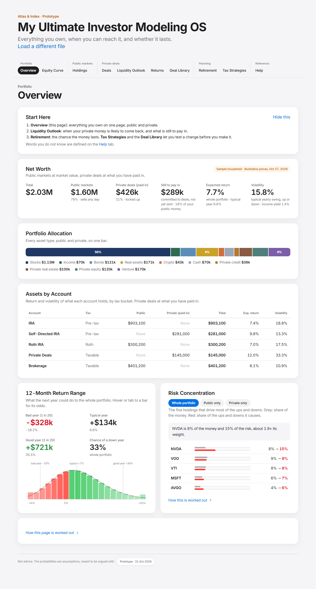

Numbered regions, top to bottom on the desktop screenshot:

| Region | What it is | Requirements |
|---|---|---|
| 1 | Tab bar, grouped (Portfolio, Public markets, Private deals, Planning, Reference) | A11Y-001, A11Y-002, MOB-001 |
| 2 | Start Here card with Hide this | OVR-002 |
| 3 | Net Worth: six figures and the household tag | OVR-003, OVR-005, OVR-006, OVR-007 |
| 4 | Portfolio Allocation bar and legend | OVR-009, OVR-014 |
| 5 | Assets by Account table | OVR-010, OVR-015 |
| 6 | 12-Month Return Range: four figures and the 20-bar histogram | OVR-011, OVR-012 |
| 7 | Risk Concentration: chips, lead sentence, top five bars | OVR-013 |
| 8 | How this page is worked out (folded) | OVR-016 |
| 9 | Footer with the disclaimer and the version pill | HLP-008 |

### OVR-001. Every new book lands on Overview

- **Requirement:** Every successful load (upload or example book) opens the Overview tab scrolled to the top.
- **Rule or formula:** On each new book object ux.js clicks the Overview tab and scrolls to the top now and again shortly after, so app.js's own smooth scroll cannot win.
- **Worked example:** Pressing Run the example book selects tab `overview` ("Overview").
- **Acceptance:** Given any tab is open; when a new tracker or the example book loads; then the selected tab is Overview.
- **Test cases:** TC-OVR-001-01: ui.test.mjs, check 'lands on Overview'; TC-OVR-001-02: ui.test.mjs, check 'QA L11 every new book lands on Overview'
- **Source:** ux.js:land, toTop
- **Status:** Implemented

### OVR-002. Start Here card

- **Requirement:** Overview opens with a three-line Start Here card that the member can hide for the rest of the session.
- **Rule or formula:** `MarketsUI.S.startHidden` set true by Hide this; reset to false on a new book (AppState).
- **Worked example:** Before Hide this: card present = true. After: card present = false.
- **Acceptance:** Given the example book on Overview; when the member presses Hide this; then the Start Here card is gone until the next book loads.
- **Test cases:** TC-OVR-002-01: ui.test.mjs, check 'UX-02 Start here card on Overview'
- **Source:** markets-ui.js:startHere, wireOverview
- **Status:** Implemented

### OVR-003. Which household is shown

- **Requirement:** Overview says where its public figures came from: the sample household or the member's own tab.
- **Rule or formula:** Tag "Sample household · illustrative prices, <date>" when `Markets.load().isDemo`, else "From your <sheet> tab".
- **Worked example:** Example book (no public tabs): tag reads "Sample household · illustrative prices, Oct 27, 2026".
- **Acceptance:** Given a tracker with no Balances or Holdings tab; when Overview renders; then the Net Worth card is tagged as the sample household with its as-of date.
- **Test cases:** TC-OVR-003-01: ui.test.mjs, check 'QA H3 Overview reads the Balances tab'
- **Source:** markets-ui.js:sampleNote; markets.js:load
- **Status:** Implemented

### OVR-004. About your file notes

- **Requirement:** Anything the loader set aside or doubted is listed once at the top of Overview under "About your file".
- **Rule or formula:** Lists `Markets.load().notes`: negative rows left out, Holdings ignored because Balances exists, implausible percents (HLD-017).
- **Worked example:** Holdings rows LOAN -50,000 and VOO 1,000 give one note: "LOAN: a negative value (-$50,000) was left out. Enter a margin loan or other debt as a liability, not a holding."
- **Acceptance:** Given a Holdings tab with a negative row; when Overview renders; then the note names the row and the row is in no total.
- **Test cases:** TC-OVR-004-01: ui.test.mjs, check 'the negative row is reported, not half counted, and the sample is not shown'; TC-OVR-004-02: markets.test.mjs, check 'a negative holding is left out with a note'
- **Source:** markets-ui.js:notesBox; markets.js:holdingsFromSheets
- **Status:** Implemented

### OVR-005. Net Worth figures

- **Requirement:** Net Worth shows Total, Public markets, Private deals (paid in) and Still to pay in, each public and private share of Total.
- **Rule or formula:** Public = sum of public holding values. Private = sum of `funded` over book rows with funded > 0. Total = Public + Private. Still to pay in = sum of `uncalled` over the book. Share = part / Total.
- **Worked example:** Example book with the sample household: Public = $1,604,500, Private = $426,000, Total = $2,030,500, Still to pay in = $289,000. Public share = 79%. On screen: Total "$2.03M", Public markets "$1.60M", Private deals "$426k", Still to pay in "$289k".
- **Acceptance:** Given the example book; when Overview renders; then the four figures equal the sums in the rule, shown in short dollars.
- **Test cases:** TC-OVR-005-01: ui.test.mjs, check 'Overview public total is the Balances total'
- **Source:** markets-ui.js:renderOverview
- **Status:** Implemented

### OVR-006. Still to pay in as a share of public money

- **Requirement:** Still to pay in is also stated as a share of public money, but only when public money is at least $1,000.
- **Rule or formula:** Sub-line adds "x% of your public money" when uncalled > 0 and public >= 1,000, x = uncalled / public, whole percent.
- **Worked example:** $289,000 / $1,604,500 = 18%. On screen: "committed to deals, not yet sent · 18% of your public money".
- **Acceptance:** Given public money under $1,000; when Overview renders; then no share of public money is printed.
- **Test cases:** TC-OVR-006-01: ui.test.mjs, check 'QA M12 no share of a negligible public total'
- **Source:** markets-ui.js:renderOverview
- **Status:** Implemented

### OVR-007. Whole-portfolio expected return and volatility

- **Requirement:** Net Worth shows the whole portfolio's expected return with its typical year, and its volatility with its income yield.
- **Rule or formula:** From `Markets.portfolioStats(public + private)`: mu = sum w_i mu_i; typical year = exp(m) - 1 with s^2 = ln(1 + sd^2 / (1 + mu)^2), m = ln(1 + mu) - s^2 / 2; sd from the factor model (HLD-007); yield = sum w_i y_i.
- **Worked example:** Example book: mu = 7.74%, sd = 15.81%, typical year = 6.60%, yield = 1.43%. On screen: Expected return "7.7%" (whole portfolio · typical year 6.6%), Volatility "15.8%".
- **Acceptance:** Given the example book; when Overview renders; then the figures equal portfolioStats on public plus private holdings.
- **Test cases:** TC-OVR-007-01: markets.test.mjs, check 'risk contributions sum to 1'; TC-OVR-007-02: markets.test.mjs, check 'portfolio volatility plausible: '
- **Source:** markets.js:portfolioStats, logParams
- **Status:** Implemented

### OVR-008. Empty state

- **Requirement:** With nothing of positive value, Overview says so instead of drawing empty charts.
- **Rule or formula:** `portfolioStats` returns null when total value is 0; the page prints "Nothing to show yet".
- **Worked example:** portfolioStats([{ value: 0 }]) returns null.
- **Acceptance:** Given no holding or deal above $0; when Overview renders; then one message is shown and no chart.
- **Test cases:** TC-OVR-008-01: plan.test.mjs, check 'portfolioStats of nothing positive is null (callers guard)'
- **Source:** markets-ui.js:renderOverview
- **Status:** Implemented

### OVR-009. Portfolio Allocation bar

- **Requirement:** Portfolio Allocation draws every asset type, public and private, on one stacked bar with a legend.
- **Rule or formula:** Public grouped by sleeve group (Stocks, Income, Bonds, Real assets, Crypto, Cash), private by class (Private credit, Private real estate, Private equity, Venture), in that fixed order. A segment prints its share when above 6%; tooltip gives label, dollars and share of the total.
- **Worked example:** Example book: Stocks $1,129,700 (55.6%), Real assets $170,600 (8.4%), Bonds $120,600 (5.9%), Cash $70,200 (3.5%), Crypto $43,400 (2.1%), Income $70,000 (3.4%), Private real estate $100,000 (4.9%), Private equity $120,000 (5.9%), Private credit $36,000 (1.8%), Venture $170,000 (8.4%).
- **Acceptance:** Given the example book; when Overview renders; then the bar segments are in the fixed order and sum to Total.
- **Test cases:** TC-OVR-009-01: TO WRITE
- **Source:** markets-ui.js:byGroup, bar
- **Status:** Partial

### OVR-010. Assets by Account

- **Requirement:** Assets by Account lists each account with its tax bucket, public, private, total, expected return and volatility.
- **Rule or formula:** Order: IRA, Self-Directed IRA, Roth IRA, Private Deals, Brokerage, then other accounts by size. Return and volatility from portfolioStats of that account's items; an account with nothing of positive value prints None.
- **Worked example:** Example book rows: IRA Pre-tax total $903,100, 7.4% / 18.8%; Self-Directed IRA Pre-tax total $281,000, 9.8% / 13.3%; Roth IRA Roth total $300,200, 7.0% / 17.5%; Private Deals Taxable total $145,000, 12.0% / 33.3%; Brokerage Taxable total $401,200, 6.1% / 10.9%.
- **Acceptance:** Given the example book; when Overview renders; then the five accounts appear in the stated order with their figures.
- **Test cases:** TC-OVR-010-01: TO WRITE
- **Source:** markets-ui.js:renderOverview, acctRank
- **Status:** Partial

### OVR-011. 12-Month Return Range

- **Requirement:** The 12-Month Return Range gives a bad year (1 in 20), a typical year, a good year (1 in 20) and the chance of a down year, in dollars and percent.
- **Rule or formula:** Lognormal with the portfolio's mu and sd: bad = exp(m - 1.645 s) - 1; typical = exp(m) - 1; good = exp(m + 1.645 s) - 1; dollars = rate x value; P(down) = Phi(-m / s), Phi by Abramowitz-Stegun 7.1.26.
- **Worked example:** mu = 0.077373, sd = 0.158078 give m = 0.063875, s = 0.145945. Bad = -16.16% (-$328,034), typical = 6.60%, good = 35.52%, P(down) = 33.1%. On screen: "-$328k", "+$134k", "+$721k", "33%".
- **Acceptance:** Given mu and sd of the whole portfolio; when Overview renders; then the four figures equal the lognormal quantiles in the rule.
- **Test cases:** TC-OVR-011-01: markets.test.mjs, check 'cone median after a year matches the lognormal median'
- **Source:** markets.js:portfolioStats, logParams, phi
- **Status:** Implemented

### OVR-012. Twenty-bar histogram

- **Requirement:** A 20-bar histogram shows next year's return as equal-width ranges and the chance of each, with the bell drawn over it.
- **Rule or formula:** Range from exp(m - 2.326 s) - 1 to exp(m + 2.326 s) - 1 in 20 equal bins; bar p = CDF(b) - CDF(a), CDF(r) = Phi((ln(1 + r) - m) / s); the first and last bars include the tails. Tooltip: range, dollars, chance, "about 1 year in N" with N = round(1 / p).
- **Worked example:** Example book: 20 bars. First: "Outcome 1 of 20: Below -20% / a loss of more than $414k / Chance: 2.3% (about 1 year in 44)". Tenth: "Outcome 10 of 20: 9% to 13% / +$185k to +$260k / Chance: 8.7% (about 1 year in 11)".
- **Acceptance:** Given the example book; when the member hovers or tabs to a bar; then its range, dollars and chance are shown and the 20 chances sum to 100%.
- **Test cases:** TC-OVR-012-01: TO WRITE
- **Source:** markets-ui.js:histogram
- **Status:** Partial

### OVR-013. Risk Concentration

- **Requirement:** Risk Concentration ranks the five holdings with the largest share of risk for the whole portfolio, public only or private only, and names the largest.
- **Rule or formula:** Chips appear only for non-empty groups; an empty choice falls back to Whole portfolio. Lead: "<name> is w% of the money and r% of the risk, about r/w times its weight." Risk share from HLD-007.
- **Worked example:** Example book, Whole portfolio: "NVDA is 8% of the money and 15% of the risk, about 1.9× its weight."
- **Acceptance:** Given the example book; when the member presses Public only; then the list and lead sentence describe public holdings and the chip reports aria-pressed true.
- **Test cases:** TC-OVR-013-01: ui.test.mjs, check 'chips say whether they are pressed'
- **Source:** markets-ui.js:renderOverview, riskBars
- **Status:** Implemented

### OVR-014. Private deals in the whole-portfolio statistics

- **Requirement:** Private deals enter the whole-portfolio statistics at what has been paid in, with an asset type chosen from their asset class.
- **Rule or formula:** Keyword on the asset class: credit, debt, lend = Private credit; real, property, estate = Private real estate; private equity, buyout, pe = Private equity; anything else = Venture (the most volatile, so an unknown never flatters risk). value = cost = funded; rows with funded 0 are left out.
- **Worked example:** Example book: 12 of 12 positions have paid-in money; classes {"pRealEstate":2,"pEquity":2,"pCredit":1,"venture":7}.
- **Acceptance:** Given a position with asset class "Self Storage"; when its private holding is built; then it is classed as Venture, because "self storage" has none of the keywords (the deal engine does read it as real estate; see gap list).
- **Test cases:** TC-OVR-014-01: markets.test.mjs, check 'private holdings carry their tax bucket'; TC-OVR-014-02: markets.test.mjs, check 'example book uses both private accounts'
- **Source:** markets.js:privateHoldings
- **Status:** Implemented

### OVR-015. Private deal account

- **Requirement:** A private deal sits in the Self-Directed IRA unless the tracker says it is held personally or in a taxable vehicle.
- **Rule or formula:** Blank = Self-Directed IRA; contains roth = kept as typed; ira, self-direct, 401, pre-tax, checkbook, solo = Self-Directed IRA; tax, personal, individual, joint, trust, llc, brok, private deal = Private Deals; anything else kept as typed.
- **Worked example:** "" -> Self-Directed IRA; "Custodian SDIRA" -> Self-Directed IRA; "Checkbook LLC" -> Self-Directed IRA; "Personal" -> Private Deals; "Roth IRA" -> Roth IRA; "Joint brokerage" -> Private Deals; "My other account" -> My other account.
- **Acceptance:** Given a deal row with Account "Checkbook LLC"; when it is placed; then it lands in the Self-Directed IRA (checkbook is tested before llc).
- **Test cases:** TC-OVR-015-01: markets.test.mjs, check 'private deals in an IRA'; TC-OVR-015-02: markets.test.mjs, check 'private deals held personally'
- **Source:** markets.js:privateAccount
- **Status:** Implemented

### OVR-016. How this page is worked out

- **Requirement:** A folded explanation states the valuation basis: public at market, private at paid in.
- **Rule or formula:** Static copy in a details element, closed by default.
- **Worked example:** Folded: open = false; summary "How this page is worked out".
- **Acceptance:** Given Overview; when the member opens the fold; then the basis of each figure is stated.
- **Test cases:** TC-OVR-016-01: TO WRITE
- **Source:** markets-ui.js:renderOverview
- **Status:** Partial

---

## 2. Equity Curve (EQC)

This year's planned range against the balance actually recorded, for the whole portfolio, all public accounts, all private accounts or any one account. A new plan starts every January 1 from the December 31 balance, as the owner's own system does. Drawn by `markets-ui.js:renderCurve`; the cones come from `markets.js:cone`, `privateCone` and `combineCones`.

**Screens.** Desktop: `docs/screens/curve.png`. Phone: `docs/screens/curve-mobile.png`.

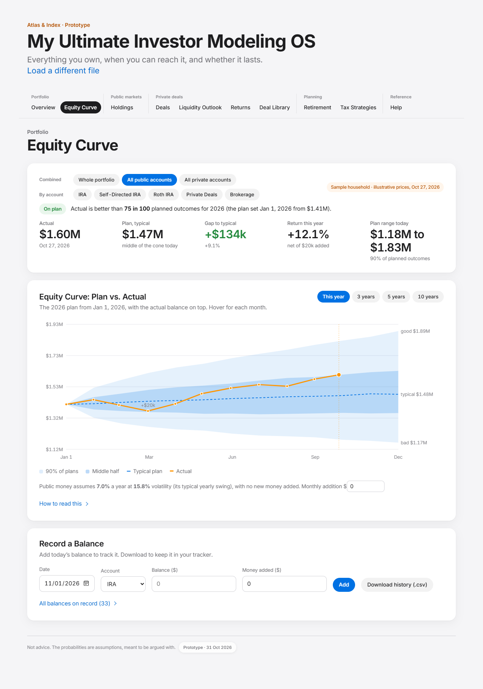

Numbered regions, top to bottom on the desktop screenshot:

| Region | What it is | Requirements |
|---|---|---|
| 1 | Scope chips: Combined and By account | EQC-001 |
| 2 | Status pill and sentence; Actual, Plan typical, Gap, Return this year, Plan range | EQC-010, EQC-011, EQC-012 |
| 3 | Horizon chips and the plan line with the monthly addition box | EQC-006, EQC-013 |
| 4 | The cone chart with the actual balance and flow labels | EQC-007, EQC-008, EQC-009, EQC-016 |
| 5 | Record a Balance form, balances on record, Download history | EQC-014, EQC-015 |

### EQC-001. Scope chips

- **Requirement:** Scope chips offer combined views first, then each account on its own.
- **Rule or formula:** Combined: Whole portfolio and All private accounts (only when the book has private accounts) and All public accounts. By account: every account with history, in account order (IRA, Self-Directed IRA, Roth IRA, Private Deals, Brokerage, others). Default All public accounts; an unavailable scope falls back to it.
- **Worked example:** Example book chips: Whole portfolio, All public accounts, All private accounts, IRA, Self-Directed IRA, Roth IRA, Private Deals, Brokerage. Selected: All public accounts.
- **Acceptance:** Given the example book; when Equity Curve opens; then All public accounts is selected and the eight chips appear in the stated order.
- **Test cases:** TC-EQC-001-01: ui.test.mjs, check 'chips say whether they are pressed'
- **Source:** markets-ui.js:renderCurve
- **Status:** Implemented

### EQC-002. Actual balance series

- **Requirement:** The actual line is the combined balance of the accounts in scope on each date where every one of them has a balance.
- **Rule or formula:** Last known balance per account carried forward; a point is emitted only when every account in scope has one; flows summed on that date.
- **Worked example:** Sample household history: 11 dates for 3 accounts; on 2026-10-27 the three balances sum to $1,604,500 (the Actual figure on screen).
- **Acceptance:** Given two accounts, one with a balance on Jan 31 and one without; when the combined series is built; then Jan 31 is not a point until both accounts have a balance on or before it.
- **Test cases:** TC-EQC-002-01: TO WRITE
- **Source:** markets-ui.js:series
- **Status:** Partial

### EQC-003. Private history at cost

- **Requirement:** Private accounts with no statements get a two-point history at cost.
- **Rule or formula:** Dec 31 of last year = funded of deals funded before this year; the as-of date = that plus funded of deals funded this year, recorded as a flow. Marked at cost.
- **Worked example:** Example book: Self-Directed IRA $195,000 on 2025-12-31, then + $86,000 funded in 2026; Private Deals $90,000 then + $55,000.
- **Acceptance:** Given a deal funded in 2026 for $36,000 in the Self-Directed IRA; when the curve builds history in 2026; then the as-of point is $36,000 higher than Dec 31 and the $36,000 is a flow, not a gain.
- **Test cases:** TC-EQC-003-01: TO WRITE
- **Source:** markets-ui.js:privateHistory
- **Status:** Partial

### EQC-004. History without an account column

- **Requirement:** A History tab with no Account column belongs to the only public account, or to All public accounts when there are several.
- **Rule or formula:** Rows default to account "All"; with one public account "All" is renamed to it.
- **Worked example:** One public account "Brokerage" plus a History tab with Date and Balance only: history accounts = ["Brokerage"].
- **Acceptance:** Given a Holdings tab with one account and a History tab with no Account column; when the file loads; then the history rows belong to that account.
- **Test cases:** TC-EQC-004-01: plan.test.mjs, check 'QA L10 a history without accounts belongs to the only public account'
- **Source:** markets.js:load
- **Status:** Implemented

### EQC-005. A new plan every January 1

- **Requirement:** A new plan starts every January 1 from the December 31 balance; the first year on record starts from its first balance.
- **Rule or formula:** Plan years = calendar years with a balance after their opening one; default the latest. t0 = Dec 31 of the prior year when a balance exists on or before it, else the first balance date of the year.
- **Worked example:** Sample household: "On planActual is better than 75 in 100 planned outcomes for 2026 (the plan set Jan 1, 2026 from $1.41M)."
- **Acceptance:** Given balances on 2025-12-31 and through 2026; when the 2026 plan is drawn; then it is set on Jan 1, 2026 from the 2025-12-31 balance.
- **Test cases:** TC-EQC-005-01: TO WRITE
- **Source:** markets-ui.js:planYears, renderCurve
- **Status:** Partial

### EQC-006. Horizon

- **Requirement:** The plan horizon can be this year, 3, 5 or 10 years.
- **Rule or formula:** months = 12 x horizon. A private-only view at one year suggests 5 or 10 years.
- **Worked example:** Horizon chips: This year (on), 3 years, 5 years, 10 years.
- **Acceptance:** Given Equity Curve; when the member presses 5 years; then the cone runs 60 months from the plan start.
- **Test cases:** TC-EQC-006-01: TO WRITE
- **Source:** markets-ui.js:renderCurve, wire
- **Status:** Partial

### EQC-007. Public plan cone

- **Requirement:** The public plan is a seeded lognormal cone from the holdings' expected return and volatility, with an optional steady monthly addition.
- **Rule or formula:** m_mo = m / 12, s_mo = s / sqrt(12) from logParams(mu, sd); v_t = v_(t-1) x exp(m_mo + s_mo z) + flow; 2,000 paths; seed 20261028 + plan year; percentiles p5, p25, p50, p75, p95 per month.
- **Worked example:** start $1,000,000, mu 7%, sd 16%, 12 months, seed 20263054: month 12 p5 $821,605, p50 $1,045,609, p95 $1,339,898. The lognormal median is $1,058,234.
- **Acceptance:** Given start $1,000,000, mu 7%, sd 16%; when a 12-month cone is drawn; then percentiles are ordered and the month-12 median is within 2 points of exp(m) - 1.
- **Test cases:** TC-EQC-007-01: markets.test.mjs, check 'cone percentiles ordered'; TC-EQC-007-02: markets.test.mjs, check 'cone median after a year matches the lognormal median'
- **Source:** markets.js:cone
- **Status:** Implemented

### EQC-008. Private plan cone

- **Requirement:** The private plan replays the Liquidity Outlook's own futures and values the accounts month by month.
- **Rule or formula:** value = cash received so far + (1 - share sold) x capital called so far x mark; mark moves linearly from 1 at the plan start to the drawn multiple at the first exit; preferred return spread evenly over its year; exits land mid-year (or next month if mid-year has passed); calls are money added. Draws from Engine.pathDraws, so path p is Outlook future p.
- **Worked example:** Example book, 2,000 paths to 2042: cone starts at $285,000 (cost of deals funded before 2026); final median $1,562,288 vs the Outlook total median $1,562,288.
- **Acceptance:** Given the example book run to its last payout year; when the private cone is drawn; then its final percentiles equal the Liquidity Outlook totals and it starts at cost.
- **Test cases:** TC-EQC-008-01: markets.test.mjs, check 'private cone ends on the Liquidity Outlook totals: '; TC-EQC-008-02: markets.test.mjs, check 'cone starts at cost'; TC-EQC-008-03: markets.test.mjs, check 'private cone ordered'
- **Source:** markets.js:privateCone
- **Status:** Implemented

### EQC-009. Whole-portfolio cone

- **Requirement:** The whole-portfolio cone adds public and private futures path by path, and the tab says the two are drawn independently.
- **Rule or formula:** combined_k[p] = public_k[p] + private_k[p], then sorted for percentiles. Independence understates the range a little.
- **Worked example:** Whole portfolio scope: "On planActual is better than 67 in 100 planned outcomes for 2026 (the plan set Jan 1, 2026 from $1.70M). Private deals are counted at what you have paid in, which reads a little low against the plan until you record a marked balance."
- **Acceptance:** Given the example book; when the member picks Whole portfolio; then the cone is public plus private and a sentence states they are drawn independently.
- **Test cases:** TC-EQC-009-01: ui.test.mjs, check 'M-18 the independence of public and private is said on the tab'
- **Source:** markets.js:combineCones
- **Status:** Implemented

### EQC-010. Status against plan

- **Requirement:** A status pill compares the latest actual balance with the plan at the same month.
- **Rule or formula:** rank = share of plan paths at or below the actual (binary search). rank < 0.10 Well below plan; < 0.25 Below plan; <= 0.75 On plan; above Ahead of plan.
- **Worked example:** All public accounts on Nov 1, 2026: pill "On plan". rankIn([1,2,3,4], 2.5) = 0.5.
- **Acceptance:** Given an actual at the 75th percentile of the plan; when the status is drawn; then it reads On plan.
- **Test cases:** TC-EQC-010-01: TO WRITE
- **Source:** markets-ui.js:renderCurve; markets.js:rankIn
- **Status:** Partial

### EQC-011. Private at cost is not scored

- **Requirement:** A private-only view valued at cost shows the plan but no status.
- **Rule or formula:** When the scope has no public accounts and no balance was recorded for its private accounts, no pill is drawn.
- **Worked example:** All private accounts: pill = "Plan only".
- **Acceptance:** Given All private accounts with no recorded balance; when the curve renders; then no status pill is shown.
- **Test cases:** TC-EQC-011-01: TO WRITE
- **Source:** markets-ui.js:renderCurve
- **Status:** Partial

### EQC-012. Return so far

- **Requirement:** Return this year excludes money added.
- **Rule or formula:** (last - start - sum of flows after the start) / start.
- **Worked example:** ($1,604,500 - $1,413,115 - $20,000) / $1,413,115 = 12.1% (screen: "Return this year +12.1%").
- **Acceptance:** Given a $20,000 contribution in the year; when the return is computed; then the contribution is not counted as return.
- **Test cases:** TC-EQC-012-01: TO WRITE
- **Source:** markets-ui.js:renderCurve
- **Status:** Partial

### EQC-013. Monthly addition

- **Requirement:** A monthly addition in dollars, floored at 0, is printed as an amount and added to every public path each month.
- **Rule or formula:** `S.flow = max(0, Number(value) or 0)`.
- **Worked example:** start $100,000, mu 0, sd 0.01%, $1,000 a month: month 12 median $112,002.
- **Acceptance:** Given a $1,000 monthly addition; when the plan is drawn; then the sentence prints $1,000 and the cone rises by about $12,000 a year from it.
- **Test cases:** TC-EQC-013-01: ui.test.mjs, check 'UX-26 the monthly addition is printed'; TC-EQC-013-02: ui.test.mjs, check 'UX-26 a set addition is printed as an amount'
- **Source:** markets-ui.js:wire
- **Status:** Implemented

### EQC-014. Record a Balance validation

- **Requirement:** Record a Balance validates every entry before accepting it.
- **Rule or formula:** Date YYYY-MM-DD, not after today (local), not before 1990-01-01; balance finite and >= 0; money added finite; more than 10 times the last balance for that account needs a second press.
- **Worked example:** Last balance on record: Brokerage $1,000,000 on 2026-10-01; today Nov 1, 2026. 2026-11-02 / $1,000 -> The date cannot be later than today. | 1989-12-31 / $1,000 -> Use a date from 1990 on. | 2026-10-30 / -$5 -> Enter the balance as a number of dollars, 0 or more. | 2026-10-30 / $20,000,000 -> That is more than ten times the last balance on record for Brokerage ($1,000,000). Press Add again if it is right. | 2026-10-30 / $1,500,000 -> (accepted)
- **Acceptance:** Given a recorded balance ten times the last one; when the member presses Add once; then a confirmation message appears; pressing Add again records it.
- **Test cases:** TC-EQC-014-01: ui.test.mjs, check 'QA M8 the default date is the local date, not UTC'; TC-EQC-014-02: ui.test.mjs, check 'QA M11 a future date is refused'; TC-EQC-014-03: ui.test.mjs, check 'a balance ten times the last asks again'; TC-EQC-014-04: ui.test.mjs, check 'the second press adds it, with feedback'
- **Source:** markets-ui.js:checkEntry, wire
- **Status:** Implemented

### EQC-015. Session balances and Download history

- **Requirement:** Balances recorded in the app last only for the session and download as tracker History rows.
- **Rule or formula:** CSV header `Date,Account,Balance,Net flow`, sorted by date; every account cell quoted; a cell starting with = + - @ tab or CR gets a leading apostrophe.
- **Worked example:** csvCell("=HYPERLINK(\"x\")") = "'=HYPERLINK(""x"")"; csvCell("IRA") = "IRA"; csvCell("-5") = "'-5".
- **Acceptance:** Given a balance recorded this session; when the member presses Download history; then the CSV holds every history row plus the new one, and no cell can start a formula.
- **Test cases:** TC-EQC-015-01: ui.test.mjs, check 'QA L9 CSV cells cannot start a formula'
- **Source:** markets-ui.js:csvCell, wire
- **Status:** Implemented

### EQC-016. Chart and hover

- **Requirement:** The chart shows the 90% band, the middle half, the typical line and the actual balance, with a readout for every month.
- **Rule or formula:** Hover: plan typical, middle half (p25 to p75), 90% (p5 to p95), and the actual's percentile when a balance falls in that month; money added labelled.
- **Worked example:** October 2026 readout: "October 2026 / Plan, typical: $1,470,040 / Middle half: $1.36M to $1.61M / 90% of plans: $1.18M to $1.83M / Actual: $1,604,500 (75th percentile)".
- **Acceptance:** Given the sample household; when the member hovers October 2026; then the readout gives the plan band and the actual percentile.
- **Test cases:** TC-EQC-016-01: TO WRITE
- **Source:** markets-ui.js:chart
- **Status:** Partial

### EQC-017. Dates without a time-zone shift

- **Requirement:** Dates read from cells keep their calendar day in every time zone.
- **Rule or formula:** Excel serials = days since 1899-12-30 in UTC; text parsed by hand (ISO, m/d/y, d.m.y, "Jan 1 2027", "1 Jan 2027"); impossible dates are null.
- **Worked example:** "01/01/2027" -> "2027-01-01"; "2027-01-01" -> "2027-01-01"; "Jan 1 2027" -> "2027-01-01"; "1 Jan 2027" -> "2027-01-01"; 46388 -> "2027-01-01"; "2027-02-30" -> null.
- **Acceptance:** Given the text 01/01/2027 in a History cell; when it is read east of Greenwich; then it is 2027-01-01, not 2026-12-31.
- **Test cases:** TC-EQC-017-01: markets.test.mjs, check 'text dates stay on their calendar day'
- **Source:** markets.js:toDate, ymd
- **Status:** Implemented

---

## 3. Holdings (HLD)

The public positions, their statistics, a risk and return map, and the sleeves that feed the Retirement plan. Drawn by `markets-ui.js:renderHoldings` from the statistics in `markets.js` (asset-class assumptions, a five-driver factor model, the single-index model for single stocks).

**Screens.** Desktop: `docs/screens/holdings.png`. Phone: `docs/screens/holdings-mobile.png`.

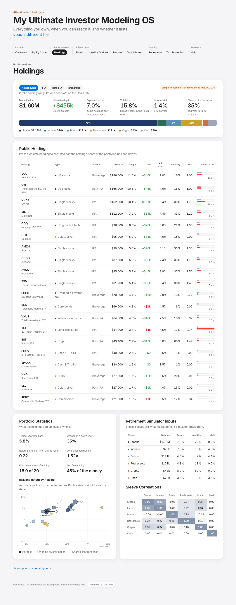

Numbered regions, top to bottom on the desktop screenshot:

| Region | What it is | Requirements |
|---|---|---|
| 1 | Account chips and the household tag | HLD-001 |
| 2 | Six headline figures | HLD-002 |
| 3 | Public Holdings table with sortable headings and risk bars | HLD-003, HLD-004, HLD-005, HLD-006, HLD-012, HLD-015 |
| 4 | Portfolio Statistics: definition grid and Risk and Return by Holding | HLD-007, HLD-008, HLD-009 |
| 5 | Retirement Simulator Inputs: the sleeves and the class assumptions | HLD-010, HLD-016 |
| 6 | Sleeve Correlations matrix | HLD-011 |

### HLD-001. Account filter

- **Requirement:** Account chips filter the table and every statistic to one account or all.
- **Rule or formula:** Chips: All accounts, then each public account in account order. A filter on an account no longer present resets to All accounts.
- **Worked example:** Sample household chips: All accounts, IRA, Roth IRA, Brokerage.
- **Acceptance:** Given the sample household; when the member presses Roth IRA; then only Roth IRA holdings and their statistics are shown.
- **Test cases:** TC-HLD-001-01: ui.test.mjs, check 'chips say whether they are pressed'
- **Source:** markets-ui.js:renderHoldings
- **Status:** Implemented

### HLD-002. Headline figures

- **Requirement:** Holdings shows market value, unrealized gain, expected return, volatility with beta, income yield in dollars and the chance of a down year.
- **Rule or formula:** gain = sum(value - cost) over holdings with a cost; % on cost = gain / sum(cost); income = y x value a year; beta = value-weighted beta; down-year chance and 1-in-20 year as OVR-011 on public holdings only.
- **Worked example:** Sample household: value $1,604,500, gain $455,300 (39.6% on $1,149,200 cost), mu 7.0%, sd 15.8%, beta 0.96, yield 1.4% = $22,110 a year, P(down) 35%. On screen: "$1.60M", "+$455k", "1.4%" ($22k a year).
- **Acceptance:** Given the sample household; when Holdings renders; then the figures equal the rule computed on its 20 holdings.
- **Test cases:** TC-HLD-002-01: TO WRITE
- **Source:** markets-ui.js:renderHoldings; markets.js:portfolioStats
- **Status:** Partial

### HLD-003. Sortable table

- **Requirement:** The holdings table sorts on any column and a second press reverses it, with the sorted column announced.
- **Rule or formula:** Text columns (Holding, Type, Account) start ascending; numeric columns start descending; nulls last. Headings are buttons inside the th; aria-sort reports the direction; focus stays on the heading.
- **Worked example:** Default (Value, descending) first row VOO; after Holding once AMZN; after Holding twice VXUS.
- **Acceptance:** Given the table sorted by Value; when the member presses Holding twice; then it sorts A to Z, then Z to A, and aria-sort follows.
- **Test cases:** TC-HLD-003-01: ui.test.mjs, check 'QA L3 sortable headers are buttons with aria-sort'; TC-HLD-003-02: ui.test.mjs, check 'sorting keeps focus on the heading'
- **Source:** markets-ui.js:renderHoldings, COLS
- **Status:** Implemented

### HLD-004. Defined statistics

- **Requirement:** Every statistic heading carries its plain-English definition.
- **Rule or formula:** Exp. return, Volatility, Beta and Share of risk have a tooltip definition from COLS.
- **Worked example:** Volatility heading definition: "The typical yearly swing, up or down, around the expected return".
- **Acceptance:** Given Holdings; when the member hovers a statistic heading; then its definition is shown.
- **Test cases:** TC-HLD-004-01: ui.test.mjs, check 'volatility defined where it is shown'
- **Source:** markets-ui.js:COLS
- **Status:** Implemented

### HLD-005. Class assumptions with overrides

- **Requirement:** A holding takes its asset class's expected return, volatility and yield unless the row states them.
- **Rule or formula:** Row values (Expected return, Volatility, Yield, Beta) override the class. Class table in DESIGN_SPEC section 5.1.
- **Worked example:** US stocks class: mu 7.0%, sd 16.0%, beta 1.000. Same class with a stated 9% and 20%: mu 9.0%, sd 20.0%, beta 1.250.
- **Acceptance:** Given a US stock ETF row with Expected return 9%; when its statistics are computed; then mu is 9% and the other figures stay the class assumption.
- **Test cases:** TC-HLD-005-01: markets.test.mjs, check 'US stocks beta is 1'; TC-HLD-005-02: markets.test.mjs, check 'one-holding portfolio keeps its volatility'
- **Source:** markets.js:holdingStats
- **Status:** Implemented

### HLD-006. Single stocks

- **Requirement:** A single stock uses the single-index model, and a stated beta comes back unchanged.
- **Rule or formula:** beta default 1.2; sd = sqrt((beta x 0.16)^2 + 0.28^2); mu = 0.035 + beta x 0.035; equity variance share = min(0.95, (beta x 0.16 x sqrt(0.95) / sd)^2); reported beta = sd x L_equity / (0.16 x sqrt(0.95)).
- **Worked example:** beta 1.2: sd 33.95%, mu 7.70%, own-risk share e2 0.6962, reported beta 1.2; beta 1.7: sd 39.04%, mu 9.45%, own-risk share e2 0.5388, reported beta 1.7.
- **Acceptance:** Given a single stock with beta 1.7; when its statistics are computed; then the reported beta is 1.7.
- **Test cases:** TC-HLD-006-01: markets.test.mjs, check 'a stated beta of 1.7 comes back as 1.7'
- **Source:** markets.js:holdingStats
- **Status:** Implemented

### HLD-007. Portfolio variance and risk contributions

- **Requirement:** Portfolio variance follows from five shared drivers plus each holding's own risk, and the risk contributions sum to 100%.
- **Rule or formula:** var = sum over drivers k of (sum_i w_i sd_i L_ik)^2 + sum_i (w_i sd_i)^2 e2_i; risk_i = (w_i sd_i sum_k L_ik F_k + (w_i sd_i)^2 e2_i) / var, with F_k = sum_i w_i sd_i L_ik. Drivers: equity, rates, real, credit, crypto.
- **Worked example:** 60% US stocks + 40% core bonds: sd 10.21% (stocks 16%, bonds 6%); risk shares 91.4% and 8.6%, sum 100.0%.
- **Acceptance:** Given a 60/40 stock and bond portfolio; when statistics are computed; then stocks carry far more than 60% of the risk and the shares sum to 100%.
- **Test cases:** TC-HLD-007-01: markets.test.mjs, check 'risk contributions sum to 1'
- **Source:** markets.js:portfolioStats
- **Status:** Implemented

### HLD-008. Sharpe, diversification, effective holdings

- **Requirement:** Portfolio Statistics reports Sharpe, the diversification ratio, the effective number of holdings and the top-five share.
- **Rule or formula:** Sharpe = (mu - 0.035) / sd; divRatio = sum(w sd) / sd; effN = 1 / sum(w^2); top5 = weight of the five largest.
- **Worked example:** Sample household: Sharpe 0.221, diversification ratio 1.515, effective holdings 15.03, top five 44.9%.
- **Acceptance:** Given the sample household; when Holdings renders; then the four figures equal the rule.
- **Test cases:** TC-HLD-008-01: TO WRITE
- **Source:** markets.js:portfolioStats
- **Status:** Partial

### HLD-009. Risk and Return by Holding

- **Requirement:** A chart places each holding by volatility and expected return, sized by weight, with the Sharpe line and a no-diversification marker.
- **Rule or formula:** Sharpe line from (0, 3.5%) through the portfolio; the no-diversification marker sits at the weighted average volatility, the portfolio marker at its real volatility.
- **Worked example:** Sample household: weighted average volatility 23.9% against portfolio volatility 15.8%; Sharpe line slope 0.221.
- **Acceptance:** Given the sample household; when the chart renders; then the gap between the two markers equals what diversification removes.
- **Test cases:** TC-HLD-009-01: TO WRITE
- **Source:** markets-ui.js:riskReturn
- **Status:** Partial

### HLD-010. Sleeves for the Retirement plan

- **Requirement:** Holdings become Retirement sleeves, each with its own price return, volatility, yield and tax mix.
- **Rule or formula:** One sleeve per group present (Stocks, Income, Bonds, Real assets, Crypto, Cash); price return = group mu - group yield (the simulator draws income separately); taxMix = value share by tax bucket.
- **Worked example:** Sample household: Stocks $1,129,700 price 6.9% sd 20.3% yield 0.9% pre-tax 63%; Income $70,000 price 2.5% sd 13.0% yield 4.5% pre-tax 0%; Bonds $120,600 price 0.1% sd 8.9% yield 4.4% pre-tax 45%; Real assets $170,600 price 3.7% sd 11.5% yield 0.6% pre-tax 56%; Crypto $43,400 price 8.0% sd 60.0% yield 0.0% pre-tax 0%; Cash $70,200 price 0.0% sd 0.4% yield 3.5% pre-tax 57%.
- **Acceptance:** Given the sample household; when sleeves are built; then sleeve balances add up to the holdings total.
- **Test cases:** TC-HLD-010-01: markets.test.mjs, check 'sleeves add up to the holdings'
- **Source:** markets.js:toSleeves
- **Status:** Implemented

### HLD-011. Sleeve correlations

- **Requirement:** Sleeve correlations follow from the factor model, are symmetric and lie between -1 and 1, shown when there are two or more sleeves.
- **Rule or formula:** rho_ab = (F_a . F_b) / (sd_a sd_b), F the sleeve's driver exposure vector; diagonal 1.
- **Worked example:** Sample household: Stocks with Bonds -0.057, Stocks with Real assets 0.243, Stocks with Crypto 0.366.
- **Acceptance:** Given two or more sleeves; when the matrix is built; then it is symmetric with entries in -1..1.
- **Test cases:** TC-HLD-011-01: markets.test.mjs, check 'corr symmetric'; TC-HLD-011-02: markets.test.mjs, check 'corr in range'
- **Source:** markets.js:toSleeves; markets-ui.js:corrTable
- **Status:** Implemented

### HLD-012. Classification

- **Requirement:** Each holding is classified by its typed label first, then by its ticker, else as a single stock.
- **Rule or formula:** Label rules (regex on the typed class) beat the ticker table; an unknown ticker is a single stock, the most cautious volatility.
- **Worked example:** VOO -> usEquity; QQQ -> growth; XYZ -> stock; XYZ typed "Gold" -> gold; VOO typed "International" -> intlEquity.
- **Acceptance:** Given ticker VOO with Asset class "International"; when it is classified; then it is intlEquity, because the typed label wins.
- **Test cases:** TC-HLD-012-01: markets.test.mjs, check 'classify'
- **Source:** markets.js:classify
- **Status:** Implemented

### HLD-013. Tax bucket of a public account

- **Requirement:** Each public account falls in one tax bucket: pre-tax, Roth or taxable.
- **Rule or formula:** Stated type first: roth or hsa = Roth; pre, trad, ira, 401, 403, sep, tsp, deferred = pre-tax; tax, brok, individual, joint, trust = taxable. Then the account name: roth or hsa = Roth; ira, 401, 403, sep, tsp, pension, sdira, rollover = pre-tax. Else taxable (the cautious default).
- **Worked example:** Roth IRA -> roth; IRA -> preTax; Work 401k -> preTax; Brokerage -> taxable; Account A (type Traditional) -> preTax; HSA -> roth.
- **Acceptance:** Given an account named Roth IRA; when its bucket is decided; then it is Roth, because Roth is tested before IRA.
- **Test cases:** TC-HLD-013-01: markets.test.mjs, check 'account tax type'; TC-HLD-013-02: markets.test.mjs, check 'IRA and Self-Directed IRA are pre-tax'
- **Source:** markets.js:acctType
- **Status:** Implemented

### HLD-014. No public holdings

- **Requirement:** With no public holdings, Holdings says how to add them, and an empty Holdings tab means none, never the sample.
- **Rule or formula:** Message names the Holdings layout (Symbol, Account, Quantity, Price) and the Balances layout (Account, Sleeve, Value).
- **Worked example:** A Holdings tab with headers only: source "holdings", 0 holdings, isDemo false.
- **Acceptance:** Given a tracker whose Holdings tab has no rows; when Holdings opens; then it shows the how-to message, not the sample household.
- **Test cases:** TC-HLD-014-01: ui.test.mjs, check 'QA M13 an empty Holdings tab means none, not the sample'; TC-HLD-014-02: plan.test.mjs, check 'QA M13 an empty Holdings tab means no public holdings'
- **Source:** markets-ui.js:renderHoldings; markets.js:load
- **Status:** Implemented

### HLD-015. Phone layout

- **Requirement:** On a phone the Type and Account columns are hidden and the account shows under the holding name.
- **Rule or formula:** CSS at max-width 700px hides `.mk-c-hide` and shows `.mk-c-show`.
- **Worked example:** Columns marked to hide on a phone: Type, Account.
- **Acceptance:** Given a 375-pixel-wide screen; when Holdings renders; then Value sits next to the name and the account appears under it.
- **Test cases:** TC-HLD-015-01: ui.test.mjs, check 'UX-48 mobile hides Type and Account and shows the account under the name'
- **Source:** index.html (CSS); markets-ui.js:COLS
- **Status:** Implemented

### HLD-016. Class assumptions table

- **Requirement:** Holdings lists the expected return, volatility and yield assumed for each class held.
- **Rule or formula:** Read from Markets.CLASSES for the classes present.
- **Worked example:** US stocks 7.0% / 16% / 1.3%; Core bonds 4.5% / 6% / 4.2%; Gold & silver 4.0% / 15% / 0.0%; Crypto 8.0% / 60% / 0.0%; Cash & T-bills 3.5% / 1% / 3.5%.
- **Acceptance:** Given the sample household; when Holdings renders; then each class shows its assumption triple.
- **Test cases:** TC-HLD-016-01: TO WRITE
- **Source:** markets-ui.js:renderHoldings
- **Status:** Partial

### HLD-017. Implausible percents are said out loud

- **Requirement:** A typed return or yield beyond plus or minus 50% a year, or a volatility outside 0% to 200%, is flagged on screen and still used.
- **Rule or formula:** pctNote adds "<label>: <field> read as x%. Check the cell: type 7% or 0.07 for seven percent."
- **Worked example:** Expected return typed 70 (read as 70%): "ABC: expected return read as 70.0%. Check the cell: type 7% or 0.07 for seven percent."
- **Acceptance:** Given a holding with Expected return 70; when the file loads; then a note says it was read as 70.0%.
- **Test cases:** TC-HLD-017-01: plan.test.mjs, check 'an implausible percent is said out loud'
- **Source:** markets.js:pctNote
- **Status:** Implemented

---

## 4. Deals (DLS)

What the member holds in private deals: totals, the allocation by commitment, every position with what the model makes of it, and one card per deal. Drawn by `app.js:renderDashboard`. The model rules it relies on are in section 11 (DM). The card headings are renamed by `ux.js` (for example "Your portfolio" shows as "Private Deals Summary").

**Screens.** Desktop: `docs/screens/dash.png`. Phone: `docs/screens/dash-mobile.png`.

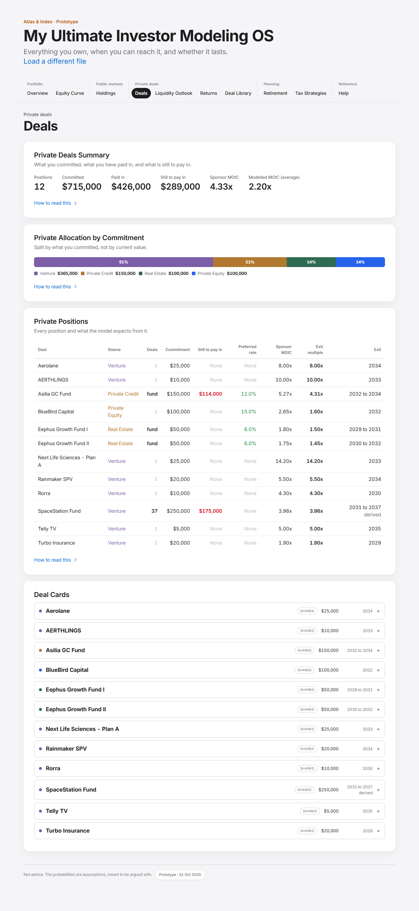

Numbered regions, top to bottom on the desktop screenshot:

| Region | What it is | Requirements |
|---|---|---|
| 1 | Private Deals Summary: six figures and the two-multiples note | DLS-001, DLS-002, DLS-003 |
| 2 | Private Allocation by Commitment bar and legend | DLS-004 |
| 3 | Private Positions table | DLS-005, DLS-006, DLS-007, DLS-008 |
| 4 | Deal Cards, one per position, expandable | DLS-009 to DLS-018 |

### DLS-001. Private Deals Summary

- **Requirement:** The summary shows positions, committed, paid in, still to pay in, the sponsor MOIC and the modelled MOIC.
- **Rule or formula:** Committed, paid in (funded) and still to pay in (uncalled) are sums over the book. Sponsor MOIC = sum(moic x commitment) / committed. Modelled MOIC = sum over positions of (expected exit + expected preferred) / committed (DLS-002).
- **Worked example:** Example book: 12 positions, committed $715,000, sponsor MOIC 4.33x, modelled MOIC 2.20x. On screen: Positions "12", Committed "$715,000", Paid in "$426,000", Still to pay in "$289,000", Sponsor MOIC "4.33x", Modelled MOIC (average) "2.20x".
- **Acceptance:** Given the example book; when Deals opens; then the six figures equal the rule.
- **Test cases:** TC-DLS-001-01: intake.test.mjs, check 'and the Deals tab renders'; TC-DLS-001-02: ui.test.mjs, check 'Deals tab uses Still to pay in and Paid in'
- **Source:** app.js:renderDashboard
- **Status:** Implemented

### DLS-002. Expected value of one position

- **Requirement:** A position's modelled value is an exact probability-weighted expectation over its outcome table, not a sample.
- **Rule or formula:** E[m] = sum_i p_i x (scales and not absolute ? v_i x exitMult : v_i) + (1 - sum p_i) x exitMult. Expected exit = commitment x E[m]. Scheduled preferred = sum over k = 1..hold of prefInYear(k). Preferred weight = sum_i p_i prefFactor(m_i) + (1 - sum p_i) prefFactor(exitMult). Expected preferred = scheduled x weight.
- **Worked example:** Eephus Growth Fund I: exitMult 1.50x, E[m] 1.07x, expected exit $53,437, scheduled preferred $15,000 x weight 0.8325 = $12,488; BlueBird Capital: exitMult 1.60x, E[m] 1.14x, expected exit $114,000, scheduled preferred $105,000 x weight 0.8325 = $87,413; Aerolane: exitMult 8.00x, E[m] 1.60x, expected exit $39,875, scheduled preferred $0 x weight 0.0000 = $0; SpaceStation Fund: exitMult 3.96x, E[m] 2.00x, expected exit $499,455, scheduled preferred $0 x weight 0.0000 = $0.
- **Acceptance:** Given a single venture deal at 8.0x; when its expectation is computed; then E[m] = 0.30 x 0 + 0.30 x 1.00 + 0.30 x 1.65 + 0.10 x 8.0 = 1.595x.
- **Test cases:** TC-DLS-002-01: TO WRITE
- **Source:** app.js:expectedOf; engine.js:prefInYear, prefFactor
- **Status:** Partial

### DLS-003. Outcome odds read from the model

- **Requirement:** The odds quoted in the explanatory text are read from the model's outcome tables, never typed.
- **Rule or formula:** Sentence built from CFG.venture, CFG.income and CFG.reEquity; the implicit top branch weight = 1 - sum of listed weights.
- **Worked example:** Example book: "a single venture deal is 30% written off, 30% back at cost, 30% at 1.65x and 10% at the sponsor case" CFG.venture = [[0.3,0],[0.3,1],[0.3,1.65]].
- **Acceptance:** Given a change to CFG.venture; when Deals renders; then the sentence changes with it.
- **Test cases:** TC-DLS-003-01: TO WRITE
- **Source:** app.js:branchOdds
- **Status:** Partial

### DLS-004. Private allocation by commitment

- **Requirement:** The allocation bar splits committed capital by asset class.
- **Rule or formula:** Venture-kind rows count as "Venture"; others by asset class. A segment label prints when its share is above 7%.
- **Worked example:** Example book: Venture $365,000 (51.0%), Private Credit $150,000 (21.0%), Real Estate $100,000 (14.0%), Private Equity $100,000 (14.0%).
- **Acceptance:** Given the example book; when Deals renders; then the bar segments are in descending size and sum to committed.
- **Test cases:** TC-DLS-004-01: TO WRITE
- **Source:** app.js:renderDashboard
- **Status:** Partial

### DLS-005. Private Positions table

- **Requirement:** Private Positions lists every position alphabetically with sleeve, deals, commitment, still to pay in, preferred rate, sponsor MOIC, exit multiple and exit window, and marks an assumed multiple.
- **Rule or formula:** Deals column: the count when above 1, "fund" for a fund without a count, else 1. "(assumed)" when no sponsor MOIC was given (moicGiven false).
- **Worked example:** Example book rows (first three): Aerolane / Venture / 1 / $25,000 / None / None / 8.00x / 8.00x / 2034; AERTHLINGS / Venture / 1 / $10,000 / None / None / 10.00x / 10.00x / 2033; Asilia GC Fund / Private Credit / fund / $150,000 / $114,000 / 12.0% / 5.27x / 4.31x / 2032 to 2034.
- **Acceptance:** Given a row with no sponsor MOIC and no preferred return; when the table renders; then its MOIC shows 5.00x (assumed).
- **Test cases:** TC-DLS-005-01: TO WRITE
- **Source:** app.js:panelPositions
- **Status:** Partial

### DLS-006. Exit window

- **Requirement:** The exit window shown is the engine's exit plan at zero timing offset.
- **Rule or formula:** Years from Engine.exitPlan(b, 0): one year for a single deal, "first to last" for a fund. Tags: "capital back" for an evergreen fund; "derived" for a fund with no stated liquidity window.
- **Worked example:** SpaceStation Fund -> [[2031,0.0571],[2032,0.0857],[2033,0.1143],[2034,0.1429],[2035,0.1714],[2036,0.2],[2037,0.2286]]; Eephus Growth Fund I -> [[2029,0.2222],[2030,0.3333],[2031,0.4444]]; Aerolane -> [[2034,1]].
- **Acceptance:** Given a fund funded 2025 with a 10-year hold and window [6, 12]; when its window is drawn; then the years 2031 to 2037 carry ramped weights that sum to 1.
- **Test cases:** TC-DLS-006-01: TO WRITE
- **Source:** app.js:payWindow; engine.js:exitPlan
- **Status:** Partial

### DLS-007. Exit earliest on a fund

- **Requirement:** A fund with a typed Exit: earliest and no liquidity window is told that the earliest exit does not move a fund's payout.
- **Rule or formula:** Shown when isFund and not liqStated and earliestTyped; names the fund, its derived window and the fix (fill Liquidity from and Liquidity to).
- **Worked example:** Fund, hold 6, funded 2025, Exit: earliest 2028: earliestTyped true, liqStated false, window [4,6] fund-years, payout years 2029, 2030, 2031; the note fires.
- **Acceptance:** Given a fund with Exit: earliest typed; when Deals renders; then a note explains that earliest does not move a fund.
- **Test cases:** TC-DLS-007-01: TO WRITE
- **Source:** app.js:windowNote
- **Status:** Partial

### DLS-008. Evergreen funds

- **Requirement:** An evergreen fund is labelled as returning capital, not exiting.
- **Rule or formula:** Evergreen when the matched deal file's vehicle or the position name matches /evergreen/i. Display only; numbers unchanged.
- **Worked example:** A $100,000 position matched to the evergreen credit fund file (vehicle "Evergreen fund"): isFund true, payout years 2029, 2030, 2031; /evergreen/i matches the vehicle, so the window is tagged "capital back".
- **Acceptance:** Given a position matched to an evergreen fund; when its window is shown; then the tag "capital back" explains the payout is redemptions at 1.0x.
- **Test cases:** TC-DLS-008-01: TO WRITE
- **Source:** app.js:isEvergreen, payWindow
- **Status:** Partial

### DLS-009. Deal cards

- **Requirement:** Deal Cards list every position alphabetically, each expanding on click.
- **Rule or formula:** OPEN[name] toggled per click; reset on a new book.
- **Worked example:** 12 cards, first "Aerolane", last "Turbo Insurance".
- **Acceptance:** Given the example book; when the member clicks a card; then it expands, and a second click closes it.
- **Test cases:** TC-DLS-009-01: TO WRITE
- **Source:** app.js:renderDashboard, dealCard
- **Status:** Partial

### DLS-010. Shared terms and overrides

- **Requirement:** A card says when its terms came from the deal library, and when the member typed over them, showing both figures.
- **Rule or formula:** Badge SHARED when a deal file matched; badge "YOURS x N" for N overrides; each override line shows yours and shared in the same format (percent fields compared after the percent rule).
- **Worked example:** File preferred 0.12: a typed 10 gives overrides [{"key":"coupon","label":"Preferred rate","fmt":"pct","yours":0.1,"shared":0.12}]; a typed 12 gives [] (12 reads as 12%, the same).
- **Acceptance:** Given a tracker coupon of 10 against a file's 0.12; when the row is enriched; then one override "Preferred rate: yours 10%, shared 12%" is recorded.
- **Test cases:** TC-DLS-010-01: engine.test.mjs, check 'a bare 10 against 0.12 is an override, shown as 10%'
- **Source:** app.js:dealCard, ovrVal; engine.js:applyDealFile
- **Status:** Implemented

### DLS-011. File terms on the card

- **Requirement:** An expanded card prints the deal file's terms: preferred, hold, equity kicker, sponsor MOIC, management fee, carry, UBTI drag, and LTV for real estate.
- **Rule or formula:** A rate field holding prose prints the prose, never "NaN%". LTV from terms.ltvPct, else terms.ltv.
- **Worked example:** Eephus Growth Fund I file terms printed on its card: preferred 6%, hold 5 yrs, sponsor MOIC 1.80x, management fee 2.0%, carry "30% to Class B after the preferred, then Class A to a 20% ARR, then 50/50".
- **Acceptance:** Given a matched deal file; when its card is expanded; then every term the file carries is listed with its label.
- **Test cases:** TC-DLS-011-01: TO WRITE
- **Source:** app.js:dealCard
- **Status:** Partial

### DLS-012. Provisional terms

- **Requirement:** A deal file whose terms are under review says so on the card.
- **Rule or formula:** Shown when the file has provisional: true.
- **Worked example:** 22 library files; provisional: true in 0; 9 files carry the field. A file set to true makes its card carry the under-review warning.
- **Acceptance:** Given a provisional deal file; when its card is expanded; then a warning says its terms are being checked.
- **Test cases:** TC-DLS-012-01: TO WRITE
- **Source:** app.js:dealCard
- **Status:** Partial

### DLS-013. Ticket-size tiers

- **Requirement:** A tiered deal shows the band the commitment landed in, or a warning when the tier cannot be resolved.
- **Rule or formula:** resolveTier: only basis "commitment" resolves; the band with min <= commitment < max and the highest min wins; its terms replace the file's defaults before blanks are filled.
- **Worked example:** Bands Small [0, 400k) 8%, Large [400k, inf) 9%: $150,000 -> Small; $400,000 -> Large; basis "class" -> null. Example book: Asilia GC Fund resolved to "Class B (under $400k)".
- **Acceptance:** Given a $400,000 commitment and bands split at $400,000; when the tier is resolved; then the upper band applies.
- **Test cases:** TC-DLS-013-01: TO WRITE
- **Source:** app.js:dealCard; engine.js:resolveTier, applyDealFile
- **Status:** Partial

### DLS-014. Term footnotes

- **Requirement:** A card prints the footnotes the terms carry, each under a plain label.
- **Rule or formula:** Every terms.*Note key with a value; known keys have fixed labels (Preferred, Hold, Sponsor MOIC, ...), others are de-camel-cased.
- **Worked example:** Eephus Growth Fund I file carries notes: couponNote, holdNote, mgmtFeeNote, carryNote, minimumNote.
- **Acceptance:** Given a file with holdNote; when the card expands; then the note appears under the label Hold.
- **Test cases:** TC-DLS-014-01: TO WRITE
- **Source:** app.js:dealCard
- **Status:** Partial

### DLS-015. Fund holdings and window source

- **Requirement:** A card lists the fund's underlying companies when the file has them, and where its liquidity window came from.
- **Rule or formula:** From holdings.companies[] and liquidity.source.
- **Worked example:** SpaceStation Fund file: 11 companies listed; liquidity null.
- **Acceptance:** Given a fund file with a holdings list; when its card expands; then the companies are listed.
- **Test cases:** TC-DLS-015-01: TO WRITE
- **Source:** app.js:dealCard
- **Status:** Partial

### DLS-016. Assumed multiple

- **Requirement:** A multiple the tool assumed is flagged on the card.
- **Rule or formula:** moicAssumed is true when no MOIC and no preferred return were given; the model then uses 5.0x.
- **Worked example:** A row with only a name and a commitment: moic 5, moicAssumed true.
- **Acceptance:** Given a venture row with no multiple; when its card renders; then it says the multiple is the tool's convention, not a projection.
- **Test cases:** TC-DLS-016-01: TO WRITE
- **Source:** app.js:dealCard; engine.js:buildBook
- **Status:** Partial

### DLS-017. The member's thesis

- **Requirement:** The member's own thesis is shown on the card and never comes from a deal file.
- **Rule or formula:** thesis read only from the tracker row.
- **Worked example:** Tracker thesis "Income floor" -> position thesis "Income floor".
- **Acceptance:** Given a tracker row with a thesis; when its card expands; then the thesis is printed.
- **Test cases:** TC-DLS-017-01: TO WRITE
- **Source:** app.js:dealCard
- **Status:** Partial

### DLS-018. Escaping

- **Requirement:** Every value from a tracker or deal file is HTML-escaped before it reaches the page, quotes included.
- **Rule or formula:** esc replaces & < > " and '.
- **Worked example:** Uploaded one position named ` O'Brien "Fund"`: an img element was created = false; the name is shown as literal text = true.
- **Acceptance:** Given a name containing markup; when any tab renders it; then the markup is shown as text and does not run.
- **Test cases:** TC-DLS-018-01: runway.test.mjs, check 'L12: a deal name is escaped in "Included in This Plan"'
- **Source:** app.js:esc
- **Status:** Implemented

---

## 5. Liquidity Outlook (LIQ)

When the money moves: capital calls going out against contractual preferred income, cumulative cash received across 6,000 simulated futures, a maturity and liquidity ladder, and the cone of outcomes. Drawn by `app.js:outlookPanels` and `renderOutlook` from `Engine.simulate(book, { paths: 6000, irr: true })`. Every figure in this section uses the example book with the calendar at 2026-11-01.

**Screens.** Desktop: `docs/screens/outlook.png`. Phone: `docs/screens/outlook-mobile.png`.

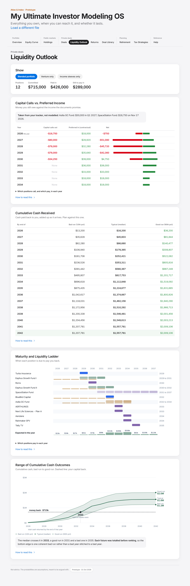

Numbered regions, top to bottom on the desktop screenshot:

| Region | What it is | Requirements |
|---|---|---|
| 1 | Show: the sleeve filter and four figures | LIQ-001, LIQ-002 |
| 2 | Capital Calls vs. Preferred Income: notes, table, bars, breakdown | LIQ-003, LIQ-004, LIQ-005, LIQ-006 |
| 3 | Cumulative Cash Received with the tie-out sentence | LIQ-008, LIQ-009 |
| 4 | Maturity and Liquidity Ladder with its breakdown | LIQ-010, LIQ-011 |
| 5 | Range of Cumulative Cash Outcomes (the cone) | LIQ-012 |

### LIQ-001. Sleeve filter

- **Requirement:** A sleeve filter (Blended portfolio, Venture only, Income sleeves only) drives every figure on Liquidity Outlook and Returns and survives a switch between them.
- **Rule or formula:** MODE in all, venture, income; venture = positions with no preferred return, income = positions with one. A sleeve the book does not hold falls back to all. Reset to all on a new book.
- **Worked example:** Example book: Venture only = 8 positions, $365,000 committed; Income sleeves only = 4 positions, $350,000.
- **Acceptance:** Given Venture only selected on Liquidity Outlook; when the member opens Returns; then Returns also shows Venture only.
- **Test cases:** TC-LIQ-001-01: TO WRITE
- **Source:** app.js:subset, outlookPanels, wire
- **Status:** Partial

### LIQ-002. Filter figures

- **Requirement:** The filter card repeats positions, committed, paid in and still to pay in for the sleeve shown.
- **Rule or formula:** From simulate(subset).totals: committed, funded, uncalled.
- **Worked example:** Blended portfolio: Positions "12", Committed "$715,000", Paid in "$426,000", Still to pay in "$289,000".
- **Acceptance:** Given the example book; when Liquidity Outlook opens; then the four figures equal the totals.
- **Test cases:** TC-LIQ-002-01: TO WRITE
- **Source:** app.js:outlookPanels
- **Status:** Partial

### LIQ-003. Capital calls against preferred income

- **Requirement:** A table shows, year by year, contractual money only: capital calls going out, preferred income promised, and the net.
- **Rule or formula:** Calls = Engine.callSchedule(book, gridYears(book)); preferred = Engine.couponSchedule (unimpaired); net = preferred - calls; only years with either above 0; the current year marked "this year". Exits are left out on purpose.
- **Worked example:** Example book: 2026 calls -$18,750, preferred $18,000, net -$750; 2027 calls -$80,000, preferred $28,920, net -$51,080; 2028 calls -$78,000, preferred $32,280, net -$45,720; 2029 calls -$78,000, preferred $35,640, net -$42,360; 2030 calls -$34,250, preferred $39,000, net $4,750.
- **Acceptance:** Given the example book on 2026-11-01; when Liquidity Outlook renders; then each row's net equals preferred minus calls and 2026 shows only what is still ahead.
- **Test cases:** TC-LIQ-003-01: TO WRITE
- **Source:** app.js:panelCalls; engine.js:callSchedule, couponSchedule
- **Status:** Partial

### LIQ-004. What the calls panel was told

- **Requirement:** The panel says which calls came from the tracker, and which stated amounts could not be placed because they had no date.
- **Rule or formula:** Engine.callNotes: stated = rows with a next call date (amount capped at uncalled); undated = an amount with no date (falls back to the even spread).
- **Worked example:** Example book stated: Asilia GC Fund $30,000 in Q1 2027; SpaceStation Fund $18,750 in Nov 17 2026. A row with Next call amount $10,000 and no date: undated [{"name":"No date","amount":10000}].
- **Acceptance:** Given a next call amount with no date; when the panel renders; then a warning says the amount cannot be placed and the even spread is used.
- **Test cases:** TC-LIQ-004-01: TO WRITE
- **Source:** app.js:panelCalls; engine.js:callNotes
- **Status:** Partial

### LIQ-005. Who makes up a bar

- **Requirement:** Hovering a call or preferred bar lists the positions that make it up, with a total when there are several.
- **Rule or formula:** One per-position split (positionsByYear) feeds both the bars and the breakdown table.
- **Worked example:** First calls readout: "2026: capital calls out / SpaceStation Fund: -$18,750".
- **Acceptance:** Given two positions calling in 2027; when the member hovers the 2027 calls bar; then both names, their amounts and the total are listed.
- **Test cases:** TC-LIQ-005-01: TO WRITE
- **Source:** app.js:positionsByYear, barTip
- **Status:** Partial

### LIQ-006. Calls and preferred by position

- **Requirement:** A folded table splits each year's calls and preferred return by position and says these are the full contractual schedule.
- **Rule or formula:** Rows per year per position (sorted by call plus preferred), a year total when more than one position.
- **Worked example:** Example book calls by year: 2026: SpaceStation Fund -$18,750; 2027: Asilia GC Fund -$30,000, SpaceStation Fund -$50,000; 2028: Asilia GC Fund -$28,000, SpaceStation Fund -$50,000; 2029: Asilia GC Fund -$28,000, SpaceStation Fund -$50,000; 2030: Asilia GC Fund -$28,000, SpaceStation Fund -$6,250.
- **Acceptance:** Given the example book; when the member opens the fold; then each year's rows sum to the table above.
- **Test cases:** TC-LIQ-006-01: TO WRITE
- **Source:** app.js:whoCalls
- **Status:** Partial

### LIQ-007. Cash flow by year is hidden

- **Requirement:** Per-year percentiles are computed but the card is hidden, because its rows cannot be added down.
- **Rule or formula:** byYear: median, odds of any cash, p90 per year. stackedP90 (sum of per-year p90) is printed against the real lifetime p90 to show the error. ux.js HIDE removes the card.
- **Worked example:** Example book: summing each year's good run gives $3,054,476 against a lifetime good run of $2,009,106 (52% too high).
- **Acceptance:** Given Liquidity Outlook; when it renders; then the Cash Flow by Year card is not visible.
- **Test cases:** TC-LIQ-007-01: TO WRITE
- **Source:** app.js:outlookPanels; ux.js:HIDE
- **Status:** Partial

### LIQ-008. Cumulative cash received

- **Requirement:** Cumulative cash received gives the bad, typical and good run by the end of each year, and is safe to read down.
- **Rule or formula:** Each future is totalled year by year first, then ranked: cum[y] = percentiles p10, p50, p90 of the running total. Rows where p90 > 0; the last row highlighted.
- **Worked example:** Example book, 6,000 paths (bad / typical / good): 2027: $35,628 / $45,603 / $81,844; 2030: $161,706 / $252,421 / $522,062; 2035: $875,435 / $1,224,677 / $1,631,665; 2042: $1,207,781 / $1,557,781 / $2,009,106.
- **Acceptance:** Given the example book; when the table renders; then every column is non-decreasing down the years.
- **Test cases:** TC-LIQ-008-01: engine.test.mjs, check 'cumulative table ties to the totals'
- **Source:** engine.js:simulate; app.js:outlookPanels
- **Status:** Implemented

### LIQ-009. Tie-out

- **Requirement:** The cumulative table states whether its last row ties to the lifetime totals.
- **Rule or formula:** ties = abs(cum[last].p50 - totals.p50) < 0.01. A failed tie prints a warning not to trust either panel.
- **Worked example:** Example book: cum last p50 $1,557,781, totals p50 $1,557,781, ties = true.
- **Acceptance:** Given any book; when the simulation finishes; then ties is true and the sentence says so.
- **Test cases:** TC-LIQ-009-01: engine.test.mjs, check 'cumulative table ties to the totals'
- **Source:** engine.js:simulate
- **Status:** Implemented

### LIQ-010. Maturity and liquidity ladder

- **Requirement:** The ladder shows one row per position and one block per payout year, shaded by weight, with the expected preferred return as a line.
- **Rule or formula:** Blocks from Engine.exitPlan(b, 0); expected exit = commitment x E[m] (DLS-002); preferred per year = prefInYear(k) x (expected preferred / scheduled preferred). Rows sorted by first year, then last year, then name.
- **Worked example:** Eephus Growth Fund I: exit $53,437 over 2029 $11,875, 2030 $17,812, 2031 $23,750; preferred line 2026 $2,498, 2027 $2,498, 2028 $2,498.
- **Acceptance:** Given a fund with a three-year window; when the ladder renders; then it shows three blocks whose amounts sum to its expected exit.
- **Test cases:** TC-LIQ-010-01: TO WRITE
- **Source:** app.js:ladderRows, ladderChart
- **Status:** Partial

### LIQ-011. Who pays in each ladder year

- **Requirement:** A folded table lists which positions pay in each year of the ladder.
- **Rule or formula:** Built from the same ladder rows; deterministic, so attributable (the cumulative percentiles are not).
- **Worked example:** 2031 exits: Eephus Growth Fund I $23,750, Eephus Growth Fund II $17,219, SpaceStation Fund $28,540.
- **Acceptance:** Given the example book; when the member opens the fold; then each year lists its positions with preferred and exit amounts.
- **Test cases:** TC-LIQ-011-01: TO WRITE
- **Source:** app.js:whoPays
- **Status:** Partial

### LIQ-012. Cone of outcomes

- **Requirement:** The cone draws the cumulative table with a dashed capital-back line and names the break-even years.
- **Rule or formula:** Break-even year for a percentile = first year its cumulative value >= committed; the sentence names the median year, and the good and bad years when they exist.
- **Worked example:** Committed $715,000: median crosses in 2033, good run in 2031, bad run 2035.
- **Acceptance:** Given the example book; when the cone renders; then the sentence names those years.
- **Test cases:** TC-LIQ-012-01: TO WRITE
- **Source:** app.js:outlookPanels, coneChart
- **Status:** Partial

### LIQ-013. One path count

- **Requirement:** Every figure on Liquidity Outlook and Returns uses the same number of simulated futures.
- **Rule or formula:** CFG.paths = 6,000 for the selected sleeve and for each sleeve series.
- **Worked example:** CFG.paths = 6000; simulate(book).totals.p50 with the default count = $1,557,781.
- **Acceptance:** Given the Outcome range and Lifetime returns on one page; when both show the same sleeve; then they print the same median.
- **Test cases:** TC-LIQ-013-01: TO WRITE
- **Source:** app.js:outlookPanels; engine.js:CFG
- **Status:** Partial

---

## 6. Returns (RET)

How much comes back and at what rate: the lifetime multiple range by sleeve, the distribution of lifetime multiples, lifetime returns, and the annual rate of return by sleeve and by deal. Drawn by `app.js:renderPerf` from the same `outlookPanels` run as Liquidity Outlook (6,000 futures, IRR on). Examples use the example book on 2026-11-01.

**Screens.** Desktop: `docs/screens/perf.png`. Phone: `docs/screens/perf-mobile.png`.

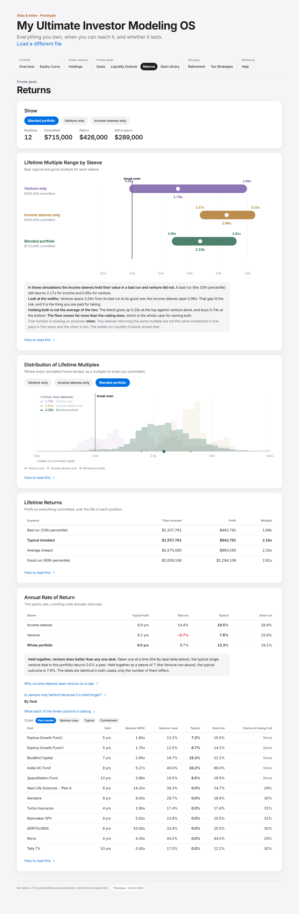

Numbered regions, top to bottom on the desktop screenshot:

| Region | What it is | Requirements |
|---|---|---|
| 1 | Show: the sleeve filter | RET-012 |
| 2 | Lifetime Multiple Range by Sleeve | RET-001 |
| 3 | Distribution of Lifetime Multiples with series buttons | RET-002 |
| 4 | Lifetime Returns table and the preferred-return note | RET-003, RET-004 |
| 5 | Annual Rate of Return by sleeve, with conditional notes | RET-005, RET-006, RET-007, RET-008 |
| 6 | By Deal table with sort buttons, unsolved footnote, paper track | RET-009, RET-010, RET-011 |

### RET-001. Lifetime multiple range by sleeve

- **Requirement:** Lifetime Multiple Range by Sleeve compares the sleeves as multiples on committed capital.
- **Rule or formula:** Per series (Venture only, Income sleeves only, Blended): p10, p50, p90 of total cash / committed. Shown only when the book has more than one sleeve. ux.js adds a hover readout.
- **Worked example:** venture 0.95x / 1.79x / 2.99x; income 2.17x / 2.64x / 3.13x; blended 1.69x / 2.18x / 2.81x (bad / typical / good).
- **Acceptance:** Given a book with only venture deals; when Returns opens; then the range card is not shown.
- **Test cases:** TC-RET-001-01: TO WRITE
- **Source:** app.js:rangeChart, rangeRead; ux.js:enrichHover
- **Status:** Partial

### RET-002. Distribution of lifetime multiples

- **Requirement:** The distribution chart shows where every future landed as a multiple on committed, with one series in front.
- **Rule or formula:** 40 bins over 0 to 4.0x (0.10x wide); a total above 4.0x lands in the last bin; bin height = count / paths.
- **Worked example:** Example book: tallest bin 2.2x to 2.3x with 9.5% of futures; share at or above 3.9x (last bin) 0.0%; bins sum to 100.0%.
- **Acceptance:** Given the example book; when the member presses Venture only on the chart; then the venture curve moves to the front and the others stay as outlines.
- **Test cases:** TC-RET-002-01: TO WRITE
- **Source:** engine.js:simulate; app.js:distChart
- **Status:** Partial

### RET-003. Lifetime returns

- **Requirement:** Lifetime returns gives the bad, typical, average and good total received, with profit on the full commitment and the multiple.
- **Rule or formula:** Rows p10, p50, mean, p90 of total cash; profit = total - committed; multiple = total / committed. The typical row is bold.
- **Worked example:** Committed $715,000: bad $1,207,781 (1.69x), typical $1,557,781 (profit $842,781, 2.18x), average $1,575,585, good $2,009,106. On screen typical row: Typical (median) / $1,557,781 / $842,781 / 2.18x.
- **Acceptance:** Given the example book; when Returns renders; then profit is measured against the full commitment, not the uncalled balance.
- **Test cases:** TC-RET-003-01: TO WRITE
- **Source:** app.js:outlookPanels
- **Status:** Partial

### RET-004. Preferred return in the lifetime figures

- **Requirement:** Lifetime returns says how much of the typical total is preferred return, what the documents promise, and what a bad run collects.
- **Rule or formula:** totals.coupon = median over paths of preferred actually paid (impaired by prefFactor); couponScheduled = contractual sum; couponP10 = 10th percentile.
- **Worked example:** Example book: typical preferred $222,840 against $258,840 promised; a bad run collects $177,438.
- **Acceptance:** Given a book with preferred-return deals; when Returns renders; then the three preferred figures are stated and the typical is below the promised.
- **Test cases:** TC-RET-004-01: TO WRITE
- **Source:** engine.js:simulate; app.js:outlookPanels
- **Status:** Partial

### RET-005. Annual rate of return by sleeve

- **Requirement:** Annual rate of return gives the bad, typical and good IRR for income sleeves, venture and the whole portfolio, with each one's typical hold.
- **Rule or formula:** IRR per path on pooled flows (DM-030), never an average of deal IRRs; bands p10, p50, p90; typical hold = commitment-weighted hold.
- **Worked example:** Example book: income 14.4% / 19.5% / 28.9% (hold 6.9 yrs); venture -0.7% / 7.6% / 15.8% (hold 9.1); whole 8.7% / 13.3% / 19.1% (hold 8.0).
- **Acceptance:** Given the example book; when Returns renders; then the whole-portfolio IRR differs from both the average and the commitment-weighted average of the deal IRRs.
- **Test cases:** TC-RET-005-01: TO WRITE
- **Source:** app.js:irrCard; engine.js:simulate
- **Status:** Partial

### RET-006. IRR that is not a number

- **Requirement:** An IRR that is not a number is shown in words, never as 0%.
- **Rule or formula:** null = "n/a"; <= -99.99% = "-100%" in red; abs < 0.05% = "0.0%" in neutral ink; >= 999.9% = ">1000%"; a negative rate in red.
- **Worked example:** nothing back -> {"r":-1,"flag":"total-loss"}; capital back -> {"r":-5.664419326312961e-17,"flag":"ok"}; no money in -> {"r":null,"flag":"no-contribution"}; 10% stream -> {"r":0.09999999999999998,"flag":"ok"}.
- **Acceptance:** Given a deal that returns exactly its capital; when its IRR is shown; then it reads 0.0% in neutral ink, not a red -0.0%.
- **Test cases:** TC-RET-006-01: engine.test.mjs, check 'nothing back is a total loss'; TC-RET-006-02: engine.test.mjs, check 'no money in has no IRR'; TC-RET-006-03: engine.test.mjs, check 'a plain 10% stream solves'
- **Source:** app.js:rate; engine.js:irrOf
- **Status:** Implemented

### RET-007. Venture held together

- **Requirement:** A note that holding venture together beats any one deal appears only when it is true of the book.
- **Rule or formula:** More than two venture deals with a loss share above 20%, and venture p50 above the median single-deal p50 plus 2 points.
- **Worked example:** 7 venture deals with loss share above 20%; their median typical IRR 0.0%; venture sleeve typical 7.6%; the note shows.
- **Acceptance:** Given a book where the sleeve is not ahead of its deals; when Returns renders; then the note is absent.
- **Test cases:** TC-RET-007-01: TO WRITE
- **Source:** app.js:irrCard
- **Status:** Partial

### RET-008. Why income beats venture on a rate

- **Requirement:** A folded explanation appears only when income's typical IRR is above venture's, and re-runs this book's venture positions at a 5-year hold.
- **Rule or formula:** Venture rows re-simulated with hold = 5 and likely = funded year + 5; the income rate compounded over 5 and 10 years gives the multiples venture would need.
- **Worked example:** Income typical 19.5% vs venture 7.6%; venture at a 5-year hold 21.7%; the income rate compounds to 2.44x over 5 years and 5.93x over 10.
- **Acceptance:** Given income typical IRR above venture's; when Returns renders; then the fold appears with figures from this book, never typed literals.
- **Test cases:** TC-RET-008-01: TO WRITE
- **Source:** app.js:irrCard, heldLonger
- **Status:** Partial

### RET-009. By deal table

- **Requirement:** The By Deal table shows hold, sponsor MOIC, sponsor-case IRR, bad, typical and good IRR and chance of losing it all, in tracker order by default.
- **Rule or formula:** Sort options: Your tracker, Sponsor case, Typical, Commitment. Loss share = share of paths with IRR <= -99.99%. Sponsor case = IRR of the deal's own schedule at its exit multiple and zero timing offset.
- **Worked example:** Aerolane: sponsor case 29.7%, -100.0% / 0.0% / 18.9%, losing it all 30%; BlueBird Capital: sponsor case 19.7%, 8.5% / 15.3% / 22.1%, losing it all 0%; SpaceStation Fund: sponsor case 19.5%, -0.2% / 8.5% / 19.5%, losing it all 0%.
- **Acceptance:** Given the example book; when the member presses Sponsor case; then rows sort by sponsor-case IRR, highest first.
- **Test cases:** TC-RET-009-01: TO WRITE
- **Source:** app.js:irrCard; engine.js:sponsorCaseIrr
- **Status:** Partial

### RET-010. Unsolved rates are named

- **Requirement:** Deals whose rate could not be solved in some futures are named with the share of runs.
- **Rule or formula:** Unsolved = (above-bracket + multi-sign + loan-shaped flags) / paths for that deal.
- **Worked example:** Example book: no deal has an unsolved path. Book-wide flag counts: {"ok":59436,"total-loss":12564}.
- **Acceptance:** Given a mostly uncalled preferred-return fund; when Returns renders; then its name and the share of runs appear in a footnote.
- **Test cases:** TC-RET-010-01: engine.test.mjs, check 'money back first, money in later is loan-shaped, not a total loss: '
- **Source:** app.js:irrCard
- **Status:** Implemented

### RET-011. Paper track

- **Requirement:** What you believe it is worth now appears only when a mark is entered, and says it is in no other figure.
- **Rule or formula:** cost = sum funded; nav = sum(funded x markedUpMoic, or funded); gain = nav - cost; multiple = nav / cost. markedUpMoic never reaches the simulation.
- **Worked example:** A: $75,000 paid in on $250,000 marked 2.0x; B: $50,000 unmarked: cost $125,000, nav $200,000, gain $75,000, multiple 1.60x. The simulated median with and without the mark: $332,500 and $332,500.
- **Acceptance:** Given a mark on one position; when Returns renders; then the paper track appears and no cash figure moves.
- **Test cases:** TC-RET-011-01: TO WRITE
- **Source:** engine.js:paperTrack; app.js:irrCard
- **Status:** Partial

### RET-012. Same filter as Liquidity Outlook

- **Requirement:** Returns uses the same sleeve filter as Liquidity Outlook.
- **Rule or formula:** See LIQ-001.
- **Worked example:** Filter buttons on Returns: Blended portfolio (on), Venture only, Income sleeves only.
- **Acceptance:** Given Income sleeves only chosen on Returns; when the member opens Liquidity Outlook; then it shows Income sleeves only.
- **Test cases:** TC-RET-012-01: TO WRITE
- **Source:** app.js:renderPerf
- **Status:** Partial

---

## 7. Deal Library (LIB) and What If I Add This Deal? (WIF)

Every deal the tool knows, with its shared terms, and a card that tests one deal against the member's Retirement plan. The list is drawn by `app.js:renderUniverse`; the tester by `consider-ui.js`, mounted by `ux.js` after the first card; what the plan includes is decided in `includes.js`. Examples run the tester with the BlueBird Capital deal file at $50,000, fully paid at close in 2026, in the Self-Directed IRA, against the example book and the sample household.

**Screens.** Desktop: `docs/screens/universe.png`. Phone: `docs/screens/universe-mobile.png`.

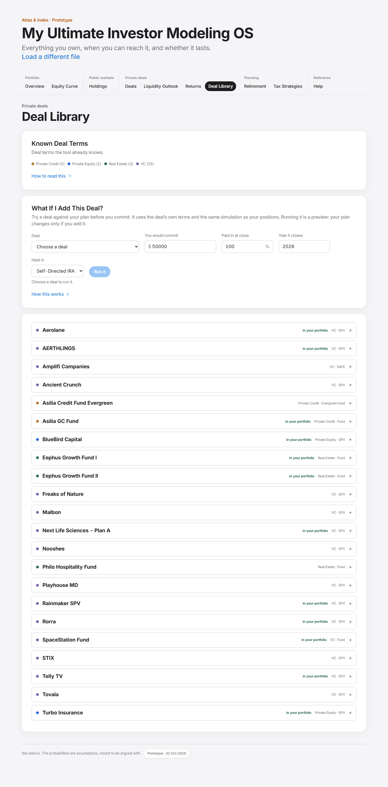

Numbered regions, top to bottom on the desktop screenshot:

| Region | What it is | Requirements |
|---|---|---|
| 1 | Known Deal Terms: count, reserved-names note, asset-class legend | LIB-001, LIB-002, LIB-003, LIB-006 |
| 2 | What If I Add This Deal?: inputs, Run it, results, Add or Remove | WIF-001 to WIF-018 |
| 3 | The deal list, one expandable entry per deal | LIB-004, LIB-005, LIB-007 |

### LIB-001. Every known deal

- **Requirement:** The library lists every deal file in the index, sorted by name, fetched in parallel.
- **Rule or formula:** Fetch deals/index.json, then every deals/<slug>.json at once; a file that fails is left out; sorted by name, case-insensitive.
- **Worked example:** Index lists 22 deals; the tab shows 22 entries, first "Aerolanein your portfolioVC · SPV+".
- **Acceptance:** Given one deal file that fails to load; when the library renders; then the other deals are listed and the failed one is absent.
- **Test cases:** TC-LIB-001-01: TO WRITE
- **Source:** app.js:loadAllDeals, renderUniverse
- **Status:** Partial

### LIB-002. Heading before the files arrive

- **Requirement:** The heading appears before the deal files arrive, so the tab never looks broken while loading.
- **Rule or formula:** A placeholder card is drawn, then replaced when loadAllDeals resolves.
- **Worked example:** On a cold load the tab first shows the card titled "Known Deal Terms" with a loading line, then the list.
- **Acceptance:** Given a slow network; when the member opens Deal Library; then a titled card shows at once.
- **Test cases:** TC-LIB-002-01: TO WRITE
- **Source:** app.js:renderUniverse
- **Status:** Partial

### LIB-003. Asset-class legend

- **Requirement:** A legend counts the deals by asset class.
- **Rule or formula:** Grouped by assetClass, else "Other", sorted by name.
- **Worked example:** Private Credit 2, Private Equity 2, Real Estate 3, VC 15.
- **Acceptance:** Given the shipped library; when the tab renders; then the counts sum to the number of files.
- **Test cases:** TC-LIB-003-01: TO WRITE
- **Source:** app.js:renderUniverse
- **Status:** Partial

### LIB-004. In your portfolio

- **Requirement:** A deal the member holds is tagged "in your portfolio".
- **Rule or formula:** Tagged when a book row's matched deal file has the same slug.
- **Worked example:** Example book: 12 library entries tagged (12 positions, all matched to files).
- **Acceptance:** Given the example book; when the library renders; then each held deal is tagged once.
- **Test cases:** TC-LIB-004-01: TO WRITE
- **Source:** app.js:universeCard
- **Status:** Partial

### LIB-005. An expanded entry

- **Requirement:** An expanded entry shows sub-strategy, sponsor, sponsor MOIC, hold, preferred return, minimum, underlying deals, underwriting score, the names it answers to, its prose sections and up to four key risks, and no holder figures.
- **Rule or formula:** From the deal file only; no commitment, funded or override data.
- **Worked example:** BlueBird Capital: sponsor MOIC 2.65x, hold 7 yrs, preferred 15.0%, minimum $100,000, score none, 8 names, 1 sections, 0 risks shown.
- **Acceptance:** Given a library entry; when the member expands it; then only the deal's shared facts are shown.
- **Test cases:** TC-LIB-005-01: TO WRITE
- **Source:** app.js:universeCard, dealProse
- **Status:** Partial

### LIB-006. Names refused on purpose

- **Requirement:** Names the index refuses on purpose are listed with the reason.
- **Rule or formula:** index.reserved[] and index.reservedNote.
- **Worked example:** The index reserves 5 names: Asilia Credit Fund I, ACF1, Asilia Debt Fund, Asilia Debt Fund (2025), Asilia Debt Fund 2025. matchDeal of a reserved prefix returns null.
- **Acceptance:** Given a tracker row named after a reserved vehicle; when it is matched; then it resolves to no deal and the library explains why.
- **Test cases:** TC-LIB-006-01: TO WRITE
- **Source:** app.js:reservedNote; engine.js:isReserved
- **Status:** Partial

### LIB-007. Version cache key

- **Requirement:** Deal data is fetched with the app version as a cache key, so a release never serves yesterday's deals.
- **Rule or formula:** URL deals/<slug>.json?v=<CFG.version>.
- **Worked example:** Current key: deals/bluebird-capital.json?v=v1.51-proto.
- **Acceptance:** Given a new release with a new version; when a member reloads; then every deal file is fetched again.
- **Test cases:** TC-LIB-007-01: TO WRITE
- **Source:** app.js:dealUrl; consider-ui.js:url
- **Status:** Partial

### LIB-008. Two tiers of deal data

- **Requirement:** Deal data has two tiers: public fields every member can see, and private reference terms used only by the math and seen only by the two founders.
- **Rule or formula:** Public: sponsor, sponsor MOIC, hold, minimum, underlying deals. Private: every other term (preferred rate, fees, call pace, tiers, LTV, notes, risks, underwriting). Prototype: every term ships to the browser.
- **Worked example:** Today the browser receives 18 top-level fields and 14 terms for BlueBird Capital; under the decision only sponsor, sponsor MOIC, hold, minimum and underlying deals would be sent.
- **Acceptance:** Given a member session; when any deal is loaded; then only public fields reach the browser and the math runs where the private terms are.
- **Test cases:** TC-LIB-008-01: TO WRITE
- **Source:** (decision, grill log Q4 and Q5)
- **Status:** Gap

### WIF-001. Card placement

- **Requirement:** The tester card sits after the library's first card, once per render.
- **Rule or formula:** ConsiderUI.mount(body) from ux.js when the Deal Library is on screen; skipped when #consider already exists.
- **Worked example:** Card order: "Known Deal Terms", "What If I Add This Deal?", "".
- **Acceptance:** Given the Deal Library; when it renders twice; then exactly one tester card is present, second on the page.
- **Test cases:** TC-WIF-001-01: ui.test.mjs, check 'UX-32 Run it is disabled until a deal is chosen, and says why'
- **Source:** consider-ui.js:mount; ux.js:tidy
- **Status:** Implemented

### WIF-002. Inputs and defaults

- **Requirement:** The member picks a known deal and sets the commitment, paid in at close, the year it closes and the account.
- **Rule or formula:** Defaults: commitment $50,000; paid in at close 100%; year = this year; account Self-Directed IRA. Deal list from the index, sorted by name.
- **Worked example:** Fresh state: commitment $50,000, paid 100%, year this year (2026), account "Self-Directed IRA".
- **Acceptance:** Given a fresh session; when the tester renders; then the defaults are filled in and no deal is chosen.
- **Test cases:** TC-WIF-002-01: ui.test.mjs, check 'a valid deal runs: '
- **Source:** consider-ui.js:fresh, draw
- **Status:** Implemented

### WIF-003. Run it disabled until ready

- **Requirement:** Run it stays disabled until a deal is chosen and every input is valid, and says why.
- **Rule or formula:** Disabled when no deal, a run is in flight, or an input error exists; hint "Choose a deal to run it."
- **Worked example:** No deal chosen: Run it disabled = true; hint "Choose a deal to run it.".
- **Acceptance:** Given no deal chosen; when the card renders; then Run it is disabled with a hint.
- **Test cases:** TC-WIF-003-01: ui.test.mjs, check 'UX-32 Run it is disabled until a deal is chosen, and says why'
- **Source:** consider-ui.js:draw
- **Status:** Implemented

### WIF-004. Closing year

- **Requirement:** A deal that closes before this year, or more than ten years out, is refused with a message.
- **Rule or formula:** year integer and this year <= year <= this year + 10.
- **Worked example:** 2025 -> The year cannot be in the past. Use 2026 or later.; 2026 -> ok; 2036 -> ok; 2037 -> Use a year no later than 2036..
- **Acceptance:** Given year 2025 on Nov 1, 2026; when the member presses Run it; then the run is refused with "The year cannot be in the past. Use 2026 or later.".
- **Test cases:** TC-WIF-004-01: plan.test.mjs, check 'QA H8 last year is refused'; TC-WIF-004-02: plan.test.mjs, check 'more than ten years out is refused'; TC-WIF-004-03: ui.test.mjs, check 'QA H8 a past year is refused'
- **Source:** includes.js:validateDeal
- **Status:** Implemented

### WIF-005. Commitment bounds

- **Requirement:** A commitment of $0 or less, or above $1B, is refused.
- **Rule or formula:** 0 < commitment <= 1e9.
- **Worked example:** $0 -> Enter how much you would commit, above $0.; -$5 -> Enter how much you would commit, above $0.; $50,000 -> ok; $2,000,000,000 -> That is more than this tool can model ($1B)..
- **Acceptance:** Given a commitment of $0; when the member presses Run it; then the run is refused with a message under the field.
- **Test cases:** TC-WIF-005-01: plan.test.mjs, check 'QA M4 a zero or negative commitment is refused'; TC-WIF-005-02: ui.test.mjs, check 'a zero commitment is refused'
- **Source:** includes.js:validateDeal
- **Status:** Implemented

### WIF-006. Paid in at close

- **Requirement:** Paid in at close outside 0% to 100% of the commitment is refused, and a blank or impossible percent keeps the last good value.
- **Rule or formula:** 0 <= paid <= commitment (dollars); the typed percent must be 0 to 100.
- **Worked example:** $0 of $50,000 -> ok; $25,000 of $50,000 -> ok; $50,000 of $50,000 -> ok; $60,000 of $50,000 -> Paid in at close must be between 0% and 100% of the commitment.; -$1 of $50,000 -> Paid in at close must be between 0% and 100% of the commitment..
- **Acceptance:** Given paid in typed as 150%; when the field changes; then a message asks for 0 to 100 and the previous value is kept.
- **Test cases:** TC-WIF-006-01: plan.test.mjs, check 'paid in outside 0..commitment is refused'; TC-WIF-006-02: ui.test.mjs, check 'QA M4 paid in above 100% is refused'
- **Source:** includes.js:validateDeal; consider-ui.js:draw
- **Status:** Implemented

### WIF-007. Commitment above public investments

- **Requirement:** A commitment larger than all the public investments is refused when a run is asked for.
- **Rule or formula:** commitment <= sum of the Retirement plan's sleeve balances (PlanIncludes.liquid, cached per book).
- **Worked example:** Sample household public investments $1,604,500. $1,604,501 -> "That is more than all your public investments ($1,604,500), so the plan has nothing to pay it from."
- **Acceptance:** Given a commitment one dollar above the public investments; when the member presses Run it; then the run is refused and the plan is unchanged.
- **Test cases:** TC-WIF-007-01: plan.test.mjs, check 'QA C2 a commitment above the public investments is refused'; TC-WIF-007-02: ui.test.mjs, check 'QA C2 a commitment above the public investments is refused'
- **Source:** includes.js:validateDeal, liquid
- **Status:** Implemented

### WIF-008. Same engine as owned positions

- **Requirement:** The tested deal runs through the same engine as the member's own positions, from its deal file.
- **Rule or formula:** Row { name, commitment, funded = paid, uncalled = commitment - paid, yearFunded = year, account } through applyDealFile, buildBook and simulate (6,000 paths, IRR on).
- **Worked example:** BlueBird Capital at $50,000 paid in full in 2026: kind income, preferred 15.0%, hold 7, sponsor MOIC 2.65x, exit multiple 1.60x (residual), likely exit 2033.
- **Acceptance:** Given a chosen deal and valid inputs; when the member presses Run it; then the deal is built exactly as a tracker row with those figures would be.
- **Test cases:** TC-WIF-008-01: ui.test.mjs, check 'a valid deal runs: '
- **Source:** consider-ui.js:runIt
- **Status:** Implemented

### WIF-009. The deal's own range

- **Requirement:** The result shows the deal's typical, bad and good multiple, its typical rate of return, and the year the money is back.
- **Rule or formula:** Multiples = totals p50, p10, p90 and mean / commitment; rate = portfolio IRR p50; money back by = first year whose cumulative p50 >= commitment, else "after the window".
- **Worked example:** Typical 2.15x (bad 1.70x, good 2.65x, average 2.01x); typical rate 15.3% a year; money back by 2033.
- **Acceptance:** Given the run above; when it finishes; then the card shows those figures with plain labels and no -0.0%.
- **Test cases:** TC-WIF-009-01: ui.test.mjs, check 'UX-12 the tester uses the plain labels'; TC-WIF-009-02: ui.test.mjs, check 'QA L2 and UX-28 no -0.0% and no symbol in the copy'
- **Source:** consider-ui.js:runIt, draw
- **Status:** Implemented

### WIF-010. Effect on the Retirement plan

- **Requirement:** The result shows the chance the money lasts and the change in money left at the end, without and with the deal, on the same futures.
- **Rule or formula:** PlanIncludes.preview(ctx, deal): two Retirement runs of 1,200 lifetimes, deal off and deal on; change = endAfter - endBefore in today's dollars. The deal brings its paid-in at close (negative dated money in its year), its calls, and its simulated proceeds.
- **Worked example:** Chance the money lasts 32% -> 33%; money left at the end $0 -> $0 (change $0, today's dollars). Also included in both runs: capital calls still owed.
- **Acceptance:** Given the run above; when it finishes; then both figures are shown as before -> after.
- **Test cases:** TC-WIF-010-01: ui.test.mjs, check 'UX-31 Run it is a preview: nothing is added to the plan'
- **Source:** consider-ui.js:runIt; includes.js:preview
- **Status:** Implemented

### WIF-011. Run it is a preview

- **Requirement:** Running the tester changes nothing in the plan.
- **Rule or formula:** preview() never touches the considered deal or the book.
- **Worked example:** After the preview: PlanIncludes.considered = null, book still 12 positions.
- **Acceptance:** Given a finished run; when the member opens Retirement; then the plan does not include the deal.
- **Test cases:** TC-WIF-011-01: ui.test.mjs, check 'UX-31 Run it is a preview: nothing is added to the plan'
- **Source:** includes.js:preview
- **Status:** Implemented

### WIF-012. Why the money left at the end moved

- **Requirement:** A sentence explains why the money left at the end rose or fell.
- **Rule or formula:** The commitment comes out of the public investments, so the deal is judged against the portfolio's expected return (RunwayUI.expectedReturn); the sentence gives the deal's typical IRR and average multiple, and says when the average is below the typical (mean < p50 - 0.005).
- **Worked example:** Portfolio expected return 7.0%; deal typical rate 15.3%, average 2.01x vs typical 2.15x; the money left at the end rose.
- **Acceptance:** Given a deal whose typical rate is below the portfolio's; when the run finishes; then the sentence says it makes money but leaves the plan behind.
- **Test cases:** TC-WIF-012-01: TO WRITE
- **Source:** consider-ui.js:whyLine
- **Status:** Partial

### WIF-013. Add and Remove

- **Requirement:** Add to my Retirement plan includes the deal; the card then shows it as included with Remove, and focus moves to Remove.
- **Rule or formula:** PlanIncludes.consider(deal); one considered deal at a time (a new one replaces it); Remove = consider(null).
- **Worked example:** consider() returned true; included items then ["capital calls still owed","BlueBird Capital (test)"]; after Remove ["capital calls still owed"].
- **Acceptance:** Given a finished run; when the member presses Add, then Remove; then Retirement lists the deal, then no longer lists it.
- **Test cases:** TC-WIF-013-01: ui.test.mjs, check 'Add to my Retirement plan includes the deal'; TC-WIF-013-02: ui.test.mjs, check 'the included state shows, with Remove'; TC-WIF-013-03: ui.test.mjs, check 'focus moves to Remove after adding'; TC-WIF-013-04: ui.test.mjs, check 'Remove takes the deal out'
- **Source:** consider-ui.js:draw; includes.js:consider
- **Status:** Implemented

### WIF-014. Invalid deals cannot be added

- **Requirement:** A deal that fails validation cannot be added.
- **Rule or formula:** consider() returns false and leaves the plan unchanged.
- **Worked example:** A 2025 deal: consider() = false, considered = null.
- **Acceptance:** Given a deal dated last year; when consider() is called; then it returns false and the plan is unchanged.
- **Test cases:** TC-WIF-014-01: plan.test.mjs, check 'consider() refuses a past-year deal and leaves the plan alone'; TC-WIF-014-02: plan.test.mjs, check 'consider() adds a sound deal'
- **Source:** includes.js:consider
- **Status:** Implemented

### WIF-015. Stale results are discarded

- **Requirement:** Changing any input clears the result, and a run overtaken by a change or a reset is thrown away.
- **Rule or formula:** Inputs are snapshotted at the start of a run; a sequence number discards a result whose run is no longer the latest.
- **Worked example:** Run BlueBird Capital, then change the commitment to $60,000 before it returns: the result area is empty and the late result is never drawn (S.seq advanced from n to n + 1).
- **Acceptance:** Given a run in flight; when the member edits the commitment; then no result is shown until Run it is pressed again.
- **Test cases:** TC-WIF-015-01: ui.test.mjs, check 'QA M5 a changed input clears the result; the plan still names the included deal'
- **Source:** consider-ui.js:draw, runIt
- **Status:** Implemented

### WIF-016. Deal list failure

- **Requirement:** A failed deal list says so and offers Try again; the failure is not cached.
- **Rule or formula:** S.indexError holds the message; Try again refetches; a later mount tries again.
- **Worked example:** With deals/index.json failing: "Could not load the list of deals (Failed to fetch). Check your connection and try again. Try again"; Try again button present = true; ConsiderUI.S.index = null.
- **Acceptance:** Given the index fails once; when the member presses Try again after it recovers; then the list loads.
- **Test cases:** TC-WIF-016-01: ui.test.mjs, check 'QA M10 a failed index says so and offers Try again'; TC-WIF-016-02: ui.test.mjs, check 'the failure is not cached'; TC-WIF-016-03: ui.test.mjs, check 'Try again loads the list'
- **Source:** consider-ui.js:index
- **Status:** Implemented

### WIF-017. A failed run keeps the included deal visible

- **Requirement:** A failed run never hides the deal already in the plan or the way to remove it.
- **Rule or formula:** Error message plus the included note with Remove.
- **Worked example:** A deal file that does not load: "This deal could not be run: its deal file did not load. Your Retirement plan has not changed." followed by the included deal and Remove.
- **Acceptance:** Given a deal already included and a run that fails; when the error shows; then the included deal and Remove are still shown.
- **Test cases:** TC-WIF-017-01: TO WRITE
- **Source:** consider-ui.js:draw
- **Status:** Partial

### WIF-018. No book yet

- **Requirement:** Without a loaded book the card asks the member to load one first.
- **Rule or formula:** Shown when PlanIncludes.ctx is absent.
- **Worked example:** Before any load: "Load your tracker or the example book first, so there is a plan to add it to."
- **Acceptance:** Given no book loaded; when the card draws; then it shows that message and no inputs.
- **Test cases:** TC-WIF-018-01: TO WRITE
- **Source:** consider-ui.js:draw
- **Status:** Partial

### WIF-019. Member-entered deals

- **Requirement:** A member can test a deal the library does not know by entering its key metrics in a required form.
- **Rule or formula:** Required fields so the simulation never lacks an input: at least asset class, vehicle (fund or single), commitment, year, hold, and either a sponsor MOIC or a preferred rate; optional liquidity window and call pace.
- **Worked example:** Not built. Today the only way is a tracker row, which runs on whatever was typed (a row with no multiple and no preferred return falls back to the 5.0x convention, DLS-016).
- **Acceptance:** Given a deal not in the library; when the member opens the form; then it cannot be run until the required metrics are entered.
- **Test cases:** TC-WIF-019-01: TO WRITE
- **Source:** (decision, grill log Q4)
- **Status:** Gap

---

## 8. Retirement (RTR)

The Retirement Simulator: will the money last? It runs one household's life 1,200 times and spends path p of the private-deal futures in lifetime p. The arithmetic is in `runway.js:simulate`; the screen and the config are built by `runway-ui.js`; what the plan includes comes from `includes.js`. Until a You tab and a Balances tab are supplied, the plan is the fictional sample household (born 1972, stop 2035, plan to 92, $200,000 a year, floor $160,000, Social Security $42,000 from 67) with sleeves from the sample public holdings. Examples marked "tiny plan" use one cash sleeve of $1,000,000, no return, no inflation, $50,000 a year, stop 2026, plan to age 70, born 1966.

**Screens.** Desktop: `docs/screens/runway.png`. Phone: `docs/screens/runway-mobile.png`.

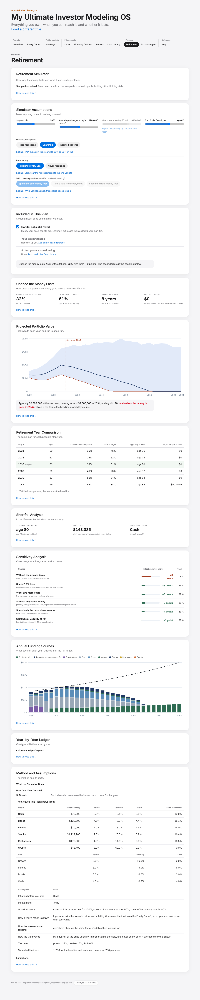

Numbered regions, top to bottom on the desktop screenshot:

| Region | What it is | Requirements |
|---|---|---|
| 1 | Retirement Simulator: source note, tax and correlation lines | RTR-001, RTR-002 |
| 2 | Simulator Assumptions: sliders, spending mode, rebalancing and draw order, Reset | RTR-003, RTR-004, RTR-005, RTR-006 |
| 3 | Included in This Plan | RTR-007, INC-001 to INC-011 |
| 4 | Chance the Money Lasts: four figures and notes | RTR-008, RTR-009, RTR-010 |
| 5 | Projected Portfolio Value fan chart | RTR-011 |
| 6 | Retirement Year Comparison | RTR-012 |
| 7 | Shortfall Analysis | RTR-013 |
| 8 | Sensitivity Analysis (levers) | RTR-014 |
| 9 | Annual Funding Sources | RTR-015 |
| 10 | Year-by-Year Ledger | RTR-016 |
| 11 | Method and Assumptions | RTR-017 |

### RTR-001. Config layering

- **Requirement:** The plan's inputs are layered: the sample household, then sleeves from the public holdings, then the You tab, then a Balances tab's sleeves, then the member's slider moves.
- **Rule or formula:** Each layer covers only what the one below left: holdings sleeves (with correlations) replace the sample sleeves; You fields replace sample fields one by one; a Balances tab replaces the sleeves and drops the correlations; sliders (LIVE) go on top. The floor is clamped to the spend target.
- **Worked example:** Example book (no You or Balances tab): born 1972, stop 2035, plan to 92, spend $200,000, floor $160,000, benefit $42,000 from 67, sleeves from holdings = true (Stocks, Income, Bonds, Real assets, Crypto, Cash), correlated = true.
- **Acceptance:** Given a You tab naming only the birth year and stop year; when Retirement renders; then those two come from the tab and every other field keeps the sample value.
- **Test cases:** TC-RTR-001-01: ui.test.mjs, check 'Retirement plans from the same Balances tab'; TC-RTR-001-02: runway.test.mjs, check 'M1: a new book starts from the tracker, not the sliders of the last book'
- **Source:** runway-ui.js:cfgBase, cfg
- **Status:** Implemented

### RTR-002. Where the numbers came from

- **Requirement:** The tab says which figures are the member's and which are the sample's.
- **Rule or formula:** sourceNote names the sample household when no You or Balances tab exists, and lists the tabs read otherwise.
- **Worked example:** "Retirement SimulatorHow long the money lasts, and what it leans on to get there.Sample household. Balances come from the sample household's public holdings (the Holdings tab).How to read thisIt models tax simply, as one ..."
- **Acceptance:** Given the example book; when Retirement opens; then the first card says the plan is a fictional sample household.
- **Test cases:** TC-RTR-002-01: TO WRITE
- **Source:** runway-ui.js:sourceNote
- **Status:** Partial

### RTR-003. Sliders

- **Requirement:** Four sliders move the stop year, the spend target, the must-have floor and the Social Security start age, and recompute when released.
- **Rule or formula:** Stop year from min(stop, max(this year, anchor - 10)) to anchor + 12; spend 50% to 150% of the anchor in $5,000 steps; floor capped at the spend and disabled unless the mode is Income floor first; benefit age 62 to 70. Input ticks update only the label; change (release) re-renders and keeps focus.
- **Worked example:** stopYear 2026..2047 step 1 = 2035; spend 100000..300000 step 5000 = 200000; floorSpend 80000..200000 step 5000 = 160000 (disabled); benefitAge 62..70 step 1 = 67.
- **Acceptance:** Given Guardrails mode; when Retirement renders; then the floor slider is disabled and says which mode uses it.
- **Test cases:** TC-RTR-003-01: runway.test.mjs, check 'UX-35: in Guardrails the floor slider is disabled and says which mode uses it'; TC-RTR-003-02: runway.test.mjs, check 'UX-35: the floor slider cannot go above the target'; TC-RTR-003-03: runway.test.mjs, check 'UX-35: in "Income floor first" the floor slider is live'; TC-RTR-003-04: runway.test.mjs, check 'H7: an input tick does not re-render or drop focus'; TC-RTR-003-05: runway.test.mjs, check 'H7: after change the tab re-renders and focus returns to the same slider'; TC-RTR-003-06: runway.test.mjs, check 'UX-40: the stop-year slider does not offer a past year'
- **Source:** runway-ui.js:panelControls, slider, wire
- **Status:** Implemented

### RTR-004. Spending modes and guardrails

- **Requirement:** The plan spends in one of three modes: fixed real spend, guardrails, or income floor first.
- **Rule or formula:** fixed: ask = target x price level. floor: ask = floor x price level. guard: ask = target x multiplier, where coverage = (liquid at the start of the year + net benefit) / target, and the multiplier is the first band met in [[12, 1.00], [9, 0.90], [0, 0.80]].
- **Worked example:** Tiny plan ($1,000,000, target $50,000, floor $40,000): fixed asks $50,000, floor asks $40,000, guardrails asks $50,000 (coverage 20). With $500,000 (coverage 10) guardrails asks $45,000; with $400,000 (coverage 8) $40,000.
- **Acceptance:** Given coverage of 10 times the target; when Guardrails decides the ask; then it asks for 90% of the target.
- **Test cases:** TC-RTR-004-01: runway.test.mjs, check 'UX-23/UX-30: lever labels name Social Security and the must-have amount'
- **Source:** runway.js:simulate, guardMult; runway-ui.js:MODES
- **Status:** Partial

### RTR-005. Rebalancing and draw order

- **Requirement:** The member chooses annual rebalancing or none, and the order sleeves are drawn; the draw order is said to do nothing while rebalancing.
- **Rule or formula:** Rebalance annual restores the starting mix after each year is funded. Draw orders: safe-first (cash, bonds, income, growth), proportional (pro rata), growth-first (growth, income, bonds, cash).
- **Worked example:** safe-first with no rebalancing: 34%; proportional with no rebalancing: 31%; growth-first with no rebalancing: 38%; annual rebalancing (any order): 36% (sample household, 300 lifetimes).
- **Acceptance:** Given annual rebalancing on; when the member changes the draw order; then the result does not change and the tab says why.
- **Test cases:** TC-RTR-005-01: TO WRITE
- **Source:** runway.js:normSleeves, payFromPrincipal; runway-ui.js:panelControls
- **Status:** Partial

### RTR-006. Reset to the tracker

- **Requirement:** After any slider or button move, a Reset button restores the tracker's (or the sample's) values.
- **Rule or formula:** Reset clears LIVE; a new book clears it too.
- **Worked example:** After moving spend up $10,000: Reset shown = true; after Reset, spend = 200000 and Reset shown = false.
- **Acceptance:** Given a moved slider; when the member presses Reset; then every control returns to its anchor.
- **Test cases:** TC-RTR-006-01: runway.test.mjs, check 'M1: a new book starts from the tracker, not the sliders of the last book'
- **Source:** runway-ui.js:panelControls, wire, reset
- **Status:** Implemented

### RTR-007. Included in This Plan

- **Requirement:** Retirement lists what the plan includes, with a switch for each, and shows the chance the money lasts with and without them on the same futures.
- **Rule or formula:** Items: capital calls still owed (on by default), your tax strategies (when any exist), a deal you are considering (when one was added). Base run = all three off, 1,200 lifetimes.
- **Worked example:** Example book: without the includes 41%, with capital calls still owed 32%.
- **Acceptance:** Given the example book; when the member unticks Capital calls still owed; then the headline rises to the without figure.
- **Test cases:** TC-RTR-007-01: runway.test.mjs, check 'L12: a deal name is escaped in "Included in This Plan"'
- **Source:** runway-ui.js:panelIncludes; includes.js:config
- **Status:** Implemented

### RTR-008. Chance the money lasts and the headline

- **Requirement:** The headline shows the chance the money lasts, the share of the full target delivered, the worst thin run and the money left at the end in today's dollars.
- **Rule or formula:** Chance the money lasts = share of lifetimes with no year (saving or drawing) left more than $1 unpaid. Share of target = median over lifetimes of min(1, spending / full target summed over drawing years). Worst thin run = median of the longest run of years paid below 90% of the ask. Left at the end = median ending wealth (nominal) deflated by the median price index (TDD-001). A move shows the change in whole points.
- **Worked example:** Example book, 1,200 lifetimes: chance 32.3%, share 61.2%, worst thin run 8 years, ending $0 nominal = $0 today. On screen: neverShort "32%", left "$0".
- **Acceptance:** Given the example book; when Retirement renders; then the headline equals PlanIncludes.run and the highlighted stop-year row.
- **Test cases:** TC-RTR-008-01: runway.test.mjs, check 'UX-17: the headline matches PlanIncludes.run, so the other tabs agree'; TC-RTR-008-02: runway.test.mjs, check 'M-06: share of target never exceeds 100% with $150k a year of bills: '; TC-RTR-008-03: ui.test.mjs, check 'UX-12 the headline label reads Chance the money lasts'
- **Source:** runway.js:simulate; runway-ui.js:panelHeadline
- **Status:** Implemented

### RTR-009. Bills before the stop year

- **Requirement:** Money going out before the stop year is paid from the sleeves with the tax gross-up, and a lifetime that cannot pay it counts as short.
- **Rule or formula:** payFromPrincipal in draw order; unpaid > $1 fails the lifetime; preStop reports n, share and the median gap.
- **Worked example:** Tiny plan with a $1,500,000 bill in 2027 against $1,000,000: preStop {"n":200,"share":1,"gapP50":720000}, chance the money lasts 0%.
- **Acceptance:** Given a bill larger than every sleeve before the stop year; when the plan runs; then every lifetime is short and the headline says how much went unpaid.
- **Test cases:** TC-RTR-009-01: runway.test.mjs, check 'C2: a bigger run-up outflow always costs more'; TC-RTR-009-02: runway.test.mjs, check 'M-01: a $100k run-up bill costs $100k / (1 - 22%) of a pre-tax sleeve: '
- **Source:** runway.js:simulate, payFromPrincipal
- **Status:** Implemented

### RTR-010. Private deals in the plan

- **Requirement:** The headline says whether private deals feed the plan.
- **Rule or formula:** hasDeals = a deal simulation with captured paths was supplied (RunwayUI.baseConfig runs Engine.simulate(book, { paths: 400, capturePaths: true })).
- **Worked example:** Example book: hasDeals = true; dealSim paths = 400.
- **Acceptance:** Given a tracker with deals; when Retirement renders; then the note "Your private deals are in these figures" is shown.
- **Test cases:** TC-RTR-010-01: TO WRITE
- **Source:** runway-ui.js:panelHeadline, baseConfig
- **Status:** Partial

### RTR-011. Projected Portfolio Value

- **Requirement:** A fan chart shows total wealth every year from today to the plan age, in today's dollars, with the stop year marked.
- **Rule or formula:** curve[y] = p10, p50, p90 of total sleeve balances at the end of each calendar year, deflated by that year's median price index; phase saving before the stop year, drawing after.
- **Worked example:** Example book (bad / typical / good, today's dollars): 2030 $1,142,237 / $1,819,277 / $2,805,911 (saving); 2035 $1,560,431 / $2,593,668 / $4,484,492 (drawing); 2050 $0 / $876,016 / $5,140,902 (drawing); 2064 $0 / $0 / $4,539,757 (drawing).
- **Acceptance:** Given the example book; when the chart renders; then the typical line at the stop year equals the sentence under the chart.
- **Test cases:** TC-RTR-011-01: runway.test.mjs, check 'M-15: curve price index = inflPre to the stop year, inflPost after'
- **Source:** runway-ui.js:panelCurve, fanChart
- **Status:** Implemented

### RTR-012. Retirement Year Comparison

- **Requirement:** The same plan is shown for stop years from four years earlier to six years later, two years apart, with the current one being the headline run itself.
- **Rule or formula:** Rows stop - 4, -2, 0, +2, +4, +6; a row before this year is dropped unless it is the current stop year; each row is a full run at the headline's path count.
- **Worked example:** 2031 59 16%; 2033 61 24%; 2035 your plan 63 32%; 2037 65 41%; 2039 67 50%; 2041 69 58%.
- **Acceptance:** Given the example book; when the table renders; then the highlighted row equals the headline.
- **Test cases:** TC-RTR-012-01: runway.test.mjs, check 'UX-17: the headline matches PlanIncludes.run, so the other tabs agree'
- **Source:** runway-ui.js:panelWhen
- **Status:** Implemented

### RTR-013. Shortfall Analysis

- **Requirement:** For the lifetimes that fell short, the tab says when, by how much, and which sleeve emptied first.
- **Rule or formula:** breaks: n, share, age p10 and p50 of the first short year, median first gap, median age the first sleeve emptied, sleeves ranked by how often they emptied first. Null when nothing failed.
- **Worked example:** Example book: 813 short lifetimes (68%), first short at age 74 (p10) / 80 (p50), first gap $143,085, first to empty: Cash 100%.
- **Acceptance:** Given lifetimes that fell short; when the card renders; then it reports only those lifetimes.
- **Test cases:** TC-RTR-013-01: TO WRITE
- **Source:** runway.js:simulate; runway-ui.js:panelBreaks
- **Status:** Partial

### RTR-014. Sensitivity Analysis

- **Requirement:** The plan is re-run with one change at a time on the same seed, and the changes are ranked by their effect on the chance the money lasts.
- **Rule or formula:** Levers: spend 10% less; work two more years; Social Security at 70 (benefit x (1 + 0.08 x years waited)); use guardrails; spend only the must-have; without the private deals; without any dated money. 700 lifetimes each; sorted by abs(delta).
- **Worked example:** Example book base 31%: Without the private deals -23 pts; Spend 10% less +8 pts; Work two more years +8 pts; Without any dated money +8 pts; Spend only the must-have amount +7 pts; Start Social Security at 70 +1 pts.
- **Acceptance:** Given the example book; when the card renders; then the largest effect is listed first.
- **Test cases:** TC-RTR-014-01: runway.test.mjs, check 'UX-23/UX-30: lever labels name Social Security and the must-have amount'; TC-RTR-014-02: runway.test.mjs, check 'UX-30: the floor lever no longer claims "never short"'
- **Source:** runway.js:levers; runway-ui.js:panelLevers
- **Status:** Implemented

### RTR-015. Annual Funding Sources

- **Requirement:** For each drawing year the chart shows what typically paid: the benefit, dated money, deal proceeds and each sleeve.
- **Rule or formula:** byYear.from: medians across lifetimes of each source's contribution; need = median target. Medians per source, so the stack is a picture, not a ledger.
- **Worked example:** Example book, first drawing year 2035: target $272,579; median from benefit $0, dated $0, deals $75,043, cash $132,216, bonds $24,960, income $6,810, stocks $21,816, real $2,240, alts $0.
- **Acceptance:** Given the example book; when the chart renders; then each bar is that year's median by source.
- **Test cases:** TC-RTR-015-01: TO WRITE
- **Source:** runway.js:simulate; runway-ui.js:panelComposition
- **Status:** Partial

### RTR-016. Year-by-Year Ledger

- **Requirement:** One lifetime, the one whose ending wealth is the median, is written out year by year and foots.
- **Rule or formula:** medianTrace: rank ending wealth with the same rule as the headline, re-run with that path traced. Each row: opening + return - withdrawn + swept in = closing; paid = benefit + dated in + deals + sleeve net; spending = paid - bills paid.
- **Worked example:** Example book: path 865 of 1200, ending $0 (= headline $0). First drawing year 2035: opening $3,810,137, asked $272,579, paid $272,579 (benefit $0, deals $116,817), tax $62,399, closing $3,686,724.
- **Acceptance:** Given the median lifetime; when the ledger renders; then every row foots and the last closing balance equals the headline's typical ending.
- **Test cases:** TC-RTR-016-01: runway.test.mjs, check 'ledger: opening + return - withdrawn + swept in = closing, and paid = its sources, every row'; TC-RTR-016-02: runway.test.mjs, check 'ledger: each closing balance is the next opening'
- **Source:** runway.js:medianTrace; runway-ui.js:panelLedger
- **Status:** Implemented

### RTR-017. Method and Assumptions

- **Requirement:** The method card lists the sleeves the plan draws from with the figures the simulator used, the tax rates, and the limits.
- **Rule or formula:** Per sleeve: balance, return = price return + yield, volatility, yield, effective tax rate; the four archetype defaults; the deal and Social Security tax rates.
- **Worked example:** Example book sleeves: Cash $70,200 return 3.5% tax 19.0%; Bonds $120,600 return 4.5% tax 18.1%; Income $70,000 return 7.0% tax 15.0%; Stocks $1,129,700 return 7.8% tax 16.4%; Real assets $170,600 return 4.3% tax 16.5%; Crypto $43,400 return 8.0% tax 0.0%; deals taxed at 18.9%, Social Security at 18.7%.
- **Acceptance:** Given the example book; when the card renders; then it states the deal and Social Security tax.
- **Test cases:** TC-RTR-017-01: runway.test.mjs, check 'M-04: the methodology states the deal and Social Security tax'
- **Source:** runway-ui.js:panelMethod
- **Status:** Implemented

### RTR-018. Why there is nothing to show

- **Requirement:** When a plan cannot run, the tab names the specific reason.
- **Rule or formula:** diagnose: no-sleeves, zero-balances, stop-before-birth, plan-age-is-a-year (a four-digit age, with the likely intended age), plan-age-too-low, history-too-short.
- **Worked example:** no sleeves: no-sleeves; zero balances: zero-balances; plan to 2062: plan-age-is-a-year; stop 1970: stop-before-birth.
- **Acceptance:** Given a You tab with Plan to age 2062; when Retirement renders; then it says 2062 looks like a year and suggests age 90.
- **Test cases:** TC-RTR-018-01: runway.test.mjs, check 'M-25: a 106-year sequence run returns null and diagnose() names why'
- **Source:** runway.js:diagnose
- **Status:** Implemented

### RTR-019. Returns and yield draws

- **Requirement:** Each sleeve's price return is lognormal with its arithmetic mean and volatility, and its yield is lognormal around the stated yield, never negative.
- **Rule or formula:** 1 + price = exp(m + s z), (m, s) = logParams(mu, sd). Yield = exp(m_y + s_y g) with cv = sd / 4, s_y^2 = ln(1 + cv^2), m_y = ln(y) - s_y^2 / 2, so E[yield] = y. A zero yield stays zero.
- **Worked example:** Growth sleeve mu 8%, sd 16%: m = 0.066106, s = 0.147345, median year 6.83%. A 4% yield at 16% volatility: s_y = 0.039984, so it swings by about 0.16% points.
- **Acceptance:** Given a sleeve with 60% volatility; when ten thousand years are drawn; then none loses more than 100% and the mean is the stated mu.
- **Test cases:** TC-RTR-019-01: runway.test.mjs, check 'M-17: logParams keeps the arithmetic mean'; TC-RTR-019-02: runway.test.mjs, check 'M-17: no year loses more than everything'
- **Source:** runway.js:draw, logParams
- **Status:** Implemented

### RTR-020. Correlated sleeves

- **Requirement:** When given a correlation matrix, the sleeves move together through one vector of correlated shocks a year; an invalid matrix is refused and the draws stay independent.
- **Rule or formula:** z = L e with L the Cholesky factor of R; e independent standard normals drawn once a year; a non positive semi-definite R returns null from cholesky and sets corrRejected.
- **Worked example:** cholesky([[1, 0.5], [0.5, 1]]) = [[1,0],[0.5,0.866]]; an impossible 3x3 (0.9, -0.9, 0.9) = null.
- **Acceptance:** Given an invalid matrix; when the plan runs; then it completes with independent draws and says the correlation was ignored.
- **Test cases:** TC-RTR-020-01: runway.test.mjs, check 'M-28: cholesky returns null for a non-PSD matrix'; TC-RTR-020-02: runway.test.mjs, check 'M-28: a valid matrix still factors'; TC-RTR-020-03: runway.test.mjs, check 'M-28: the run says the correlation was ignored'; TC-RTR-020-04: markets.test.mjs, check 'correlated run completes'
- **Source:** runway.js:cholesky, zFor
- **Status:** Implemented

### RTR-021. How one drawing year is paid

- **Requirement:** Each drawing year is paid in a fixed order: the benefit, dated money coming in, deal proceeds, every sleeve's income, then sleeve principal in the draw order; bills are paid before spending.
- **Rule or formula:** ask + bills = what the year must pay. Benefit net = gross x (1 - 0.85 x pre-tax rate). Deal proceeds spent are taxed at the deal rate (gross = net / (1 - rate)); the rest is swept untaxed into the first sleeve. Yield is spent net of each sleeve's rate before any principal. Unpaid > $1 makes the year short.
- **Worked example:** Tiny plan with a $20,000 benefit: asked $50,000; benefit net $16,260 (gross $20,000, tax $3,740); from the sleeve $43,256 gross for $33,740 net at its rate; total tax $13,256.
- **Acceptance:** Given a $50,000 ask and a $20,000 benefit; when the year is paid; then the benefit pays first after its tax and the sleeve pays the rest grossed up.
- **Test cases:** TC-RTR-021-01: runway.test.mjs, check 'M-06: bills are paid first, spending gets the rest'; TC-RTR-021-02: runway.test.mjs, check 'M-04: Social Security reaches spending after tax at 85% x 22%: '; TC-RTR-021-03: runway.test.mjs, check 'M-04: with tax off the benefit is spent in full'
- **Source:** runway.js:simulate, payFromPrincipal
- **Status:** Implemented

### RTR-022. Tax by account type

- **Requirement:** Withdrawals are grossed up at one effective rate per account type, blended by each sleeve's tax mix.
- **Rule or formula:** Pre-tax 22%, taxable 15%, Roth 0%; rate = sum(share x rate) clamped to 0..0.9; a missing mix is pre-tax. gross = net / (1 - rate). Deal proceeds use the book's commitment-weighted mix (blank account = Self-Directed IRA = pre-tax).
- **Worked example:** A 50% pre-tax, 50% taxable sleeve: rate 18.5%, so $100,000 of spending costs $122,699. Example book deal mix: pre-tax 55.2%, taxable 44.8% -> deal rate 18.9%.
- **Acceptance:** Given a $100,000 bill from a pre-tax sleeve; when it is paid; then the sleeve gives up $128,205.
- **Test cases:** TC-RTR-022-01: runway.test.mjs, check 'M-01: a $100k run-up bill costs $100k / (1 - 22%) of a pre-tax sleeve: '; TC-RTR-022-02: runway.test.mjs, check 'M-04: with no bucket given, deal proceeds are taxed as pre-tax (22%), the conservative default'; TC-RTR-022-03: runway.test.mjs, check 'M-04: proceeds landing in a taxable account are taxed at 15%'; TC-RTR-022-04: runway.test.mjs, check 'M-04: deal tax mix is weighted by commitment, a blank account counting as the Self-Directed IRA'
- **Source:** runway.js:rateOfMix, dealRateOf; runway-ui.js:dealTaxMix
- **Status:** Implemented

### RTR-023. Saving years

- **Requirement:** Before the stop year, income is reinvested, dated money coming in is added to the first sleeve, money going out is paid from principal, and early deal proceeds are reinvested.
- **Rule or formula:** Per saving year: flow > 0 adds to sleeve 1; flow < 0 is paid by payFromPrincipal; deal proceeds landing before the stop year are added to sleeve 1; balances grow by (1 + yield)(1 + price); rebalance if on.
- **Worked example:** Tiny plan stopping 2028 with a $10,000 gift in 2026: run-up rows [{"year":2026,"flow":10000,"balance":1010000},{"year":2027,"flow":0,"balance":1010000}].
- **Acceptance:** Given a gift dated in a saving year; when the plan runs; then it lands in the first sleeve that year.
- **Test cases:** TC-RTR-023-01: runway.test.mjs, check 'H8: a past-dated outflow is charged, as if dated this year'; TC-RTR-023-02: runway.test.mjs, check 'H8: a past-dated inflow is not added on top of the balances'
- **Source:** runway.js:simulate
- **Status:** Implemented

### RTR-024. Historical sampling (not exposed)

- **Requirement:** The simulator can draw years from 1928 to 2025 history, in 10-year blocks or every real sequence, though the tab does not offer it yet.
- **Rule or formula:** sampling historical: blockPath of consecutive real years, never wrapping; sequence: every window of the needed length; a stated sleeve replays the series rescaled to its own mean and volatility; inflation from the same year.
- **Worked example:** History has 98 years from 1928; there are 59 complete 40-year windows; stocks in 2008 -36.5%, CPI in 1980 13.5%.
- **Acceptance:** Given sampling "sequence" with a 106-year horizon; when the plan runs; then it returns null and diagnose names the reason.
- **Test cases:** TC-RTR-024-01: runway.test.mjs, check 'history: blocks are consecutive real years and never wrap: '; TC-RTR-024-02: runway.test.mjs, check 'history: sequences() counts every complete window'; TC-RTR-024-03: runway.test.mjs, check 'M-25: a 106-year sequence run returns null and diagnose() names why'; TC-RTR-024-04: runway.test.mjs, check 'M-27: a 60% volatility sleeve replays history with a far wider (log) range than a 16% one'
- **Source:** history.js; runway.js:simulate
- **Status:** Partial

### RTR-025. Determinism

- **Requirement:** The same inputs and seed always give the same answer.
- **Rule or formula:** Seeded mulberry32 (seed 20260929 by default); deal futures from the engine's own seeded streams.
- **Worked example:** Two runs of a 100% growth tiny plan: 99.00% and 99.00%; ending p50 $973,665 and $973,665.
- **Acceptance:** Given two identical configs; when both run; then every output is identical.
- **Test cases:** TC-RTR-025-01: runway.test.mjs, check 'same inputs and seed give the same answer'
- **Source:** runway.js:simulate
- **Status:** Implemented

### RTR-026. Required figures before a member plan runs

- **Requirement:** On a member’s own file, Retirement shows no result until the You tab carries birth year, planned stop work year, annual spend target, estimated annual benefit and benefit start age, and the file has a Balances or Holdings tab. Until then it lists exactly what is missing, labelled as typed on the You tab. The deal tester shows the deal’s own figures but holds back its two retirement figures and says why. The sample household and the example book are never gated. (Owner decision, grill Q20, 2026-11-01.)
- **Rule or formula:** missing = the five You fields that are absent or blank in column B, plus "A Balances tab (or a Holdings tab)" when neither tab is present. A 0 is an answer (no benefit; a Balances tab whose only row is Cash 0 means no public money). Column C is never read as a value.
- **Worked example:** A You tab with a blank birth year, stop year 2030 and a benefit of 0 parses to {"stopYear":2030,"benefitAnnual":0}; Retirement would ask for Birth year, Annual spend target, Benefit start age and a Balances tab.
- **Acceptance:** Given a member file of private deals only, with no You or Balances tab; when Retirement opens; then it lists the six missing items and shows no chance-the-money-lasts figure.
- **Test cases:** TC-RTR-026-01: ui.test.mjs, check 'Q20 private-only file: Retirement asks for its figures instead of running on the sample'; TC-RTR-026-02: ui.test.mjs, check 'Q20 the request names every missing figure as it is typed on the You tab'; TC-RTR-026-03: ui.test.mjs, check 'Q20 only the one missing figure is asked for; a 0 benefit counts as an answer'; TC-RTR-026-04: ui.test.mjs, check 'Q20 a complete file runs, and a Balances tab of 0 reads as no public money'; TC-RTR-026-05: ui.test.mjs, check 'Q20 the plan uses the member'; TC-RTR-026-06: ui.test.mjs, check 'Q20 on a file without the You tab the tester holds back its retirement figures and says why'; TC-RTR-026-07: ui.test.mjs, check 'a blank or unreadable You value is missing, never the explanation beside it'; TC-RTR-026-08: ui.test.mjs, check 'the example book and the sample household are never gated'
- **Source:** runway-ui.js:missingRequired, requiredCard; consider-ui.js; portfolio.js:parseYou
- **Status:** Implemented

### RTR-027. Capital calls before the stop year

- **Requirement:** When the book still owes capital calls dated before the planned stop year, Retirement shows them as numbers with no verdict: each year’s calls from the engine’s own call schedule, the running total, and how much of that total the public money in the file could not cover if no deal paid anything out first. The first year a gap appears is highlighted in red. A summary line states calls due, public money in the file and the amount not covered, and how much more falls in or after the stop year. Deal payouts and account returns are left out of this panel; the simulation counts both. (Owner decision, grill Q21 option b, 2026-11-02.)
- **Rule or formula:** For each year y < stopYear with calls: due(y) = callSchedule; cum(y) = sum of due up to y; notCovered(y) = max(0, cum(y) - publicMoney), publicMoney = sum of sleeve balances (0 when the file has no public money). Highlight = the first y with notCovered > 0, and only that row. No panel when nothing is left to call before the stop year.
- **Worked example:** A private-only book owing $37,500 in 2026 and $200,000 in 2027, with $0 of public money, reads: 2026 not covered $37,500 (highlighted, first year not covered), 2027 not covered $237,500.
- **Acceptance:** Given a member file with uncalled commitments, a stop year of 2030 and $100,000 of public money; when Retirement opens; then the panel lists 2026 to 2029, the running total ties to the call schedule, and only the first year the calls outrun $100,000 is highlighted.
- **Test cases:** TC-RTR-027-01: ui.test.mjs, check 'Q21 a member file with calls before the stop year shows the capital-calls panel'; TC-RTR-027-02: ui.test.mjs, check 'Q21 the panel lists only years before the stop year'; TC-RTR-027-03: ui.test.mjs, check 'Q21 the running total ties to the engine call schedule'; TC-RTR-027-04: ui.test.mjs, check 'Q21 exactly one row is highlighted, the first year the calls outrun the public money'; TC-RTR-027-05: ui.test.mjs, check 'Q21 the panel states the numbers and gives no verdict'; TC-RTR-027-06: ui.test.mjs, check 'Q21 calls the file can cover are listed with nothing highlighted'; TC-RTR-027-07: ui.test.mjs, check 'Q21 a book with nothing left to call shows no capital-calls panel'
- **Source:** runway-ui.js:panelCalls; includes.js:callsDated
- **Status:** Implemented

---

## 9. Tax Strategies (TAX, HM, WFH, ROTH, CSG, OG, SOL, INV)

Pick one or more strategies, set their terms, and see the federal tax saved and owed back year by year, its effect on retirement, and what investing the savings does. Drawn and modelled by `taxes-ui.js`; Heavy Machinery and Workforce Housing run the published tools' models ported line for line in `taxplay.js`. Unless an example says otherwise it uses the tab's own defaults: married filing jointly, W-2 income $400,000 in 2026 growing 3% a year until the Retirement stop year (2035 for the sample household) and $0 after, personal deductions $32,200 (the larger of these and the standard deduction is used), brackets indexed 2.5% a year for the four models written in this file, and a 6% discount rate for "worth today". Federal tax only.

**Screens.** Desktop: `docs/screens/tax.png`. Phone: `docs/screens/tax-mobile.png`.

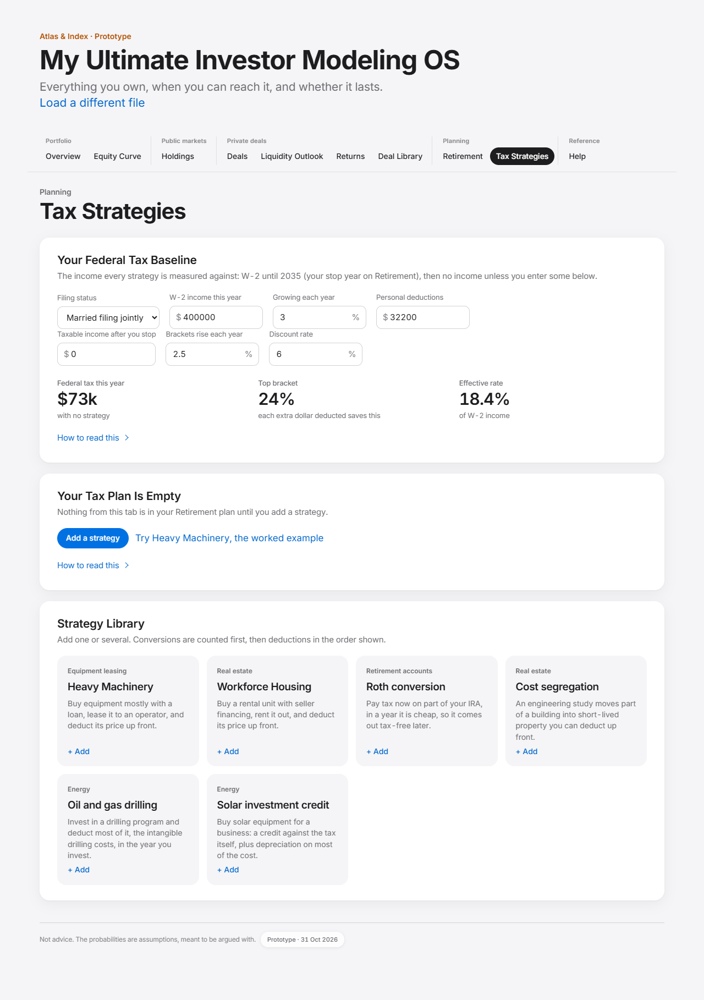

Numbered regions, top to bottom on the desktop screenshot:

| Region | What it is | Requirements |
|---|---|---|
| 1 | Your Federal Tax Baseline: inputs and three figures | TAX-002, TAX-003 |
| 2 | Your Tax Plan Is Empty (or one card per strategy in the plan) | TAX-001, TAX-005, TAX-006 |
| 3 | Strategy Library: six cards | TAX-004 |
| 4 | Plan results: figures, effect on retirement, year-by-year chart | TAX-010 to TAX-015 |
| 5 | If You Invest What It Saves | INV-001 to INV-005 |

### TAX-001. An empty plan

- **Requirement:** The plan starts empty, hands nothing to Retirement, and offers "Add a strategy" and "Try Heavy Machinery".
- **Rule or formula:** S.plan = []; dated(ctx) returns null; no results card.
- **Worked example:** Fresh session: plan items 0, dated() = null, card "Your Tax Plan Is Empty".
- **Acceptance:** Given a fresh load; when Tax Strategies opens; then the empty-state card is shown and Retirement includes no tax strategy.
- **Test cases:** TC-TAX-001-01: taxes2.test.mjs, check 'H1: a fresh load has an empty plan'; TC-TAX-001-02: taxes2.test.mjs, check 'H1: an empty plan hands Retirement nothing'; TC-TAX-001-03: taxes2.test.mjs, check 'H1: empty state with an "Add a strategy" call to action'; TC-TAX-001-04: taxes2.test.mjs, check 'H1: a visible "Try Heavy Machinery" button keeps the example meaningful'; TC-TAX-001-05: taxes2.test.mjs, check 'H1: no results card for an empty plan'
- **Source:** taxes-ui.js:render, dated
- **Status:** Implemented

### TAX-002. Federal tax baseline

- **Requirement:** The baseline card shows this year's federal tax with no strategy, the top bracket, and the effective rate.
- **Rule or formula:** TI = max(0, W-2 - max(standard deduction, personal deductions) x f); tax = f x bracketTax(TI / f); f = 1.025^(year - 2026); top bracket = the bracket TI falls in; effective = tax / W-2.
- **Worked example:** W-2 $400,000, MFJ, 2026: taxable $367,800, tax $73,468, top bracket 24%, effective 18.4%.
- **Acceptance:** Given W-2 $400,000 married filing jointly in 2026; when the baseline renders; then taxable income is $367,800, the tax is $73,468 and the top bracket is 24%.
- **Test cases:** TC-TAX-002-01: taxes.test.mjs, check 'conversion tax follows the brackets: '
- **Source:** taxes-ui.js:render; taxplay.js:tax
- **Status:** Implemented

### TAX-003. Baseline inputs and income map

- **Requirement:** The baseline takes W-2 income, its growth, personal deductions, taxable income after the stop year, bracket indexing and the discount rate, and builds the income every strategy is measured against.
- **Rule or formula:** income[y] = W-2 x (1 + growth)^(y - now) before the Retirement stop year; from it, retireIncome x (1 + bracketIndex)^(y - now). Defaults: 400,000; 3%; 32,200; 0; 2.5%; 6%. With no plan loaded, W-2 runs on.
- **Worked example:** Sample household (stop 2035): 2026 $400,000, 2027 $412,000, 2034 $506,708, 2035 $0.
- **Acceptance:** Given a stop year of 2035; when the income map is built; then 2035 onward is the after-stop income, $0 by default.
- **Test cases:** TC-TAX-003-01: taxes2.test.mjs, check 'income: W-2 grows at its own rate with no stop year'
- **Source:** taxes-ui.js:incomeMap, PROFILE_FIELDS
- **Status:** Implemented

### TAX-004. Strategy library

- **Requirement:** Six strategies are offered as cards, each adding a new plan item with its defaults starting this year.
- **Rule or formula:** Heavy Machinery, Workforce Housing, Roth conversion, Cost segregation, Oil and gas drilling, Solar investment credit; a new item gets startYear = this year and repeat = repeatDefault or 1.
- **Worked example:** Heavy Machinery (Equipment leasing, repeat 1); Workforce Housing (Real estate, repeat 1); Roth conversion (Retirement accounts, repeat 3); Cost segregation (Real estate, repeat 1); Oil and gas drilling (Energy, repeat 1); Solar investment credit (Energy, repeat 1).
- **Acceptance:** Given an empty plan; when the member presses Roth conversion; then a Roth item starting 2026 repeated 3 times is added.
- **Test cases:** TC-TAX-004-01: taxes2.test.mjs, check 'DOM: "Try Heavy Machinery" adds the example'; TC-TAX-004-02: taxes2.test.mjs, check 'DOM: "Add a strategy" moves focus to the library'
- **Source:** taxes-ui.js:STRATEGIES, addStrategy
- **Status:** Implemented

### TAX-005. Field validation

- **Requirement:** Every numeric field is bounded; an entry outside the bounds is set to the nearest bound with a message, and a blank keeps the previous value.
- **Rule or formula:** validate(f, raw, prev): strip $ , % and spaces; blank or non-numeric keeps prev; int fields rounded; clamp to [min, max] (functions of the year where stated); percent stored as a fraction. Money with no max uses $1B.
- **Worked example:** "150" -> {"value":1,"msg":"Down payment must be between 0% and 100%; set to 100%."}; "-5" -> {"value":0,"msg":"Down payment must be between 0% and 100%; set to 0%."}; "" -> {"value":0.1,"msg":"Down payment needs a number between 0% and 100%; kept 10%."}; "25%" -> {"value":0.25,"msg":null}.
- **Acceptance:** Given a down payment typed as 150; when the field changes; then it is stored as 100% with a message under the field.
- **Test cases:** TC-TAX-005-01: taxes2.test.mjs, check 'bounds: a 150% down payment becomes 100% with a message'; TC-TAX-005-02: taxes2.test.mjs, check 'bounds: a negative percent becomes the minimum'; TC-TAX-005-03: taxes2.test.mjs, check 'bounds: a blank keeps the previous value and says so'; TC-TAX-005-04: taxes2.test.mjs, check 'bounds: a "%" sign is ignored; a valid entry has no message'; TC-TAX-005-05: taxes2.test.mjs, check 'bounds: every numeric field declares a min and a max'; TC-TAX-005-06: taxes2.test.mjs, check 'DOM: a 150% down payment is stored as 100%'
- **Source:** taxes-ui.js:validate, bound
- **Status:** Implemented

### TAX-006. Start year and repeats

- **Requirement:** Each plan item has a first year from this year to 40 years out and a repeat count from 1 to 20.
- **Rule or formula:** ITEM_FIELDS startYear [now, now + 40], repeat [1, 20]; a repeat means the same again each year from the start year. Items that start in the past after a year rollover move to this year (freshen).
- **Worked example:** startYear {"value":2026,"msg":"First year must be between 2026 and 2066; set to 2026."}; repeat {"value":20,"msg":"Repeat must be between 1 and 20; set to 20."}.
- **Acceptance:** Given a first year of 2020; when it is entered; then it is set to this year with a message.
- **Test cases:** TC-TAX-006-01: taxes2.test.mjs, check 'bounds: repeat 1 to 20, first year this year to 40 years out'; TC-TAX-006-02: taxes2.test.mjs, check 'year: after midnight the plan and its dated cash start in 2027'; TC-TAX-006-03: taxes2.test.mjs, check 'year: the first-year minimum moves with the clock'
- **Source:** taxes-ui.js:ITEM_FIELDS, freshen
- **Status:** Implemented

### TAX-007. Pricing a change through the brackets

- **Requirement:** Every model written in this file prices a change in income through the brackets on gross income, so an unused deduction absorbs new income first and a deduction cannot use income that does not exist.
- **Rule or formula:** tax change = taxAt(gross + delta) - taxAt(gross), taxAt = f x bracketTax(max(0, gross - deduction x f) / f). deduct(y, a) lowers gross to zero at most; the rest carries forward.
- **Worked example:** $100,000 converted with no other income in 2026: taxable $67,800, tax $7,640 (= tax on $67,800).
- **Acceptance:** Given a $100,000 conversion in a year with no income; when it is priced; then only $67,800 is taxed.
- **Test cases:** TC-TAX-007-01: taxes2.test.mjs, check 'M-07: $100k converted with no other income is taxed on $67,800: '; TC-TAX-007-02: taxes2.test.mjs, check 'M-07: with $20k of income, the other $12,200 of deduction still counts'; TC-TAX-007-03: taxes2.test.mjs, check 'M-07: production income below the standard deduction is not taxed in a zero-income year'
- **Source:** taxes-ui.js:ledger
- **Status:** Implemented

### TAX-008. Bracket indexing

- **Requirement:** The four models written here index brackets, the standard deduction and the capital-gains thresholds each year; Heavy Machinery and Workforce Housing keep 2026 brackets, as the published tools do, and the tab says which is which.
- **Rule or formula:** tax in year y = f x tax(TI / f), f = (1 + bracketIndex)^(y - 2026), default 2.5%.
- **Worked example:** Taxable $300,000 in 2036: unindexed $57,196, indexed $53,050 (f = 1.2801).
- **Acceptance:** Given the same nominal income ten years out; when it is taxed; then the indexed tax is lower.
- **Test cases:** TC-TAX-008-01: taxes2.test.mjs, check 'brackets: a conversion in a later year is priced on indexed brackets and deduction'; TC-TAX-008-02: taxes2.test.mjs, check 'brackets: indexing lowers the tax on the same nominal income'; TC-TAX-008-03: taxes2.test.mjs, check 'brackets: the methodology says which models index and which do not'
- **Source:** taxes-ui.js:indexOf, taxIdx
- **Status:** Implemented

### TAX-009. Stacking order

- **Requirement:** Strategies that add income are counted first, then deductions in the order shown, each measured against the income the ones before it left.
- **Rule or formula:** runPlan: raisesIncome items (Roth) first, then the rest in plan order; each model returns next (gross income after it). For HM and WFH the next income is dealTI + recapture in the exit year + personal deduction, or min(deduction, income + loss) when nothing taxable is left.
- **Worked example:** Heavy Machinery alone saves $73,468 in year one; with a $100,000 conversion counted first it saves $102,608, because it also absorbs the converted income.
- **Acceptance:** Given Heavy Machinery listed before a Roth conversion; when the plan runs; then the conversion is still counted first.
- **Test cases:** TC-TAX-009-01: taxes.test.mjs, check 'stacking order does not depend on list order'; TC-TAX-009-02: taxes.test.mjs, check 'HM saves more when a conversion raises the income it offsets'; TC-TAX-009-03: taxes2.test.mjs, check 'M-08: a later strategy’s recapture is priced above an earlier exit’s recapture'
- **Source:** taxes-ui.js:runPlan
- **Status:** Implemented

### TAX-010. Run shape and sign convention

- **Requirement:** Every strategy returns the same year rows: cash put in, tax saved, extra tax, cash from the deal, sale after the loan, and tax owed back, signed so that adding them gives the year's net.
- **Rule or formula:** down <= 0, saved >= 0, extra <= 0, cash usually >= 0, sale >= 0 (before tax), owed <= 0; net = sum. sum: down (positive), y1Deduction, y1TaxSaved, cumTaxSaved (saved + extra), cash, exitYear, owedBack (positive), netSale, allIn.
- **Worked example:** Heavy Machinery defaults from 2026: 2026 {saved $73,468, extra $0, cash -$10,705, sale $0, down -$50,000, owed $0}; 2027 {saved $17,060, extra $0, cash $4,295, sale $0, down $0, owed $0}; ... exit 2031.
- **Acceptance:** Given any strategy; when it runs; then its rows follow the sign convention and allIn equals the sum of every net.
- **Test cases:** TC-TAX-010-01: taxes.test.mjs, check 'HM through runPlan = TaxPlay: '
- **Source:** taxes-ui.js:rowsOf, fromTaxPlay
- **Status:** Implemented

### TAX-011. Plan figures

- **Requirement:** The plan shows tax in the first year, tax saved over all years, tax owed back at sale, cash put in, net all in, and worth today.
- **Rule or formula:** Sums of each run's sum fields; worth today = sum over years of net / 1.06^(year - now).
- **Worked example:** Heavy Machinery defaults: first year $73,468, all years $32,935, owed back $97,071, put in $50,000, net all in -$40,194, worth today -$25,171.
- **Acceptance:** Given Heavy Machinery at its defaults; when the plan renders; then the six figures equal the rule.
- **Test cases:** TC-TAX-011-01: taxes2.test.mjs, check 'M-10: the convention is stated on the tab'
- **Source:** taxes-ui.js:render, presentValue
- **Status:** Implemented

### TAX-012. Effect on retirement

- **Requirement:** The plan states its effect on the Retirement plan: the chance the money lasts and the change in money left at the end, without and with the strategies.
- **Rule or formula:** PlanIncludes.effect(ctx, 'tax'): 1,200 lifetimes each; the strategies enter as dated cash (TAX-014).
- **Worked example:** Heavy Machinery at its defaults: chance the money lasts 32% -> 31%; money left at the end $0 -> $0 (today's dollars).
- **Acceptance:** Given a plan with one strategy; when the results render; then the effect line shows before and after on the same futures.
- **Test cases:** TC-TAX-012-01: ui.test.mjs, check 'UX-12 the headline label reads Chance the money lasts'
- **Source:** taxes-ui.js:render; includes.js:effect
- **Status:** Implemented

### TAX-013. Year-by-year chart

- **Requirement:** A stacked bar chart shows every year's six parts with a dot for the year's net and a readout per bar.
- **Rule or formula:** yearly(runs): totals by calendar year, years where every part rounds to zero left out; positive parts stack up, negative down.
- **Worked example:** 2026 {saved $0, extra -$29,140, cash $0, sale $0, down $0, owed $0}; 2040 {saved $4,463, extra $0, cash $0, sale $0, down $0, owed $0}; 2041 {saved $4,463, extra $0, cash $0, sale $0, down $0, owed $0}.
- **Acceptance:** Given a plan; when the member hovers a year; then the readout lists each part and the strategies behind it.
- **Test cases:** TC-TAX-013-01: taxes2.test.mjs, check 'render: every strategy together prints no NaN'
- **Source:** taxes-ui.js:yearly, chart
- **Status:** Implemented

### TAX-014. Hand-off to Retirement

- **Requirement:** The stacked plan reaches Retirement as dated cash, the same flows the chart draws.
- **Rule or formula:** dated(ctx) = { year: { net, items: [{ label: "Tax strategies: <part>", amount }] } } from yearly(runPlan(incomeMap, profile)); null for an empty plan.
- **Worked example:** Heavy Machinery: 2026 net $12,763, 2027 net $21,355, 2028 net -$8,113 ...
- **Acceptance:** Given a plan with Heavy Machinery; when Retirement runs with tax strategies included; then those dated amounts are in its plan.
- **Test cases:** TC-TAX-014-01: taxes2.test.mjs, check 'H1: an empty plan hands Retirement nothing'
- **Source:** taxes-ui.js:dated
- **Status:** Implemented

### TAX-015. Worth today

- **Requirement:** Every "worth today" figure on the tab is each year's net discounted to this year at the tab's discount rate, and is not called today's dollars.
- **Rule or formula:** pv = sum net_y / (1 + d)^(max(0, y - now)), d default 6%.
- **Worked example:** One $100,000 conversion: worth today at 6% -$5,140, at 3% $16,074.
- **Acceptance:** Given a discount rate of 6%; when any worth-today figure is shown; then it uses 6% and is labelled worth today.
- **Test cases:** TC-TAX-015-01: taxes2.test.mjs, check 'M-10: no strategy pill calls its present value "today’s dollars"'; TC-TAX-015-02: taxes2.test.mjs, check 'M-09: the Roth card pv is its own flows discounted to today'
- **Source:** taxes-ui.js:pvOf, presentValue
- **Status:** Implemented

### TAX-016. A new book starts a new plan

- **Requirement:** Loading a different book empties the plan and restores the baseline defaults.
- **Rule or formula:** reset() registered with AppState; syncBook as a fallback when AppState is absent.
- **Worked example:** TaxStrategies.reset is registered on the shared reset; after a new book S.plan.length = 0 and S.local returns to the defaults (W-2 $400,000, 3%, $32,200, $0, 2.5%, 6%).
- **Acceptance:** Given a plan built for book A; when book B loads; then the plan is empty.
- **Test cases:** TC-TAX-016-01: taxes2.test.mjs, check 'book: a strategy added for book A'; TC-TAX-016-02: taxes2.test.mjs, check 'book: re-drawing the same book keeps it'; TC-TAX-016-03: taxes2.test.mjs, check 'book: a different book starts empty'
- **Source:** taxes-ui.js:reset, syncBook
- **Status:** Implemented

### HM-001. Heavy Machinery model

- **Requirement:** Heavy Machinery buys equipment mostly with a loan, leases it, deducts its price, and sells it back at the exit, exactly as the published tool computes it.
- **Rule or formula:** loan = price x (1 - down), level monthly payment pmt = P i (1 + i)^n / ((1 + i)^n - 1), i = rate / 12, n = 12 x term. Year one deducts fees = price x fee. Business income = lease - interest - depreciation - fees. Depreciation 100% in year one (bonus) or MACRS 5-year over six years. Horizon 8 years; exit 1 to 8. Defaults: price $500,000, down 10%, rate 6.75%, term 10, fee 3%, lease $66,300, exit 6, buyback 56%.
- **Worked example:** Defaults on the tab's income: monthly payment $5,167.09; year one interest $29,378, depreciation $500,000, fees $15,000, business income -$478,078, tax saved $73,468, operating cash -$10,705.
- **Acceptance:** Given the published tool's inputs; when the port runs; then every year row equals the published tool's to 1e-6.
- **Test cases:** TC-HM-001-01: taxplay_parity.test.mjs, check 'MISMATCH (none): HM, 3 input sets x every income path, every numeric field of every year'; TC-HM-001-02: taxes.test.mjs, check 'HM through runPlan = TaxPlay: '
- **Source:** taxplay.js:runHM, amortYear
- **Status:** Implemented

### HM-002. Loss limits and NOL

- **Requirement:** A Heavy Machinery loss is capped by the excess business loss limit and the rest is carried forward, used against at most 80% of a later year's income.
- **Rule or formula:** allowed = min(loss, EBL) with EBL $512,000 MFJ / $256,000 single; NOL += excess + loss below zero taxable income; a later year uses min(NOL, 0.8 x tentative taxable income).
- **Worked example:** $1,000,000 of equipment on $150,000 of W-2: year one EBL excess $510,456, loss below zero $394,200, NOL $904,656; year two NOL used $103,910.
- **Acceptance:** Given a loss larger than the year's income; when the model runs; then the unused loss carries forward and later years use at most 80% of income.
- **Test cases:** TC-HM-002-01: taxplay_parity.test.mjs, check 'MISMATCH (none): HM year rows'
- **Source:** taxplay.js:runHM
- **Status:** Implemented

### HM-003. Exit, recapture and capital gain

- **Requirement:** At the exit the operator buys the equipment back; gain up to the depreciation taken is ordinary income, gain above the price is a long-term capital gain, and a sale below the adjusted basis is an ordinary loss.
- **Rule or formula:** proceeds = buyback x price; recapture = min(gain, depreciation); LTCG = max(0, proceeds - price) at 0/15/20% stacked on ordinary income; s.1231 loss benefit when gain < 0; netSale = proceeds - recapture tax - LTCG tax + loss benefit - loan payoff.
- **Worked example:** Defaults, exit year 2031: proceeds $280,000, recapture $280,000 taxed $97,071, payoff $216,827, net sale -$33,898; all in over the life -$40,194.
- **Acceptance:** Given a buyback above the adjusted basis; when the exit year runs; then the recapture tax is the bracket tax on the recaptured amount on top of that year's income.
- **Test cases:** TC-HM-003-01: taxplay_parity.test.mjs, check 'MISMATCH (none): HM with status single, exit 3, buyback 120%'; TC-HM-003-02: taxes2.test.mjs, check 'bounds: an HM sale after the 8 modelled years is pulled back to year 8'
- **Source:** taxplay.js:runHM, ltcgTax
- **Status:** Implemented

### HM-004. Repeats and stacked plays

- **Requirement:** A repeated play runs once per year, each measured against the income the earlier plays left.
- **Rule or formula:** runPlan runs reps(item) plays with startYear + k; each sees cur, then updates it.
- **Worked example:** Two Heavy Machinery plays (2026 and 2027): year-one savings Heavy Machinery #1 $73,468, Heavy Machinery #2 $59,288.
- **Acceptance:** Given two identical plays in one year on $450,000 of income; when they run; then together they save less than twice one play.
- **Test cases:** TC-HM-004-01: taxplay_parity.test.mjs, check 'STACK FAIL (none): two identical plays in the same year save less than 2x one play'
- **Source:** taxes-ui.js:runPlan; taxplay.js:stack
- **Status:** Implemented

### WFH-001. Workforce Housing model

- **Requirement:** Workforce Housing buys a rental unit with seller financing, rents it, deducts its price and sells it at the exit, exactly as the published tool computes it.
- **Rule or formula:** note = price x (1 - down) at the note rate, interest only unless rent pays it down (monthly from net operating income). Rent = monthly rent x 12 (x share rented in year one), less the management fee. Business income = NOI - interest - depreciation. Horizon 10; exit 1 to 10. Defaults: price $500,000, down 20%, rate 4%, rent $3,194 a month, fee 21%, year one 50% rented, exit 9, sale $250,000.
- **Worked example:** Defaults: note $400,000; year one rent $19,164, NOI $15,140, interest $16,000, depreciation $500,000, tax saved $73,468; year two NOI $30,279; net sale -$236,790; all in -$152,516.
- **Acceptance:** Given the published tool's inputs; when the port runs; then every year row equals the published tool's to 1e-6.
- **Test cases:** TC-WFH-001-01: taxplay_parity.test.mjs, check 'MISMATCH (none): WFH, 4 input sets x every income path, every numeric field of every year'
- **Source:** taxplay.js:runWFH
- **Status:** Implemented

### WFH-002. Rent pays down the note

- **Requirement:** With paydown on, the rent's net operating income pays the note monthly and no free cash is paid out.
- **Rule or formula:** Monthly: interest = balance x rate / 12; principal = NOI / 12 - interest, floored at 0 and capped at the balance; freeCash = 0.
- **Worked example:** Paydown on: year one principal $0, year two principal $14,544, balance after year two $385,456, free cash $0.
- **Acceptance:** Given paydown on; when the model runs; then the note balance falls each year and free cash is zero.
- **Test cases:** TC-WFH-002-01: taxplay_parity.test.mjs, check 'MISMATCH (none): WFH with paydown'
- **Source:** taxplay.js:runWFH
- **Status:** Implemented

### ROTH-001. Roth conversion

- **Requirement:** A Roth conversion pays ordinary tax now on the converted amount and saves tax later on level withdrawals of the grown balance.
- **Rule or formula:** Per conversion year c: tax T = income(c, amount). Balance at the first withdrawal W = max(c + 1, drawStart) is amount x (1 + g)^(W - c); level withdrawals over D years pmt = bal x g / (1 - (1 + g)^-D) / (1 + g) (bal / D at g = 0); each saves pmt x later rate. Defaults: $100,000 a year for 3 years, growth 6%, later rate 24%, draw from now + 14 for 20 years.
- **Worked example:** One $100,000 conversion on a flat $400,000, no indexing: tax now $29,140 (29.1%); 20 withdrawals from 2040 each saving $4,463; worth today -$5,140 (= $100,000 x 24% - tax now when discount = growth).
- **Acceptance:** Given $100,000 converted on $400,000 of W-2; when it runs; then the tax is $35,750 x 24% + $64,250 x 32% = $29,140.
- **Test cases:** TC-ROTH-001-01: taxes.test.mjs, check 'conversion tax follows the brackets: '; TC-ROTH-001-02: taxes.test.mjs, check 'conversion adds to that year only'; TC-ROTH-001-03: taxes.test.mjs, check 'pv = A x laterRate - tax now'; TC-ROTH-001-04: taxes.test.mjs, check 'year-by-year flows discount back to the same pv'; TC-ROTH-001-05: taxes.test.mjs, check 'withdrawals run over the drawing years'; TC-ROTH-001-06: taxes.test.mjs, check 'a cheap year makes converting pay'
- **Source:** taxes-ui.js:rothRun
- **Status:** Implemented

### ROTH-002. The Roth card's one comparison

- **Requirement:** The Roth card states the rate paid now against the rate avoided later, the result worth today, and what the conversion adds when other strategies are in the plan.
- **Rule or formula:** Win when pv >= 0; a sentence explains when the rates alone point the other way (timing); paired = pv(plan) - pv(plan without this item) when a deduction is present.
- **Worked example:** Alone: pays 29.1% now to avoid 24%, worth -$5,140. With Heavy Machinery in the plan the conversion adds $969 worth today.
- **Acceptance:** Given a conversion paired with Heavy Machinery; when the card renders; then it says how much better the pair is than the conversion alone.
- **Test cases:** TC-ROTH-002-01: taxes2.test.mjs, check 'M-10: the Roth card follows the tab discount rate, not its growth rate'; TC-ROTH-002-02: taxes2.test.mjs, check 'M-22: amount 0 gives zero rates, not NaN'; TC-ROTH-002-03: taxes2.test.mjs, check 'M-22: the Roth card renders without NaN'
- **Source:** taxes-ui.js:rothRead, render
- **Status:** Implemented

### CSG-001. Cost segregation

- **Requirement:** Cost segregation models only the difference from not doing the study: extra depreciation up front, less later, recapture on a sale.
- **Rule or formula:** B = price x (1 - land), R = B x reclass, life 27.5 (residential) or 39. base_t = min(B / life, B - base so far); with the study: building part (B - R) / life (capped) + R x bonus in year one + R x (1 - bonus) x MACRS7[t]; diff_t = with - base (+ fee in year one). Defaults: $1,000,000, land 20%, residential, reclass 25%, bonus 100%, fee $8,000, active, hold 10, sell.
- **Worked example:** Defaults: year-one extra deduction $200,727, saving $47,288; recapture owed at the sale $10,700; net $14,624, worth today $22,116.
- **Acceptance:** Given the defaults; when the study runs; then the year-one extra deduction is $221,818 with the study less $29,091 without, plus the $8,000 fee, which is $200,727.
- **Test cases:** TC-CSG-001-01: taxes.test.mjs, check 'year-1 extra deduction: '; TC-CSG-001-02: taxes.test.mjs, check 'year-1 saving priced through the brackets'; TC-CSG-001-03: taxes.test.mjs, check 'later years deduct less, and a sale brings recapture'; TC-CSG-001-04: taxes.test.mjs, check 'no reclassification, no fee: no difference'
- **Source:** taxes-ui.js:costSegRun
- **Status:** Implemented

### CSG-002. Keep or sell, active or passive

- **Requirement:** Keeping the building (or a 1031 exchange) runs the comparison to the end of its life with no recapture; a passive investor's loss waits for the sale.
- **Rule or formula:** keep: N = ceil(life), extra deduction given back as smaller later deductions; sell: N = hold, recapture of the extra depreciation plus (marginal rate - 25%) on the reclassified straight-line share. passive: losses suspended and released at the sale (never, if kept).
- **Worked example:** Keep: runs 28 years, net $25,324, worth today $28,449. Passive and sell: year-one saving $0, net -$8,000.
- **Acceptance:** Given a passive investor; when the study runs; then nothing is set against W-2 income and the loss is released at the sale.
- **Test cases:** TC-CSG-002-01: taxes.test.mjs, check 'passive: nothing against W-2, loss released at the sale'; TC-CSG-002-02: taxes2.test.mjs, check 'M-05: keep ignores the years held (same result at 5 and 40): '; TC-CSG-002-03: taxes2.test.mjs, check 'M-05: keep runs the 27.5-year life (28 calendar years)'; TC-CSG-002-04: taxes2.test.mjs, check 'M-05: the keep card says the deduction is given back, never "permanent"'
- **Source:** taxes-ui.js:costSegRun, costSegRead
- **Status:** Implemented

### OG-001. Oil and gas drilling

- **Requirement:** A drilling program deducts its intangible drilling costs and bonus-depreciated equipment in the year invested, then taxes declining production cash less 15% depletion.
- **Rule or formula:** Year one deduction = amount x idc + equipment depreciation (amount x tdc x bonus, rest MACRS 7). Production year t (from the next year): cash = amount x yield1 x (1 - decline)^(t - 1), taxable = 0.85 x cash - depreciation. idc + tdc <= 100% (fix). Defaults: $100,000, idc 75%, tdc 20%, bonus 100%, working interest, yield 22%, decline 18%, 12 years.
- **Worked example:** Defaults: year-one deduction $95,000, saving $22,800 (cost after tax $77,200); production cash $110,926 over 12 years; net $13,890, worth today -$6,045.
- **Acceptance:** Given $100,000 at 75% IDC and 20% equipment with full bonus; when it runs; then the year-one deduction is $95,000 in the 24% bracket.
- **Test cases:** TC-OG-001-01: taxes.test.mjs, check 'year-1 deduction 95k, all in the 24% bracket: '; TC-OG-001-02: taxes.test.mjs, check 'production cash follows the decline curve'; TC-OG-001-03: taxes.test.mjs, check 'a dry program loses most of the money even with the deduction'; TC-OG-001-04: taxes2.test.mjs, check 'bounds: drilling costs plus equipment are held to 100%'
- **Source:** taxes-ui.js:oilGasRun
- **Status:** Implemented

### OG-002. Working interest against limited partner

- **Requirement:** A working interest offsets W-2 income; a limited partner's loss is passive, shelters the program's own income first and is released when production ends.
- **Rule or formula:** working: book(-deduction) against income; limited: carry = deduction, used against production income, the rest released in the last production year.
- **Worked example:** Working: year-one saving $22,800, worth today -$6,045. Limited: year-one saving $0, worth today -$12,544.
- **Acceptance:** Given a limited partner; when the program runs; then there is no year-one saving and the same cash is worth less.
- **Test cases:** TC-OG-002-01: taxes.test.mjs, check 'limited partner: no year-1 saving, same cash, worth less'
- **Source:** taxes-ui.js:oilGasRun
- **Status:** Implemented

### SOL-001. Solar investment credit

- **Requirement:** Solar equipment earns a credit against the tax itself for projects in service by the end of 2027, plus depreciation on cost less half the credit, income, and a sale.
- **Rule or formula:** credit = price x rate when the year <= 2027, else 0. basis = price - credit / 2; depreciation = basis x bonus in year one plus MACRS 5 on the rest. The credit only reduces tax that exists; leftovers carry up to 20 years after the sale. Income from year two: price x yield1 x (1 - decline)^(t - 2). Defaults: $100,000, credit 30%, bonus 100%, active, yield 10%, decline 1%, hold 6, sale 30% of cost.
- **Worked example:** Defaults in 2026: credit $30,000, saved in year one $50,400, net $9,623, worth today -$1,762. The same project in 2028: credit $0 (late = true).
- **Acceptance:** Given a $100,000 project in 2026 for an active owner; when it runs; then year one saves the $30,000 credit plus $85,000 of depreciation at 24%.
- **Test cases:** TC-SOL-001-01: taxes.test.mjs, check 'year one: 30k credit + 85k basis at 24%: '; TC-SOL-001-02: taxes.test.mjs, check 'in service after 2027: no credit'; TC-SOL-001-03: taxes.test.mjs, check 'passive: nothing against W-2 in year one'
- **Source:** taxes-ui.js:solarRun
- **Status:** Implemented

### SOL-002. Clawback and the sale

- **Requirement:** Selling within five years claws back the unvested credit, half of which is added back to basis; the sale's gain is recaptured up to the depreciation taken and taxed as a capital gain above that.
- **Rule or formula:** claw = credit x min(1, max(0, 6 - hold) / 5); adjusted basis = basis + claw / 2 - depreciation; recapture = min(gain, depreciation) at ordinary rates; capital gain = gain - recapture at 0/15/20%; a sale below basis is an ordinary loss.
- **Worked example:** hold 1: clawback $30,000; hold 3: clawback $18,000; hold 5: clawback $6,000; hold 6: clawback $0. Sale at 150% of cost after 6 years: capital-gains tax $9,750.
- **Acceptance:** Given a sale after three years; when it runs; then 60% of the credit is clawed back.
- **Test cases:** TC-SOL-002-01: taxes.test.mjs, check 'credit clawback follows the 5-year schedule'; TC-SOL-002-02: taxes2.test.mjs, check 'M-12: $65k above the $85k basis is taxed at 15%: '; TC-SOL-002-03: taxes2.test.mjs, check 'M-12: the default sale (below basis) has no capital gain'; TC-SOL-002-04: taxes2.test.mjs, check 'M-12: selling for nothing deducts the remaining basis as an ordinary loss (and the clawback still applies)'; TC-SOL-002-05: taxes2.test.mjs, check 'M-12: a full clawback adds half the credit back to basis before the gain'
- **Source:** taxes-ui.js:solarRun
- **Status:** Implemented

### INV-001. If You Invest What It Saves

- **Requirement:** A side account takes each year's net and grows at a chosen rate, shown against the same money left as cash.
- **Rule or formula:** inv_y = inv_(y-1) x (1 + g) + net_y; flat_y = flat_(y-1) + net_y.
- **Worked example:** Heavy Machinery defaults at 7%: ends 2031 at -$32,425 invested against -$40,194 left as cash.
- **Acceptance:** Given a plan and a growth rate; when the card renders; then the end values equal the recursion.
- **Test cases:** TC-INV-001-01: taxes.test.mjs, check 'at 0% growth it is the plain total'
- **Source:** taxes-ui.js:compound
- **Status:** Implemented

### INV-002. Default growth rate

- **Requirement:** The growth rate starts at the Retirement plan's expected return and can be moved from 0% to 12%; a moved rate offers a way back.
- **Rule or formula:** g = RunwayUI.expectedReturn(ctx) rounded to 0.1%, else 7%; slider 0 to 12% in 0.1% steps.
- **Worked example:** Sample household expected return 6.997%, so the slider starts at 7.0%.
- **Acceptance:** Given no move of the slider; when the card renders; then it uses the portfolio's expected return and says so.
- **Test cases:** TC-INV-002-01: TO WRITE
- **Source:** taxes-ui.js:growthNow, compoundCard
- **Status:** Partial

### INV-003. Break-even rates

- **Requirement:** The card finds every growth rate at which the side account ends at zero, and never claims a single break-even when there are several.
- **Rule or formula:** Scan the account's end value from -50% to 100% in 0.25% steps, bisect each sign change (60 steps); ranges between roots are ahead or behind.
- **Worked example:** Heavy Machinery defaults: roots [24.67] (%), sign changes 1; at the break-even the side account ends at $0.
- **Acceptance:** Given a plan with one break-even; when the growth is set to it; then the side account ends at zero.
- **Test cases:** TC-INV-003-01: taxes.test.mjs, check 'side account ends at zero at the break-even rate'; TC-INV-003-02: taxes2.test.mjs, check 'M-11: no single break-even claimed; two sign changes counted'; TC-INV-003-03: taxes2.test.mjs, check 'M-11: a one-root plan still reports its single rate'
- **Source:** taxes-ui.js:compound
- **Status:** Implemented

### INV-004. The break-even sentence

- **Requirement:** The sentence says whether the plan is deferral-shaped (wins above a rate) or investment-shaped (wins below one), or names every range where it is ahead.
- **Rule or formula:** compoundText: never-negative -> ahead at any rate; never-positive -> growth cannot rescue it; one range to 100% -> "grows faster than x%"; one range from 0% -> "grow slower than x%"; several -> lists ranges.
- **Worked example:** Heavy Machinery: "This plan saves tax first and pays some back later, so it beats paying the tax as usual if what it frees up grows faster than 24.7% a year. At 7.0% it ends $32k behind in..." Oil and gas: "This plan puts money in first and gets it back later, so it beats leaving that money invested only if your investments would grow slower than 3.9% a year, its own rate of..."
- **Acceptance:** Given an oil and gas program; when the sentence is written; then it calls the plan investment-shaped.
- **Test cases:** TC-INV-004-01: taxes.test.mjs, check 'oil and gas is investment-shaped'; TC-INV-004-02: taxes2.test.mjs, check 'M-11: the sentence says ahead only between 10% and 20%: '; TC-INV-004-03: taxes2.test.mjs, check 'M-11: and says the plan ends behind at 7% (-100k x 1.07^2 + 230k x 1.07 - 132k = -390)'
- **Source:** taxes-ui.js:compoundText
- **Status:** Implemented

### INV-005. Side-account chart

- **Requirement:** A chart draws the invested account against cash, with a readout per year.
- **Rule or formula:** Readout: the year's net, invested value, cash value, and what growth added so far (inv - flat).
- **Worked example:** Heavy Machinery defaults at 7%, 2028: net -$8,113, invested $29,349, cash $26,005, growth added $3,344.
- **Acceptance:** Given the card; when the member hovers a year; then the four figures are shown.
- **Test cases:** TC-INV-005-01: TO WRITE
- **Source:** taxes-ui.js:compoundChart
- **Status:** Partial

---

## 10. Help (HLP)

Reference copy: About This Tool and Terms (added by `ux.js:help`), then the private-deal explainers drawn by `app.js:renderBackground` and `glossary`. The release notes dialog and version pill sit in the page footer on every tab.

**Screens.** Desktop: `docs/screens/about.png`. Phone: `docs/screens/about-mobile.png`.

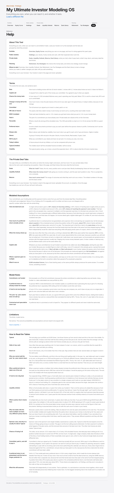

Numbered regions, top to bottom on the desktop screenshot:

| Region | What it is | Requirements |
|---|---|---|
| 1 | About This Tool: the five areas and what each answers | HLP-001 |
| 2 | Terms: sixteen plain definitions | HLP-002 |
| 3 | The Private Deal Tabs, Modeled Assumptions, Model Rules, Limitations | HLP-003, HLP-004, HLP-005 |
| 4 | How to Read the Tables | HLP-006 |
| 5 | Footer: disclaimer and version pill (release notes dialog) | HLP-007, HLP-008 |

### HLP-001. About This Tool

- **Requirement:** Help opens with About This Tool, which names the five areas of the tab bar and what each answers, using the tab labels exactly.
- **Rule or formula:** Tab names read from the rendered tab buttons, so the copy cannot drift from the bar.
- **Worked example:** "About This ToolEverything you own, when you can reach it, and whether it lasts. Load your tracker (or try the example) and the tabs are grouped by what they answer:PortfolioOverview, Equity Curve: everything you own on one page, and how it is doing against this year’s plan.Public marketsHoldings: yo..."
- **Acceptance:** Given any book; when Help opens; then About This Tool is the first card and names Portfolio, Public markets, Private deals and Planning.
- **Test cases:** TC-HLP-001-01: ui.test.mjs, check 'UX-08 Help has About This Tool and Terms'; TC-HLP-001-02: ui.test.mjs, check 'UX-02 About copy is current'
- **Source:** ux.js:help
- **Status:** Implemented

### HLP-002. Terms

- **Requirement:** A Terms card defines the words the app uses in plain English.
- **Rule or formula:** Sixteen entries: Beta, Capital call, Chance the money lasts, Change in money left at the end, Committed, IRR, MOIC, Paid in, Percentile, Preferred return, Sharpe ratio, Sleeve, Still to pay in, Today's dollars, Typical (median), Volatility.
- **Worked example:** 16 terms: Beta, Capital call, Chance the money lasts, Change in money left at the end, Committed, IRR (rate of return), MOIC (multiple), Paid in, Percentile, Preferred return, Sharpe ratio, Sleeve, Still to pay in, Today’s dollars, Typical (median), Volatility.
- **Acceptance:** Given Help; when the Terms card renders; then every term used in a headline label is defined.
- **Test cases:** TC-HLP-002-01: ui.test.mjs, check 'Terms defines '
- **Source:** ux.js:TERMS, help
- **Status:** Implemented

### HLP-003. The private deal tabs

- **Requirement:** Help explains what each private-deal tab answers, by its current label.
- **Rule or formula:** Deals: what do I hold; Liquidity Outlook: when does the money move; Returns: how much comes back. Tab names from tabLabel.
- **Worked example:** Help card headings: About This Tool, Terms, The Private Deal Tabs, Modeled Assumptions, Model Rules, Limitations, How to Read the Tables.
- **Acceptance:** Given renamed tabs; when Help renders; then the explainer uses the renamed labels.
- **Test cases:** TC-HLP-003-01: ui.test.mjs, check 'UX-02 About copy is current'
- **Source:** app.js:renderBackground
- **Status:** Implemented

### HLP-004. Modeled assumptions

- **Requirement:** Help lists every number the tool invents (outcome tables, timing spread, preferred impairment, fund rules), read from the model so it cannot drift.
- **Rule or formula:** Copy built from Engine.CFG (venture, income, reEquity, fundVenture, timing, prefPaid, fundMinDeals).
- **Worked example:** CFG.timing = [[0.2,-3],[0.5,0],[0.25,2],[0.05,4]]; CFG.prefPaid = {"writeOff":0.25,"wellBelow":0.7,"below":0.9,"onPlan":1}; CFG.fundVenture = [[0.1,0.18],[0.15,0.25],[0.25,0.38],[0.25,0.56],[0.15,0.76]].
- **Acceptance:** Given a change to CFG; when Help renders; then the stated assumption changes with it.
- **Test cases:** TC-HLP-004-01: TO WRITE
- **Source:** app.js:renderBackground
- **Status:** Partial

### HLP-005. Model rules

- **Requirement:** Help states the five rules the model enforces: commitment not funded; the preferred return is inside the multiple; a fund is not one big deal; the year-by-year column does not add up; contractual and speculative never sum.
- **Rule or formula:** Static list in renderBackground.
- **Worked example:** 5 rules listed.
- **Acceptance:** Given Help; when it renders; then the five rules are listed.
- **Test cases:** TC-HLP-005-01: TO WRITE
- **Source:** app.js:renderBackground
- **Status:** Partial

### HLP-006. How to read the tables

- **Requirement:** Help explains each statistic used on Liquidity Outlook and Returns (typical, odds of any cash, good run, sponsor case, chance of losing it all, and more).
- **Rule or formula:** glossary(): 14 entries; reference cards stay open, not folded.
- **Worked example:** 14 entries.
- **Acceptance:** Given Help; when it renders; then the entries are open, not folded.
- **Test cases:** TC-HLP-006-01: TO WRITE
- **Source:** app.js:glossary; ux.js:OPEN_CARDS
- **Status:** Partial

### HLP-007. Release notes

- **Requirement:** The version pill opens a release-notes dialog that closes with Close, the backdrop or Escape.
- **Rule or formula:** Pill text = CFG.version + released date (the page shows the prototype date); the dialog has role dialog and aria-modal.
- **Worked example:** Pill: "Prototype · 31 Oct 2026"; dialog hidden on load = true.
- **Acceptance:** Given the page; when the member presses the pill, then Escape; then the dialog opens and closes.
- **Test cases:** TC-HLP-007-01: ui.test.mjs, check 'UX-42 version pill sits in the footer'; TC-HLP-007-02: ui.test.mjs, check 'UX-54 pill and release notes name the same version'
- **Source:** app.js (release notes block); ux.js:versionPill
- **Status:** Implemented

### HLP-008. Disclaimer

- **Requirement:** Every page carries the disclaimer that this is not advice and the probabilities are assumptions.
- **Rule or formula:** Footer text in index.html.
- **Worked example:** "Not advice. The probabilities are assumptions, meant to be argued with. Prototype · 31 Oct"
- **Acceptance:** Given any tab; when it renders; then the footer disclaimer is visible.
- **Test cases:** TC-HLP-008-01: TO WRITE
- **Source:** index.html
- **Status:** Partial

---

## 11. Private-deal model (DM), cross-cutting

The rules of `engine.js`, which every private-deal figure in the app comes from. The pipeline is tracker row -> `applyDealFile` (blanks filled from the shared deal file) -> `buildBook` (one Position per row, inputs corrected and reported) -> `simulate` (6,000 seeded futures). Synthetic rows below are funded in 2026 unless stated; the calendar is 2026-11-01 (16.4% of the year left).

### DM-001. Commitment is the basis

- **Requirement:** Exit proceeds are the commitment times the drawn multiple, never the funded amount times it.
- **Rule or formula:** cash at exit = commitment x m.
- **Worked example:** $100,000 committed, $20,000 funded, sponsor 3.0x: path 4 draws m = 1.65 -> exit cash $165,000 (not $33,000).
- **Acceptance:** Given a position 20% funded; when it exits at 3.0x; then it returns $300,000, not $60,000.
- **Test cases:** TC-DM-001-01: TO WRITE
- **Source:** engine.js:simulate
- **Status:** Partial

### DM-002. Residual exit multiple

- **Requirement:** A deal that pays a preferred return exits on the residual multiple, so the preferred return is not counted twice.
- **Rule or formula:** exitMult = max(0.2, moic - coupon x hold) when coupon > 0, else moic. A missing moic on a coupon payer is 1 + coupon x hold.
- **Worked example:** 15% for 7 years at 2.65x: exitMult = 2.65 - 1.05 = 1.60x. 8% for 5 years, no MOIC: moic 1.40x, exitMult 1.00x (floor 0.20x).
- **Acceptance:** Given a 2.65x deal paying 15% for 7 years; when it is built; then it exits on 1.60x.
- **Test cases:** TC-DM-002-01: TO WRITE
- **Source:** engine.js:buildBook
- **Status:** Partial

### DM-003. Funded, uncalled and commitment tie

- **Requirement:** Funded and uncalled are kept in range, a blank funded is derived from the other two, and every correction is reported.
- **Rule or formula:** funded in 0..commitment; uncalled in 0..commitment - funded; funded blank and uncalled typed -> funded = commitment - uncalled; uncalled blank -> commitment - funded.
- **Worked example:** A funded $0 uncalled $100,000; B funded $30,000 uncalled $70,000; C funded $70,000 uncalled $30,000. Warnings: A: funded to date of -$20,000 is negative, so it was read as $0 | B: uncalled of $90,000 is more than the $70,000 left to call ($100,000 committed less $30,000 funded), so the model calls $70,000
- **Acceptance:** Given uncalled above what is left to call; when the row is built; then uncalled is capped and the warning names the figure the model ran on.
- **Test cases:** TC-DM-003-01: engine.test.mjs, check 'negative funded reads as 0, uncalled is the rest'; TC-DM-003-02: engine.test.mjs, check 'uncalled above the commitment is capped and reported'; TC-DM-003-03: engine.test.mjs, check 'funded above the commitment is capped and reported'; TC-DM-003-04: engine.test.mjs, check 'invariant: 0 <= funded <= commitment, 0 <= uncalled <= commitment - funded'; TC-DM-003-05: engine.test.mjs, check 'warnings reach opts.warnings with name, field and message'
- **Source:** engine.js:buildBook
- **Status:** Implemented

### DM-004. Other input corrections

- **Requirement:** A negative hold, a negative multiple, a likely exit already gone and an implausible year funded are corrected or flagged, and a blank year funded means this year.
- **Rule or formula:** hold <= 0 -> 10 (negative reported); moic < 0 ignored (reported); exitLikely < this year reported and landed this year or later; year funded < 1980 or > this year + 5 reported but used; blank -> this calendar year.
- **Worked example:** hold 10, moic 5 (assumed true), year funded blank -> 2026. Warnings: hold, yearFunded, moic, exitLikely.
- **Acceptance:** Given a hold of -3; when the row is built; then the hold is 10 years and a warning says so.
- **Test cases:** TC-DM-004-01: engine.test.mjs, check 'a negative hold falls back to 10 years, reported'; TC-DM-004-02: engine.test.mjs, check 'a negative multiple is ignored and reported'; TC-DM-004-03: engine.test.mjs, check 'a likely exit already gone is reported'; TC-DM-004-04: engine.test.mjs, check 'and still lands this year'; TC-DM-004-05: engine.test.mjs, check 'an implausible year funded is reported'; TC-DM-004-06: engine.test.mjs, check 'a blank year funded is this calendar year'
- **Source:** engine.js:buildBook
- **Status:** Implemented

### DM-005. A multiple nobody gave

- **Requirement:** A venture row with no multiple and no preferred return runs at 5.0x and is flagged as assumed.
- **Rule or formula:** moic = 5 when neither moic nor coupon is given; moicAssumed true; moicGiven false.
- **Worked example:** moic 5, moicAssumed true, kind venture.
- **Acceptance:** Given no multiple and no preferred return; when the row is built; then the model uses 5.0x and every screen marks it assumed.
- **Test cases:** TC-DM-005-01: TO WRITE
- **Source:** engine.js:buildBook
- **Status:** Partial

### DM-006. Kind and outcome table

- **Requirement:** Each position gets one outcome table: income (pays a preferred return), real-estate equity, a diversified venture fund, or a single venture deal.
- **Rule or formula:** coupon > 0 -> CFG.income (scales); else real estate by asset class -> reEquity(LTV) (scales, loss buckets absolute); else 20+ deals -> fundVenture (scales); else CFG.venture (absolute). Real estate is tested before diversification.
- **Worked example:** income -> [[0.05,0],[0.25,0.6],[0.55,0.75]] scales true; real estate -> [[0.1,0,true],[0.3,0.7,true],[0.45,0.75,false]] scales true; 20-deal fund -> [[0.1,0.18],[0.15,0.25],[0.25,0.38],[0.25,0.56],[0.15,0.76]] scales true; single -> [[0.3,0],[0.3,1],[0.3,1.65]] scales false.
- **Acceptance:** Given a real-estate fund holding 25 properties with no preferred return; when it is built; then it uses the real-estate table, not the venture fund table.
- **Test cases:** TC-DM-006-01: TO WRITE
- **Source:** engine.js:buildBook, isRealEstate
- **Status:** Partial

### DM-007. Real-estate leverage dial

- **Requirement:** Leverage moves only the zero-outcome weight of the real-estate table, taken from or given to the upside bucket.
- **Rule or formula:** zero weight 4% at LTV <= 50%, 10% at 65% (reference), 20% at >= 80%, linear between; upside weight adjusted by the difference; no LTV leaves the table unchanged.
- **Worked example:** LTV 50%: [0.04,0.3,0.51]; 72.5%: [0.15,0.3,0.4]; 80%: [0.2,0.3,0.35]; none: [0.1,0.3,0.45].
- **Acceptance:** Given an LTV typed as 80; when the row is built; then the zero weight is 20%.
- **Test cases:** TC-DM-007-01: engine.test.mjs, check 'a bare 80 LTV moves the real estate table to its high-leverage zero weight'; TC-DM-007-02: engine.test.mjs, check 'terms.ltv is read'; TC-DM-007-03: engine.test.mjs, check 'terms.ltvPct wins over terms.ltv'
- **Source:** engine.js:reEquityTable
- **Status:** Implemented

### DM-008. Fund or single deal, and the sell-down window

- **Requirement:** A fund sells down across a liquidity window in fund-years; a single deal pays once.
- **Rule or formula:** Vehicle text decides first (fund, pool, syndicat, portfolio = fund; single, spv, one, direct, company = single); else a coupon payer is a fund unless deals = 1 was typed, and venture is a fund only with more than one deal. Window: stated from/to, else [max(1, round(0.6 x hold)), hold (+2 for venture)]. Weights ramp 2, 3, 4, ... normalised to 1.
- **Worked example:** Coupon payer, hold 5: isFund true, window [3,5], spread [[-2,0.2222],[-1,0.3333],[0,0.4444]]. Venture fund of 37, hold 10: window [6,12].
- **Acceptance:** Given a coupon-paying fund with a 5-year hold; when it is built; then it pays in fund-years 3 to 5 with weights 2/9, 3/9, 4/9.
- **Test cases:** TC-DM-008-01: TO WRITE
- **Source:** engine.js:buildBook, liqWindow, liqSpread, vehKind
- **Status:** Partial

### DM-009. Exit timing

- **Requirement:** Exits slip later rather than earlier, and nothing lands in a year already gone.
- **Rule or formula:** Offset from the likely year drawn from CFG.timing [[0.20, -3], [0.50, 0], [0.25, +2], [0.05, +4]]. exitPlan: a single deal lands max(likely + offset, this year); a fund's tranches before this year are dropped and the rest renormalised; a window wholly past lands this year.
- **Worked example:** Fund funded 2020, hold 5 (likely 2025): offset 0 -> [[2026,1]]; offset +2 -> [[2026,0.4286],[2027,0.5714]]. CFG.timing = [[0.2,-3],[0.5,0],[0.25,2],[0.05,4]].
- **Acceptance:** Given a window that lies wholly in the past; when the exit is placed; then all of it lands this year.
- **Test cases:** TC-DM-009-01: engine.test.mjs, check 'and still lands this year'
- **Source:** engine.js:exitPlan, pick
- **Status:** Implemented

### DM-010. Capital calls

- **Requirement:** Uncalled capital is called deterministically: a stated next call first, then a known pace or an even three-year spread, never in time already gone.
- **Rule or formula:** Stated date and amount: min(amount, uncalled) in max(year, this year), the rest placed from the next year. Date only: nothing before it. Pace p: p x commitment a year. Else even over 3 years from the year after funding; a spread that would start in the past starts now with only the share of this year left, and the remainder lands after the window.
- **Worked example:** Even spread, $300,000 uncalled from 2025: {"2026":16439,"2027":100000,"2028":100000,"2029":83561}. Pace 20% of $250,000: {"2026":8219,"2027":50000,"2028":50000,"2029":50000,"2030":16781}. Stated $30,000 in Q1 2027 on $114,000 uncalled: {"2027":30000,"2028":28000,"2029":28000,"2030":28000}.
- **Acceptance:** Given a 2025 commitment with $300,000 uncalled on Nov 1, 2026; when calls are placed; then 2026 carries only the 16.4% of a year left and the tail lands in 2029.
- **Test cases:** TC-DM-010-01: TO WRITE
- **Source:** engine.js:callsOf, callYearOf
- **Status:** Partial

### DM-011. Preferred return accrues on called capital

- **Requirement:** The preferred return in year k is the rate on capital called by then, plus any yield on the uncalled balance until it expires.
- **Rule or formula:** prefInYear(k) = calledBy(k) x coupon + (commitment - calledBy(k)) x uncalledYield x share(year); calledBy = funded + calls to that year (capped at commitment); share = clamp(until - year, 0, 1) when an end date is set, else 1.
- **Worked example:** Asilia GC Fund (12%, $150,000 committed, $36,000 funded): 2027 called $66,000 -> $7,920; 2028 called $94,000 -> $11,280; 2029 called $122,000 -> $14,640; 2030 called $150,000 -> $18,000. A 6.5% uncalled yield ending 2027.5 counts 0.5 of 2027 and 0 of 2028.
- **Acceptance:** Given a fund 24% funded; when its first year of preferred return is computed; then it is the rate on the $36,000 in, not on $150,000.
- **Test cases:** TC-DM-011-01: TO WRITE
- **Source:** engine.js:prefInYear, calledBy, uncalledYieldShare
- **Status:** Partial

### DM-012. Preferred return is impaired by the outcome

- **Requirement:** The share of the preferred return that is paid depends on the same outcome draw as the exit.
- **Rule or formula:** r = m / exitMult for a scaling table; r <= 0.001 -> 25%; < 0.65 -> 70%; < 0.95 -> 90%; else 100% (CFG.prefPaid).
- **Worked example:** outcome 0.00x -> 25%; outcome 0.96x -> 70%; outcome 1.20x -> 90%; outcome 1.60x -> 100% (BlueBird Capital, exitMult 1.60x).
- **Acceptance:** Given a written-off income deal; when its preferred return is paid; then a quarter of the schedule arrives.
- **Test cases:** TC-DM-012-01: TO WRITE
- **Source:** engine.js:prefFactor
- **Status:** Partial

### DM-013. Marked-up MOIC is display only

- **Requirement:** A holder's marked-up multiple never reaches the simulation and applies to funded capital only.
- **Rule or formula:** paperNav = funded x markedUpMoic; not read by simulate.
- **Worked example:** paperNav $150,000 (= $75,000 x 2), exitMult still 3.00x.
- **Acceptance:** Given a mark of 2.0x; when the book is simulated; then every cash figure is identical to the unmarked book.
- **Test cases:** TC-DM-013-01: TO WRITE
- **Source:** engine.js:buildBook, paperTrack
- **Status:** Partial

### DM-014. Calendar grid

- **Requirement:** The simulation's years run from this year to the last year anything in the book can land, and never start in the past.
- **Rule or formula:** gridYears = this year .. max(CFG.yearTo 2042, latest exit at the +4 offset including the sell-down, last call, last preferred year).
- **Worked example:** Example book: 2026 to 2042 (17 years).
- **Acceptance:** Given a long fund ending after 2042; when the grid is built; then it extends to the fund's last year.
- **Test cases:** TC-DM-014-01: engine.test.mjs, check 'same calendar with the tiny deal'
- **Source:** engine.js:gridYears
- **Status:** Implemented

### DM-015. One company, one fate

- **Requirement:** Rows of the same deal share one timing and outcome draw per future.
- **Rule or formula:** groupKey = the matched file's slug, else "name:" + lower-case name; pathDraws reuses the first row's draw within a path; each row keeps its own exit multiple and dates.
- **Worked example:** Two rows named Same Co: groupKeys ["name:same co","name:same co"]; path 3 draws [[0,0],[0,0]].
- **Acceptance:** Given two tranches of one company; when any future is drawn; then they never have different outcomes.
- **Test cases:** TC-DM-015-01: engine.test.mjs, check 'tranches of one deal share one fate on every path'
- **Source:** engine.js:pathDraws
- **Status:** Implemented

### DM-016. Tranches with different exit years

- **Requirement:** Rows of one deal with different exit years are flagged, because one company exits once.
- **Rule or formula:** validate groups rows by name; more than one distinct Exit: likely, or one typed and one blank, produces a message.
- **Worked example:** "X: 2 rows of the same deal with different exit years. They stay 2 separate rows with their own commitments and funding dates; nothing is merged. But one company has one fate, so they already share an outcome, and a company only exits once. Put the same exit years on both and they will pay together."
- **Acceptance:** Given two rows of X exiting 2030 and 2031; when the file loads; then the message says they stay separate but share an outcome.
- **Test cases:** TC-DM-016-01: TO WRITE
- **Source:** app.js:validate
- **Status:** Partial

### DM-017. Per-year and cumulative percentiles

- **Requirement:** Per-year percentiles rank each year alone; cumulative percentiles rank whole futures, so only the cumulative ones can be read down a column.
- **Rule or formula:** byYear: median, odds of any cash, p90 per year (with typical and scheduled preferred and calls). cum: running totals per path, then percentiles. totals: p10, p50, p90, mean of lifetime totals; stackedP90 = sum of per-year p90.
- **Worked example:** 2031: typical year $101,950, odds of any cash 100%, good year $302,882, typical preferred $30,600 of $36,000 scheduled.
- **Acceptance:** Given the example book; when it is simulated; then stacking the per-year p90 overstates the lifetime p90.
- **Test cases:** TC-DM-017-01: engine.test.mjs, check 'cumulative table ties to the totals'
- **Source:** engine.js:simulate
- **Status:** Implemented

### DM-018. IRR solver

- **Requirement:** IRR is solved by bisection between -99.99% and 1000% and returns a flag instead of a number when there is no honest single answer.
- **Rule or formula:** Flags: no-contribution (null), total-loss (-1), loan-shaped (null: money back before money in, nothing back after), above-bracket (null), multi-sign (null, more than one sign change), ok. 60 bisection steps.
- **Worked example:** plain -> {"r":0.09999999999999998,"flag":"ok"}; loan-shaped -> {"r":null,"flag":"loan-shaped"}; two sign changes (roots near 10% and 20%) -> {"r":-1,"flag":"total-loss"}.
- **Acceptance:** Given a stream with money back before money in and nothing after; when the IRR is solved; then it is flagged loan-shaped, not -100%.
- **Test cases:** TC-DM-018-01: engine.test.mjs, check 'money back first, money in later is loan-shaped, not a total loss: '; TC-DM-018-02: engine.test.mjs, check 'a plain 10% stream solves'; TC-DM-018-03: engine.test.mjs, check 'nothing back is a total loss'; TC-DM-018-04: engine.test.mjs, check 'money in first and ending with money out is still a total loss'; TC-DM-018-05: engine.test.mjs, check 'no money in has no IRR'
- **Source:** engine.js:irrOf
- **Status:** Implemented

### DM-019. Portfolio IRR on pooled flows

- **Requirement:** The portfolio IRR is solved once per future on the pooled cash flows of every deal, never averaged across deals, and unsolvable futures keep their place at the top of the ranking.
- **Rule or formula:** irrPort[p] = irrOf(all flows of path p, earliest funded year). Quantile qi: nulls rank above every solved value; a quantile landing among them is null. byCash = the IRR of the path at the cash percentile.
- **Worked example:** Example book: pooled typical 13.3% against the plain average of deal medians 5.9%; by cash 16.6%; defined 5885 of 6000.
- **Acceptance:** Given the example book; when IRR is solved; then the portfolio figure differs from the average of the deals.
- **Test cases:** TC-DM-019-01: TO WRITE
- **Source:** engine.js:simulate
- **Status:** Partial

### DM-020. Matching a row to a deal file

- **Requirement:** A tracker row matches a deal file by exact alias at any length, or by prefix when both strings are at least six characters and only one deal is in play; reserved names match nothing.
- **Rule or formula:** Exact alias wins; prefix matches need length >= 6 on both sides; more than one candidate -> null; a match that also fits a reserved name -> null.
- **Worked example:** "BlueBird Capital" -> bluebird-capital; "BlueBird" -> bluebird-capital; "Bluebird Capital LP" -> bluebird-capital; "Ae" -> none; "Asilia" -> none; "Asilia Credit Fund I" -> none.
- **Acceptance:** Given a name that prefixes two deals; when it is matched; then it matches none and the screen lists both candidates.
- **Test cases:** TC-DM-020-01: TO WRITE
- **Source:** engine.js:matchDeal, isReserved
- **Status:** Partial

### DM-021. The tracker always wins

- **Requirement:** A deal file fills only what the tracker left blank, and records every field the holder typed over.
- **Rule or formula:** Fills assetClass, vehicle, coupon, uncalled yield and its end, hold, call pace, LTV (ltvPct, else ltv), moic, deals, liquidity from and to; records overrides for asset class, preferred rate, uncalled yield, hold, MOIC, deals, fund or single, payout window.
- **Worked example:** Typed hold 7 and liquidity to 6 against a file with 12%, 5 years, 1.8x, window 4 to 5: coupon 0.12, hold 7, moic 1.8, liqFrom 4, liqTo 6; overrides ["hold","window"].
- **Acceptance:** Given a typed hold of 7 against a file's 5; when the row is enriched; then the model runs on 7 and the card shows both.
- **Test cases:** TC-DM-021-01: engine.test.mjs, check 'a typed LTV still wins'; TC-DM-021-02: engine.test.mjs, check 'no LTV in the file leaves it blank'
- **Source:** engine.js:applyDealFile
- **Status:** Implemented

### DM-022. Expected figures tie to the simulation

- **Requirement:** The exact expectation on Deals and the simulated mean on Returns describe the same model.
- **Rule or formula:** Both use the same tables and prefFactor; the mean of 6,000 futures converges to the exact expectation.
- **Worked example:** Deals modelled MOIC (exact) "2.20x"; Returns mean 2.20x over 6,000 futures.
- **Acceptance:** Given the example book; when both tabs render; then the two agree to sampling error.
- **Test cases:** TC-DM-022-01: TO WRITE
- **Source:** app.js:expectedOf; engine.js:simulate
- **Status:** Partial

---

## 12. Spreadsheet intake and validation (INT), cross-cutting

How a tracker becomes a book and a set of sheets. `app.js` reads the file in the browser (SheetJS), keeps every sheet, picks the positions sheet, enriches rows from the deal library, validates, and builds the book; `portfolio.js` and `markets.js` read the other tabs by their columns. Nothing is uploaded. The landing screenshot shows the drop zone before any book.

**Screens.** Desktop: `docs/screens/landing.png`. Phone: `docs/screens/landing-mobile.png`.

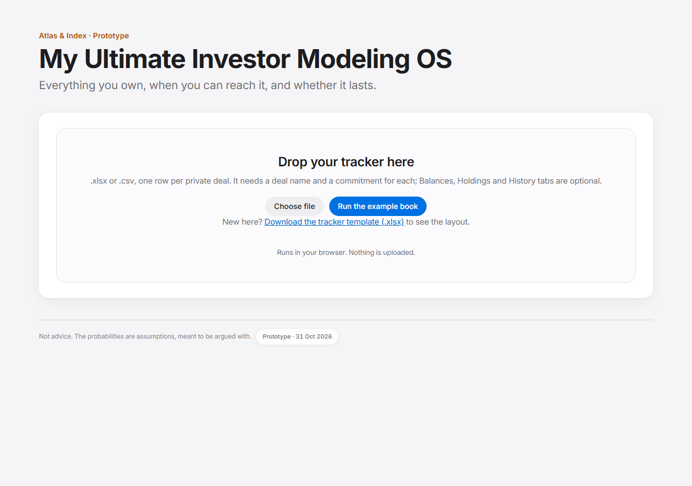

Numbered regions, top to bottom on the desktop screenshot:

| Region | What it is | Requirements |
|---|---|---|
| 1 | Title and promise | INT-001 |
| 2 | Drop zone: Choose file, Run the example book, template link, privacy line | INT-001, INT-016, INT-018, INT-028 |
| 3 | Error and note area under the drop zone | INT-009 to INT-015 |

### INT-001. Read in the browser

- **Requirement:** A tracker (.xlsx, .xls or .csv) is read in the browser by choosing it or dropping it, and nothing is uploaded.
- **Rule or formula:** FileReader + XLSX.read; sheet_to_json(header: 1, raw: true) for every sheet. The only network requests are the deal files and the example book.
- **Worked example:** Uploading a one-row tracker made 0 network requests (the deal list was already cached from the example book); the file itself never left the page.
- **Acceptance:** Given a tracker on disk; when the member drops it on the page; then it is parsed in the page and no request carries its contents.
- **Test cases:** TC-INT-001-01: intake.test.mjs, check 'a clean upload raises no intake error'
- **Source:** app.js:readFile, readWorkbook
- **Status:** Implemented

### INT-002. Every sheet is kept

- **Requirement:** Every sheet of the workbook is read before the positions sheet is chosen, and all of them reach the other tabs.
- **Rule or formula:** readWorkbook: sheets[name] = rows for every sheet; positions = the first sheet in workbook order that parses into rows.
- **Worked example:** Sheets kept: ["Read me","Positions","You"]; positions from "Positions" (1 row).
- **Acceptance:** Given You and Balances tabs after Positions; when the file loads; then Retirement reads them.
- **Test cases:** TC-INT-002-01: intake.test.mjs, check 'positions found on the second sheet: '; TC-INT-002-02: intake.test.mjs, check 'You and Balances after Positions arrive intact'; TC-INT-002-03: intake.test.mjs, check 'a header-only sheet is skipped, and every sheet is still kept'; TC-INT-002-04: intake.test.mjs, check 'no positions anywhere returns an error and still the sheets'
- **Source:** app.js:readWorkbook
- **Status:** Implemented

### INT-003. Finding the header row

- **Requirement:** The header row is the first of the top 12 rows that has both a deal name column and a commitment column.
- **Rule or formula:** rowsFromSheet scans rows 0..11 with mapHeaders.
- **Worked example:** Header found on row 3; map {"name":0,"commitment":1,"funded":2}; rows [["A",1000,500]].
- **Acceptance:** Given a title row above the headers; when the sheet is read; then the third row is the header.
- **Test cases:** TC-INT-003-01: intake.test.mjs, check 'positions found on the second sheet: '
- **Source:** app.js:rowsFromSheet
- **Status:** Implemented

### INT-004. Header matching

- **Requirement:** Headers match loosely and in a fixed order, so narrower names are claimed before broader ones.
- **Rule or formula:** Lower-case, trimmed; a header is claimed by the first unclaimed field whose alias equals it or that it starts with. Order traps: deals before name; account type before account; year funded before funded; marked-up MOIC before MOIC; "type" belongs to asset class, not vehicle.
- **Worked example:** {"name":0,"yearFunded":1,"funded":2,"markedUpMoic":3,"moic":4,"assetClass":5,"accountType":6,"account":7,"deals":8,"coupon":9}.
- **Acceptance:** Given a column headed "Funded year"; when headers are mapped; then it is the year funded, not the funded amount.
- **Test cases:** TC-INT-004-01: TO WRITE
- **Source:** app.js:FIELDS, mapHeaders
- **Status:** Partial

### INT-005. The positions columns

- **Requirement:** The positions sheet accepts the documented columns and aliases; only a deal name and a commitment are required.
- **Rule or formula:** Fields: deals, vehicle, liqFrom, liqTo, name, accountType, account, assetClass, commitment, yearFunded, funded, uncalled, nextCallDate, nextCallAmount, hold, coupon, markedUpMoic, moic, conviction, thesis, exitEarliest, exitLikely, exitLatest (aliases in DESIGN_SPEC 4.1).
- **Worked example:** 23 fields: deals, vehicle, liqFrom, liqTo, name, accountType, account, assetClass, commitment, yearFunded, funded, uncalled, nextCallDate, nextCallAmount, hold, coupon, markedUpMoic, moic, conviction, thesis, exitEarliest, exitLikely, exitLatest.
- **Acceptance:** Given a sheet with only Deal name and Commitment; when it loads; then every position runs with the defaults and the missing terms are reported.
- **Test cases:** TC-INT-005-01: intake.test.mjs, check 'AppIntake test hook is exposed'
- **Source:** app.js:FIELDS
- **Status:** Implemented

### INT-006. Rows that are skipped

- **Requirement:** Blank names, total rows and prose under the table are skipped; a short row without a commitment is reported as looking like a deal.
- **Rule or formula:** Skip blank name or /^total/i; no commitment > 0 -> skipped, and listed only when the name is at most 40 characters and has fewer than four inner words.
- **Worked example:** rows ["Real deal"]; skipped and reported ["Forgot amount"].
- **Acceptance:** Given a note row under the table; when the sheet loads; then it is ignored without a message.
- **Test cases:** TC-INT-006-01: TO WRITE
- **Source:** app.js:rowsFromSheet
- **Status:** Partial

### INT-007. Enrich before validating

- **Requirement:** Rows are filled from the deal library before validation, so a term the library knows is not reported as missing.
- **Rule or formula:** enrich -> validate -> buildBook -> bookWarnings.
- **Worked example:** A bare row "X" with no terms is reported: "X: no sponsor multiple and no preferred return, so there is nothing to exit on". The same name matched to a file with a sponsor MOIC would not be.
- **Acceptance:** Given a row named after a library deal with no terms typed; when it loads; then no "no sponsor multiple" problem is reported.
- **Test cases:** TC-INT-007-01: intake.test.mjs, check 'the example book loads 12 positions'; TC-INT-007-02: intake.test.mjs, check 'and raises no input warnings'
- **Source:** app.js:load, enrich
- **Status:** Implemented

### INT-008. Unmatched names

- **Requirement:** Rows the library cannot place are listed: an ambiguous name with its candidates, an unknown name as normal, a near miss with "close to".
- **Rule or formula:** Candidates recomputed with the 6-character prefix rule; more than one -> ambiguous.
- **Worked example:** "One position could mean more than one deal, so the tool has not guessed. Write the fuller name and the terms will fill in:• Asilia could be Asilia Credit Fund Evergreen or Asilia GC FundOne position is not in the shared deal files, so it is running on what you typed and nothing else. That is fine, and it is normal: most portfolios hold things this tool has n..."
- **Acceptance:** Given a row named "Asilia"; when the file loads; then the note says it could mean two deals and names both.
- **Test cases:** TC-INT-008-01: TO WRITE
- **Source:** app.js:enrich, matchNote
- **Status:** Partial

### INT-009. Deal list failure

- **Requirement:** When the deal list cannot load, the page says so plainly, everything runs on what was typed, and the next load retries.
- **Rule or formula:** A failed index is never cached; matchNote replaces the unmatched note.
- **Worked example:** With deals/index.json failing, after Run the example book: "Could not load the shared deal list, so no terms were filled in from it. Every position is running on what you typed. Check your connection and load the file again to retry.Loaded 12 positions, with 12 things worth fixin"
- **Acceptance:** Given the index request fails; when a file loads; then the message shows and the next load fetches the index again.
- **Test cases:** TC-INT-009-01: intake.test.mjs, check 'an index failure is said plainly'; TC-INT-009-02: intake.test.mjs, check 'and is not called normal'; TC-INT-009-03: intake.test.mjs, check 'the next load retries the index'; TC-INT-009-04: intake.test.mjs, check 'and the note goes once it loads'
- **Source:** app.js:loadDealIndex, matchNote
- **Status:** Implemented

### INT-010. Validation messages

- **Requirement:** Missing terms, a missing year funded, and funded plus uncalled short of the commitment are reported by name.
- **Rule or formula:** No MOIC and no coupon; no year funded (treated as this year); all three capital figures typed, in range, and funded + uncalled < commitment - 1.
- **Worked example:** "A: funded $20,000 plus uncalled $30,000 does not equal the $100,000 committed. The model calls the uncalled figure and exits on the commitment, so one of the three is out of date." "B: no year funded, so it is treated as funded in 2026, which sets when its preferred return and calls start"
- **Acceptance:** Given funded $20,000 and uncalled $30,000 on $100,000; when the file loads; then the message says one of the three figures is out of date.
- **Test cases:** TC-INT-010-01: intake.test.mjs, check 'funded plus uncalled short of the commitment is reported'; TC-INT-010-02: intake.test.mjs, check 'the oversized case is not reported twice (buildBook reports it)'; TC-INT-010-03: intake.test.mjs, check 'a blank year funded names this calendar year'
- **Source:** app.js:validate
- **Status:** Implemented

### INT-011. Corrections shown in one panel

- **Requirement:** Validation problems and the engine's corrections appear together in one "worth fixing" panel after a load.
- **Rule or formula:** problems + Engine.bookWarnings(book); the panel says "Loaded N positions, with M ..." and lists them.
- **Worked example:** "Loaded 1 positions, with 2 things worth fixing. These rows are running on whatever was there, plus the defaults each line below names.Bare eight: funded to date of -$5,000 is negative, so it was read as $0Bare eight: a preferred return of 8 was read as 8% (0.08). Type it with a % sign, or as a decimal, and this note goes away"
- **Acceptance:** Given a bare 8 coupon and a negative funded figure; when the file loads; then both corrections are listed with the figures the model ran on.
- **Test cases:** TC-INT-011-01: intake.test.mjs, check 'a bare 8 coupon is reported on screen'; TC-INT-011-02: intake.test.mjs, check 'negative funded is reported on screen'; TC-INT-011-03: intake.test.mjs, check 'uncalled above the commitment is reported on screen'; TC-INT-011-04: intake.test.mjs, check 'shown in the existing "worth fixing" panel'
- **Source:** app.js:load; engine.js:bookWarnings
- **Status:** Implemented

### INT-012. A failed load changes nothing

- **Requirement:** A file with no usable positions, or one that cannot be read, leaves the previous book and sheets exactly as they were.
- **Rule or formula:** BOOK and SHEETS are replaced together only on success; the message links the template.
- **Worked example:** Uploading a workbook with no positions: book unchanged = true; message "Could not find your positions. Your file needs a row of column headers with a deal name and a commitment, and at least one row with a commitment above zero. Dow".
- **Acceptance:** Given a loaded book; when the member drops a file with no positions; then the tabs still show the previous book.
- **Test cases:** TC-INT-012-01: intake.test.mjs, check 'a file with no positions says so'; TC-INT-012-02: intake.test.mjs, check 'and links the downloadable template'; TC-INT-012-03: intake.test.mjs, check 'and no longer mentions a repository'; TC-INT-012-04: intake.test.mjs, check 'and the book and sheets are left as they were'
- **Source:** app.js:load, readFile
- **Status:** Implemented

### INT-013. Older tracker note

- **Requirement:** A tracker with none of the newer optional columns gets a note that a newer template exists and nothing is wasted.
- **Rule or formula:** None of deals, liqFrom, liqTo, thesis, vehicle found -> note naming the template version CFG.trackerVersion. The example book derives the map from its keys, so it never shows the note.
- **Worked example:** Old four-column tracker: note shown = true; the example book: note shown = false.
- **Acceptance:** Given a tracker without the newer columns; when it loads; then the older-tracker note names version v1.8.
- **Test cases:** TC-INT-013-01: TO WRITE
- **Source:** app.js:trackerAge, ageNote
- **Status:** Partial

### INT-014. Only the latest load wins

- **Requirement:** A newer load stops an older one still in flight, and choosing the same file again works.
- **Rule or formula:** LOADSEQ guards the async enrich; the file input value is cleared after each pick.
- **Worked example:** Two files chosen in quick succession: only the second becomes the book; picking the same file again after editing it fires a new load.
- **Acceptance:** Given two quick loads; when the first finishes last; then its result is discarded.
- **Test cases:** TC-INT-014-01: TO WRITE
- **Source:** app.js:load, #file onchange
- **Status:** Partial

### INT-015. The example book

- **Requirement:** Run the example book loads 12 fictional-household positions with no sheets, shows a busy state, and raises no input warnings.
- **Rule or formula:** Fetch example-book.json?v=<version>; sheets {}; the button is disabled while loading.
- **Worked example:** Example book: 12 positions, committed $715,000, sheets [].
- **Acceptance:** Given the landing page; when the member presses Run the example book; then the button shows it is working and Overview opens.
- **Test cases:** TC-INT-015-01: intake.test.mjs, check 'the example book loads 12 positions'; TC-INT-015-02: intake.test.mjs, check 'the demo hands plugins no sheets'; TC-INT-015-03: ui.test.mjs, check 'UX-03 Run the example book shows a loading state'; TC-INT-015-04: ui.test.mjs, check 'UX-03 loading state cleared after load'
- **Source:** app.js (#demo); ux.js:demoBusy, demoDone
- **Status:** Implemented

### INT-016. Other tabs are recognised by their columns

- **Requirement:** You, Balances, Property, Cashflows, Events, Holdings and History tabs are found by their columns, never their names, and a sheet claimed by one is not read as another.
- **Rule or formula:** You: label and value pairs, at least two matches. Balances: value and account, no symbol column. Property: value and sell year. Cashflows: amount and starts. Events: amount, year and label, skipping claimed sheets. Holdings: symbol and quantity or value. History: date and value, rejecting rows that also name label, sleeve, symbol, yield, expected return, holding or cost basis; a sheet named History first.
- **Worked example:** You from A, Balances from B, Cashflows from C, Events from D; history found in the Balances sheet = false.
- **Acceptance:** Given a tab renamed "Balances (2027)"; when the file loads; then it is still read as Balances.
- **Test cases:** TC-INT-016-01: plan.test.mjs, check 'a Balances tab is not read as balance history'; TC-INT-016-02: plan.test.mjs, check 'historyFromSheets refuses a Balances layout'; TC-INT-016-03: plan.test.mjs, check 'portfolio.js does not read a Holdings tab as Balances'
- **Source:** portfolio.js:findSheet, build; markets.js:findTable
- **Status:** Implemented

### INT-017. Which household every tab shows

- **Requirement:** One rule decides the household for every tab: a Balances tab, else a Holdings tab (an empty one means none), else the sample household; Balances wins over Holdings and says so.
- **Rule or formula:** Markets.load: source balances | holdings | sample, with a note when both exist.
- **Worked example:** Both tabs: source "balances"; note "Your tracker has both a Bal tab and a Hold tab. Every tab uses Bal, which the Retirement plan reads; the Hold rows were not used.".
- **Acceptance:** Given both Balances and Holdings tabs; when the file loads; then every tab uses Balances and Overview says the Holdings rows were not used.
- **Test cases:** TC-INT-017-01: plan.test.mjs, check 'a Balances tab is the household'; TC-INT-017-02: plan.test.mjs, check 'Balances wins over Holdings, and says so'; TC-INT-017-03: plan.test.mjs, check 'a Holdings tab without Balances'; TC-INT-017-04: plan.test.mjs, check 'no tabs: the sample household'; TC-INT-017-05: ui.test.mjs, check 'QA H3 Overview reads the Balances tab'; TC-INT-017-06: ui.test.mjs, check 'Holdings lists the Balances row'; TC-INT-017-07: ui.test.mjs, check 'Retirement plans from the same Balances tab'
- **Source:** markets.js:load
- **Status:** Implemented

### INT-018. Balances rows

- **Requirement:** A Balances row needs a positive value and an account; a blank percent cell means "use the model's default", never zero.
- **Rule or formula:** yield, return and volatility are fractions or null when blank; sleeves are value-weighted per field over only the rows that state it; the tax mix comes from the account name and type.
- **Worked example:** Growth sleeve: balance $1,000,000, mu 7.0% (from the 401k row only), yield 2.0% (from the brokerage row only), tax mix {"preTax":0.6,"roth":0,"taxable":0.4}.
- **Acceptance:** Given one row stating a return and another stating only a yield; when the sleeve is built; then each figure is weighted over the rows that state it.
- **Test cases:** TC-INT-018-01: plan.test.mjs, check 'Balances tab percents'; TC-INT-018-02: plan.test.mjs, check 'Balances rows keep their tax bucket and sleeve'
- **Source:** portfolio.js:parseBalances, build
- **Status:** Implemented

### INT-019. Sleeve names

- **Requirement:** A Balances sleeve name maps to one of four kinds, and an unknown name is treated as growth and flagged.
- **Rule or formula:** growth, equities, equity, venture, convex, tech -> growth; income, credit, debt, real estate -> income; bonds, ballast, treasuries, bond -> bonds; cash, money market -> cash; prefix matches allowed.
- **Worked example:** Growth -> {"kind":"growth","known":true}; Ballast -> {"kind":"bonds","known":true}; Credit fund -> {"kind":"income","known":true}; Crypto -> {"kind":"growth","known":false}.
- **Acceptance:** Given a sleeve named "Crypto"; when it is mapped; then it is growth with known false.
- **Test cases:** TC-INT-019-01: TO WRITE
- **Source:** portfolio.js:kindOf, SLEEVE_KIND
- **Status:** Partial

### INT-020. Tax treatment of a Balances account

- **Requirement:** Each Balances account is pre-tax, Roth or taxable from its name and type, with Roth tested first.
- **Rule or formula:** roth, hsa, 529, tax-free -> Roth; 401, 403, 457, tsp, sep, simple, trad, pre-tax, deferred, ira, sdira, rollover -> pre-tax; else taxable.
- **Worked example:** Roth IRA -> roth; Work 401k -> preTax; Joint -> taxable; Custodian SDIRA -> preTax; Account / HSA -> roth.
- **Acceptance:** Given an account named Roth IRA; when it is classified; then it is Roth.
- **Test cases:** TC-INT-020-01: plan.test.mjs, check 'Balances rows keep their tax bucket and sleeve'
- **Source:** portfolio.js:taxTreatment
- **Status:** Implemented

### INT-021. Dated cash from Property, Cashflows and Events

- **Requirement:** Property sales, recurring cashflows and one-off events become dated cash for the Retirement plan, and cashflows marked to inflate grow.
- **Rule or formula:** Sale net = value x (1 - cost to sell, default 6%) - mortgage, in the sell year. Cashflow: every year from starts to ends (blank = the plan horizon, birth year + plan to age; no horizon = one year; at most 120 years); inflating amounts x level(y), level = product of (1 + inflPre) to the stop year then (1 + inflPost). Events: the amount in its year.
- **Worked example:** House sale 2045 $740,000; pension 2042 $41,215, 2043 $42,451, last year 2067; roof 2043 -$45,000.
- **Acceptance:** Given a pension marked to inflate starting 2042; when dated cash is built; then it grows 3.5% a year to the stop year and 3% after, and runs to the plan horizon.
- **Test cases:** TC-INT-021-01: plan.test.mjs, check 'pension grows at the pre-stop rate to 2036: '; TC-INT-021-02: plan.test.mjs, check 'and at the post-stop rate after 2038: '; TC-INT-021-03: plan.test.mjs, check 'a flow marked no does not inflate'
- **Source:** portfolio.js:datedFlows
- **Status:** Implemented

### INT-022. Property rent, payment and value

- **Requirement:** A property's net rent and mortgage payment feed the plan as yearly cash, and its equity counts toward net worth.
- **Rule or formula:** Parsed today (rent, payment, rate, mortgage) but only the sale reaches the plan; the equity is added to an account's figures in build() but no tab shows it.
- **Worked example:** A rental with $2,200 a month net rent and a $1,600 payment: dated years ["2055"] (only the 2055 sale, $314,000).
- **Acceptance:** Given a rental with net rent; when the plan runs; then the rent should arrive each year until the sale (not built).
- **Test cases:** TC-INT-022-01: TO WRITE
- **Source:** portfolio.js:parseProperty, datedFlows
- **Status:** Gap

### INT-023. Holdings rows

- **Requirement:** A Holdings row needs a symbol and a value (market value, or quantity times price); the account defaults to Brokerage; a negative value is left out with a note.
- **Rule or formula:** value = market value if given, else qty x price; account blank -> Brokerage; percent cells by pctIn.
- **Worked example:** VOO $6,000 in Brokerage (taxable); BND $370 in Roth IRA (roth).
- **Acceptance:** Given a row with quantity 10 and price 600; when it loads; then its value is $6,000 in Brokerage.
- **Test cases:** TC-INT-023-01: markets.test.mjs, check 'a negative holding is left out with a note'; TC-INT-023-02: plan.test.mjs, check 'QA H9 negative rows are left out with a note'
- **Source:** markets.js:holdingsFromSheets
- **Status:** Implemented

### INT-024. Template download

- **Requirement:** The landing page and every intake error link the tracker template.
- **Rule or formula:** tracker-template.xlsx served next to the page; tabs: Read me, Positions, What you get back, You, Balances, Property, Cashflows, Events.
- **Worked example:** Landing link: "Download the tracker template (.xlsx)" -> tracker-template.xlsx.
- **Acceptance:** Given a first visit; when the landing page shows; then the template can be downloaded.
- **Test cases:** TC-INT-024-01: ui.test.mjs, check 'UX-01 landing page links the tracker template'
- **Source:** index.html; app.js:TEMPLATE_LINK
- **Status:** Implemented

### INT-025. Template carries Holdings and History

- **Requirement:** The template includes Holdings and History tabs with instructions, as the app reads both.
- **Rule or formula:** Today the template has no Holdings or History tab.
- **Worked example:** tracker-template.xlsx sheets: Read me, Positions, What you get back, You, Balances, Property, Cashflows, Events.
- **Acceptance:** Given a member who downloads the template; when they look for where to enter stock positions; then a Holdings tab is there (not built).
- **Test cases:** TC-INT-025-01: TO WRITE
- **Source:** tracker-template.xlsx
- **Status:** Gap

### INT-026. Template You tab: required and optional figures

- **Requirement:** The template’s You tab marks the five figures Retirement requires (orange) apart from the optional ones (yellow), and carries three optional Tax Strategies figures (Filing status, Household income, Taxable income after you stop) that seed that tab’s baseline once per book. The Balances tab says it is required and how to show no public money.
- **Rule or formula:** Labels in column A are matched by prefix (portfolio.js YOU_KEYS); values are read from column B only. Tax-only fields never enter the Retirement config.
- **Worked example:** You tab rows: REQUIRED Birth year, Planned stop work year, Annual spend target, Estimated annual benefit, Benefit start age; OPTIONAL Plan to age, Floor spend, Inflation until stop, Inflation after stop; OPTIONAL (tax) Filing status, Household income, Taxable income after you stop.
- **Acceptance:** Given the downloaded template, unedited; when it is uploaded; then all twelve You figures are read and Retirement runs.
- **Test cases:** TC-INT-026-01: ui.test.mjs, check 'Tax Strategies baseline is seeded from the You tab'; TC-INT-026-02: ui.test.mjs, check 'the tax-only You fields stay out of the plan config'
- **Source:** tracker-template.xlsx; portfolio.js:YOU_KEYS; taxes-ui.js:seedFromSheet
- **Status:** Implemented

---

## 13. Plan includes (INC), cross-cutting

One place, `includes.js:PlanIncludes`, decides what the Retirement plan includes, so Retirement, Tax Strategies and the Deal Library cannot disagree. Examples use the example book and the sample household, 1,200 lifetimes.

### INC-001. Three items and their defaults

- **Requirement:** The plan can include capital calls still owed (on by default), the tax strategies (when any exist) and one considered deal (when one was added).
- **Rule or formula:** S = { tax: true, calls: true, deal: true }; available() = { tax: plan non-empty, calls: true, deal: a deal was added }.
- **Worked example:** available() = {"tax":false,"calls":true,"deal":false}; S = {"tax":true,"calls":true,"deal":true}; included now: ["capital calls still owed"].
- **Acceptance:** Given a fresh session; when Retirement renders; then only capital calls still owed is included.
- **Test cases:** TC-INC-001-01: plan.test.mjs, check 'PlanIncludes is back to defaults and remembers the new book'
- **Source:** includes.js:DEFAULTS, available
- **Status:** Implemented

### INC-002. Capital calls as dated money

- **Requirement:** Capital calls still owed enter the plan as money going out in the years the engine schedules them.
- **Rule or formula:** callsDated(book) = { year: { net: -callSchedule[year] } } over gridYears(book).
- **Worked example:** 2026 -$18,750, 2027 -$80,000, 2028 -$78,000, 2029 -$78,000, 2030 -$34,250.
- **Acceptance:** Given the example book; when the plan includes capital calls; then those amounts are bills in those years.
- **Test cases:** TC-INC-002-01: TO WRITE
- **Source:** includes.js:callsDated
- **Status:** Partial

### INC-003. Assembling the run

- **Requirement:** The run's dated money is the tracker's own dated cash plus each included item; a considered deal also joins the deal book for the proceeds.
- **Rule or formula:** dated = port.dated + TaxStrategies.dated (if tax) + callsDated(book) (if calls) + the deal's paid-in at close in its year and its calls (if deal); book = ctx.book + deal.book.
- **Worked example:** Example book: 5 dated years; first 2026 net -$18,750; deal paths 400.
- **Acceptance:** Given a considered $50,000 deal paid in 2026; when the run is assembled; then 2026 carries -$50,000 labelled paid in at close.
- **Test cases:** TC-INC-003-01: TO WRITE
- **Source:** includes.js:config
- **Status:** Partial

### INC-004. Same futures with and without

- **Requirement:** effect() and preview() run the plan with and without one item on the same seeded futures, so the difference is the item alone.
- **Rule or formula:** Two runs of 1,200 lifetimes, seed unchanged; each deal draws from its own stream (RND-002), so adding a deal does not reshuffle the others.
- **Worked example:** Capital calls still owed: chance 40.7% without -> 32.3% with.
- **Acceptance:** Given a $1 deal added; when preview runs; then the existing deals' futures are unchanged.
- **Test cases:** TC-INC-004-01: engine.test.mjs, check 'per-path cash: (book + tiny) - book = tiny alone, worst gap '; TC-INC-004-02: runway.test.mjs, check 'UX-17: the headline matches PlanIncludes.run, so the other tabs agree'
- **Source:** includes.js:effect, preview, run
- **Status:** Implemented

### INC-005. Money left at the end

- **Requirement:** The money left at the end is the typical lifetime's ending wealth in today's dollars, with one deflator everywhere.
- **Rule or formula:** ending = RunwayUI.real(terminal.p50, last curve year, C) using the run's median price index.
- **Worked example:** Example book without calls: terminal p50 $0 nominal -> $0 today (the sample plan typically runs out, see D6). The same plan at a $140,000 target: terminal p50 $2,430,637 in 2064 / price index 3.2118 = $756,794 today.
- **Acceptance:** Given any run; when the ending is reported; then it equals the Retirement headline's Left at the end.
- **Test cases:** TC-INC-005-01: runway.test.mjs, check 'UX-17: the headline matches PlanIncludes.run, so the other tabs agree'
- **Source:** includes.js:ending
- **Status:** Implemented

---

## 14. State and reset (STA), cross-cutting

Nothing is stored: every module keeps its own session state in memory, and a new book resets all of it through one hook, `window.AppState` in `includes.js`.

### STA-001. Nothing is stored

- **Requirement:** The app stores nothing: no server, no browser storage; a reload starts clean.
- **Rule or formula:** No localStorage, sessionStorage, IndexedDB or cookies in any file.
- **Worked example:** 14 source files scanned; files using browser storage: [].
- **Acceptance:** Given a member who reloads the page; when it opens; then no previous figures, what-ifs or balances remain.
- **Test cases:** TC-STA-001-01: TO WRITE
- **Source:** all files
- **Status:** Partial

### STA-002. One reset hook

- **Requirement:** A new book resets every module's session state once, before anything is drawn.
- **Rule or formula:** AppState.noteBook(ctx): a different book object from the last one -> reset("new book"); the first book resets nothing. Hooks: AppState.onReset(fn) or window.APP_RESET_HOOKS; one failing hook does not stop the others.
- **Worked example:** A new book object noted twice: hook ran 1 time(s).
- **Acceptance:** Given book 2 loaded after book 1; when any tab renders; then each hook has run exactly once.
- **Test cases:** TC-STA-002-01: plan.test.mjs, check 'the first book seen resets nothing'; TC-STA-002-02: plan.test.mjs, check 'the same book again resets nothing'; TC-STA-002-03: plan.test.mjs, check 'AppState.reset() can be called directly'; TC-STA-002-04: plan.test.mjs, check 'onReset returns an unregister function'; TC-STA-002-05: plan.test.mjs, check 'one failing hook does not stop the others'; TC-STA-002-06: ui.test.mjs, check 'AppState.onReset hooks run once per new book: '
- **Source:** includes.js:AppState
- **Status:** Implemented

### STA-003. What each module owns

- **Requirement:** Each module owns and clears only its own state.
- **Rule or formula:** PlanIncludes: switches and considered deal. ConsiderUI.S: tester inputs and result (keeps a loaded deal list). MarketsUI.S: filters, sort, scope, horizon, plan year, monthly addition, recorded balances, risk view, Start Here. TaxStrategies.S: plan and baseline. RunwayUI LIVE: slider moves. app.js: MODE, DIST, TAB, OPEN, DEALSORT (reset on load).
- **Worked example:** MarketsUI.S keys: acct, sort, dir, scope, horizon, year, flow, added, risk, startHidden, flash. ConsiderUI.S keys: slug, commitment, paid, year, account, result, busy, seq, errors, index, indexError.
- **Acceptance:** Given book 1 with a considered deal, recorded balances and a sort; when book 2 loads; then all three are cleared and the tester runs against book 2.
- **Test cases:** TC-STA-003-01: ui.test.mjs, check 'QA H2 the remembered book is the new one before any plugin tab opens'; TC-STA-003-02: ui.test.mjs, check 'QA M1 the considered deal and tester are cleared'; TC-STA-003-03: ui.test.mjs, check 'QA M1 recorded balances and sort are cleared'; TC-STA-003-04: ui.test.mjs, check 'the tester runs against book 2'
- **Source:** includes.js; consider-ui.js; markets-ui.js; taxes-ui.js; runway-ui.js; app.js
- **Status:** Implemented

### STA-004. The book event

- **Requirement:** Every successful load tells the plan layer about the new book and dispatches a privatedeals:book event with the context.
- **Rule or formula:** app.js load: PlanIncludes.remember(ctx) then dispatchEvent(new CustomEvent("privatedeals:book", { detail: ctx })).
- **Worked example:** PlanIncludes.ctx.book is the rendered book: true.
- **Acceptance:** Given an upload; when it succeeds; then PlanIncludes.ctx holds the new book before any plugin tab opens.
- **Test cases:** TC-STA-004-01: intake.test.mjs, check 'PlanIncludes.remember is told about the new book on load (QA H2): '; TC-STA-004-02: intake.test.mjs, check 'ctx.book is the uploaded book'; TC-STA-004-03: intake.test.mjs, check 'privatedeals:book event carries the sheets'
- **Source:** app.js:load; includes.js:remember
- **Status:** Implemented

---

## 15. Number parsing rules (NUM), cross-cutting

How a cell becomes a number. Two percent rules exist today and differ on a bare 1: the deal engine's `pctField` and the public and plan readers' `pctIn` / `pctOf` (see the gap list).

### NUM-001. Money and counts

- **Requirement:** A money or count cell strips $, commas, percent signs and spaces; a percent sign divides by 100 in the deal engine.
- **Rule or formula:** Engine.num: blank -> 0; number as is; text parsed after stripping; "%" -> / 100. Markets num: null for blank. Portfolio num: 0 for blank.
- **Worked example:** "$100,000" -> 100000; "8%" -> 0.08; " 1,234.5 " -> 1234.5; "" -> 0; "abc" -> 0.
- **Acceptance:** Given a CSV cell "$100,000"; when it is read; then it is 100000.
- **Test cases:** TC-NUM-001-01: engine.test.mjs, check '"8%" is 8%, no warning'
- **Source:** engine.js:num
- **Status:** Implemented

### NUM-002. Deal percent fields

- **Requirement:** A deal percent field (preferred return, LTV, call pace, uncalled yield) reads text with % as percent, a bare number above 1 as percent with a warning, and a bare number from 0 to 1 as a decimal.
- **Rule or formula:** pctField: blank -> 0; "%" -> / 100; bare > 1 -> / 100 and warn; 0..1 as is; negative -> 0 and warn.
- **Worked example:** 8 -> 0.08; "8" -> 0.08; "8%" -> 0.08; 0.08 -> 0.08; "0.5%" -> 0.005; 1 -> 1; "150%" -> 1.5; 12.5 -> 0.125; -0.05 -> 0.
- **Acceptance:** Given a bare 8 in Coupon %; when the row is built; then the rate is 8% and a warning says how to avoid the note.
- **Test cases:** TC-NUM-002-01: engine.test.mjs, check 'a bare 8 in Coupon % is 8%: '; TC-NUM-002-02: engine.test.mjs, check 'the text "8" is 8%, with a warning'; TC-NUM-002-03: engine.test.mjs, check '"8%" is 8%, no warning'; TC-NUM-002-04: engine.test.mjs, check '0.08 is 8%, no warning'; TC-NUM-002-05: engine.test.mjs, check '"0.5%" is half a percent'; TC-NUM-002-06: engine.test.mjs, check 'a bare 1 is a decimal (100%)'; TC-NUM-002-07: engine.test.mjs, check '"150%" is still 150%'; TC-NUM-002-08: engine.test.mjs, check 'a bare 12.5 is 12.5%'; TC-NUM-002-09: engine.test.mjs, check 'a negative coupon is 0, with a warning'; TC-NUM-002-10: engine.test.mjs, check 'a $100k position at a bare 8 no longer returns millions: median '
- **Source:** engine.js:pctField
- **Status:** Implemented

### NUM-003. Public and plan percent cells

- **Requirement:** Percent cells on the Holdings, Balances, You and Property tabs read text with % as percent, and a bare number below 1 as a fraction and from 1 up as percent points.
- **Rule or formula:** pctIn / pctOf: "%" -> / 100; abs(n) >= 1 -> / 100; else as is; blank -> null (pctIn).
- **Worked example:** "1%" -> 0.01; "1.2%" -> 0.012; 1.2 -> 0.012; 0.012 -> 0.012; 1 -> 0.01; 8 -> 0.08; "150%" -> 1.5; -5 -> -0.05.
- **Acceptance:** Given a You tab inflation of "1%"; when it is read; then it is 1%, not 100%.
- **Test cases:** TC-NUM-003-01: plan.test.mjs, check 'text with % agrees with Engine.num: '; TC-NUM-003-02: plan.test.mjs, check 'You tab: "1%" inflation is 1%, not 100%'; TC-NUM-003-03: plan.test.mjs, check 'QA H4 Holdings: "1%", 1.2, 1.4 read as 1%, 1.2%, 1.4%'; TC-NUM-003-04: ui.test.mjs, check 'QA H4 "1%" and 1.2 read as about one percent'
- **Source:** markets.js:pctIn; portfolio.js:pctOf
- **Status:** Implemented

### NUM-004. Call dates

- **Requirement:** A next call date is read for its year only, in any common spelling.
- **Rule or formula:** callYearOf: a number 1900..2200, else the first 19xx, 20xx or 21xx in the text; else 0.
- **Worked example:** "Q1 2027" -> 2027; "2027-03" -> 2027; "March 2027" -> 2027; 2027 -> 2027; "Nov 17 2026" -> 2026; "soon" -> 0.
- **Acceptance:** Given "Q1 2027"; when it is read; then the call lands in 2027.
- **Test cases:** TC-NUM-004-01: TO WRITE
- **Source:** engine.js:callYearOf
- **Status:** Partial

### NUM-005. Display formats

- **Requirement:** Money, short money, multiples and percents are formatted one way, with no "-$0" and no "-0.0%".
- **Rule or formula:** money: "$1,234" / "-$1,234"; short: $950, $48k, $1.25M, $2.50B, $1.00T; multiple: two decimals and x; percent: a value that rounds to zero prints 0.
- **Worked example:** short: $950, $48k, $1.25M, $2.50B, $0; pct: 0.0%, 12.3%.
- **Acceptance:** Given a value of -0.00001; when it is shown as a percent; then it reads 0.0%.
- **Test cases:** TC-NUM-005-01: taxes2.test.mjs, check 'format: B and T steps, no "-$0"'; TC-NUM-005-02: taxes2.test.mjs, check 'format: no "-0.0%"'
- **Source:** taxes-ui.js:short, pct; markets-ui.js:short, pct; app.js:money, pct
- **Status:** Implemented

---

## 16. Randomness and seeding (RND), cross-cutting

Every random figure is seeded, so the same inputs always give the same answer. The deal engine gives each deal its own stream.

### RND-001. Seeds

- **Requirement:** Every simulation is seeded with a fixed base seed.
- **Rule or formula:** mulberry32. Deal engine base seed 20260922 (opts.seed overrides); retirement 20260929; public cone 20261028 + plan year; private cone replays the deal seed.
- **Worked example:** Engine.CFG.seed = 20260922; Runway.DEFAULTS.seed = 20260929; makeRng(1) first three draws 0.627074, 0.002736, 0.527447.
- **Acceptance:** Given the same book twice; when it is simulated; then the two results are identical.
- **Test cases:** TC-RND-001-01: engine.test.mjs, check 'two runs agree exactly'; TC-RND-001-02: engine.test.mjs, check 'base seed unchanged'; TC-RND-001-03: engine.test.mjs, check 'opts.seed defaults to CFG.seed'; TC-RND-001-04: engine.test.mjs, check 'a different seed gives different futures'
- **Source:** engine.js:makeRng, CFG; runway.js:DEFAULTS; markets.js:cone
- **Status:** Implemented

### RND-002. One stream per deal

- **Requirement:** Each deal group draws from its own stream, so adding, removing or reordering one deal never moves another deal's futures.
- **Rule or formula:** streamFor(key, path, seed) = makeRng(mix32(mix32(fnv1a(key) xor seed) + (path + 1) x 0x9E3779B9)); exactly two draws per group per path: timing first, then outcome.
- **Worked example:** Path 5 draws for the first three deals alone [[0,0.6],[0,0.6],[-3,0.75]]; with a deal inserted in front [[0,0.6],[0,0.6],[-3,0.75]]. hashKey("bluebird-capital") = 3047677163.
- **Acceptance:** Given a $1 deal added to the book; when the book is simulated; then every existing deal's draws are unchanged on every path.
- **Test cases:** TC-RND-002-01: engine.test.mjs, check 'reordering the book changes no path: '; TC-RND-002-02: engine.test.mjs, check 'streamFor is stable per (key, path) and differs across them'; TC-RND-002-03: engine.test.mjs, check 'first draws of the streams are uniform on average: '; TC-RND-002-04: engine.test.mjs, check 'per-path cash: (book + tiny) - book = tiny alone, worst gap '
- **Source:** engine.js:streamFor, hashKey, mix32, pathDraws
- **Status:** Implemented

### RND-003. Replays use the engine

- **Requirement:** Anything that replays the deal futures (the private cone) calls Engine.pathDraws rather than copying the draw code.
- **Rule or formula:** privateCone uses E.pathDraws(list, p, seed).
- **Worked example:** Path 0, first position: offset 0, branch {"v":null,"abs":false}, multiple 1.5000.
- **Acceptance:** Given the example book; when the private cone is drawn; then it ends on the Outlook totals.
- **Test cases:** TC-RND-003-01: engine.test.mjs, check 'a replay built on Engine.pathDraws reproduces simulate() path for path: '; TC-RND-003-02: markets.test.mjs, check 'private cone ends on the Liquidity Outlook totals: '
- **Source:** markets.js:privateCone; engine.js:pathDraws
- **Status:** Implemented

### RND-004. Public and private independence

- **Requirement:** Public market paths and private deal paths come from separate generators, and the tabs that combine them say so.
- **Rule or formula:** Runway: lifetime p spends deal path p mod 400 with its own market draws; the Equity Curve adds paths independently.
- **Worked example:** Retirement runs 1,200 lifetimes over 400 deal futures, so each deal future is reused 3 times with different market draws.
- **Acceptance:** Given the whole-portfolio cone; when it renders; then it states the two halves are drawn independently.
- **Test cases:** TC-RND-004-01: ui.test.mjs, check 'M-18 the independence of public and private is said on the tab'
- **Source:** runway.js:simulate; markets.js:combineCones
- **Status:** Implemented

---

## 17. Today's dollars and worth today (TDD), cross-cutting

Two different adjustments exist and are kept apart: Retirement's "today's dollars" removes inflation; Tax Strategies' "worth today" discounts at a return the money could earn.

### TDD-001. Today's dollars

- **Requirement:** A future amount in today's dollars is divided by the price level of its year, using the plan's own inflation path.
- **Rule or formula:** real(v, year) = v / index(year): the run's median price index when available, else (1 + inflPre)^(years to the stop year) x (1 + inflPost)^(years after). Defaults 3.5% and 3%.
- **Worked example:** $1,000,000 in 2035 = $733,731; in 2064 = $311,356 today.
- **Acceptance:** Given a $200,000 target typed today; when it is deflated back from 2064; then it reads $200,000.
- **Test cases:** TC-TDD-001-01: runway.test.mjs, check 'M-15: the 2064 target deflates back to the $200,000 typed: '; TC-TDD-001-02: runway.test.mjs, check 'M-15: curve price index = inflPre to the stop year, inflPost after'; TC-TDD-001-03: runway.test.mjs, check 'M-19: 0% inflation is 0%, not the 3.5% default'
- **Source:** runway-ui.js:real
- **Status:** Implemented

### TDD-002. Inputs in today's dollars

- **Requirement:** The spend target, the floor, the benefit and inflating cashflows are typed in today's dollars and grown on each lifetime's own price level.
- **Rule or formula:** target_y = spend x inflF_y; dated items flagged inflates are multiplied by inflF on the path; portfolio.js grows inflating cashflows before they reach the simulator.
- **Worked example:** A $50,000 target from 2030 at 3% inflation: 2030 need $56,275 nominal (= 50,000 x 1.03^4).
- **Acceptance:** Given a $50,000 target and 3% inflation; when the first drawing year is four years out; then it asks for $56,275.
- **Test cases:** TC-TDD-002-01: runway.test.mjs, check 'an unflagged dated item stays nominal'
- **Source:** runway.js:simulate, datedAt
- **Status:** Implemented

### TDD-003. Worth today is not today's dollars

- **Requirement:** Tax Strategies discounts at its own rate and never labels the result today's dollars; only the effect-on-retirement line uses Retirement's meaning.
- **Rule or formula:** See TAX-015.
- **Worked example:** Discount default 6% against inflation defaults 3.5% / 3%.
- **Acceptance:** Given any figure on Tax Strategies; when it is labelled; then present values say worth today.
- **Test cases:** TC-TDD-003-01: taxes2.test.mjs, check 'M-10: no strategy pill calls its present value "today’s dollars"'; TC-TDD-003-02: taxes2.test.mjs, check 'M-10: the convention is stated on the tab'
- **Source:** taxes-ui.js
- **Status:** Implemented

---

## 18. Accessibility (A11Y), cross-cutting

Keyboard, screen-reader and touch behaviour, mostly added by `ux.js` on top of the rendered page.

### A11Y-001. Tab pattern

- **Requirement:** The tab bar is an ARIA tablist with one tab in the Tab order and arrow, Home and End keys to move.
- **Rule or formula:** role tablist / tab, aria-selected, roving tabindex (0 on the selected tab, -1 elsewhere), Left, Right, Home, End move and keep focus.
- **Worked example:** 10 tabs; selected "Overview"; tabindex 0 count 1.
- **Acceptance:** Given focus on Overview; when the member presses Right; then Equity Curve is selected and focused.
- **Test cases:** TC-A11Y-001-01: ui.test.mjs, check 'UX-52 tab bar has the tab pattern'; TC-A11Y-001-02: ui.test.mjs, check 'one selected tab in the Tab order'; TC-A11Y-001-03: ui.test.mjs, check 'Right arrow moves to the next tab and keeps focus'
- **Source:** ux.js:groupTabs, tabKeys
- **Status:** Implemented

### A11Y-002. Visible focus and pressed state

- **Requirement:** Everything a keyboard can reach shows focus, and toggle buttons say whether they are pressed.
- **Rule or formula:** CSS :focus-visible outlines; chips carry aria-pressed.
- **Worked example:** focus-visible rules in index.html: 7.
- **Acceptance:** Given keyboard navigation; when a chip is focused; then an outline shows and aria-pressed reports its state.
- **Test cases:** TC-A11Y-002-01: ui.test.mjs, check 'chips say whether they are pressed'
- **Source:** index.html; ux.js:relabel
- **Status:** Implemented

### A11Y-003. Chart readouts without a mouse

- **Requirement:** Chart marks with a readout have an aria-label and show the readout on keyboard focus.
- **Rule or formula:** app.js moves title text to data-tip and aria-label; ux.js focusTips shows the box on focus.
- **Worked example:** Overview chart marks with aria-label: 20.
- **Acceptance:** Given a histogram bar; when it receives focus; then its readout shows.
- **Test cases:** TC-A11Y-003-01: TO WRITE
- **Source:** app.js (hover layer); ux.js:enrichHover, focusTips
- **Status:** Partial

### A11Y-004. Focus kept across re-renders

- **Requirement:** After a control re-renders its tab, focus returns to the same control.
- **Rule or formula:** focusKey / restoreFocus in Retirement, Tax Strategies, the tester and Holdings.
- **Worked example:** Moving the stop-year slider and releasing it re-renders Retirement and focus returns to the stop-year slider.
- **Acceptance:** Given a slider change; when the tab re-renders; then focus is on the same slider.
- **Test cases:** TC-A11Y-004-01: runway.test.mjs, check 'H7: a mode button keeps focus after the re-render'; TC-A11Y-004-02: runway.test.mjs, check 'H7: after change the tab re-renders and focus returns to the same slider'; TC-A11Y-004-03: taxes2.test.mjs, check 'DOM: focus stays on the edited field after the re-draw'; TC-A11Y-004-04: taxes2.test.mjs, check 'DOM: tabbing on keeps focus on the next field'; TC-A11Y-004-05: ui.test.mjs, check 'sorting keeps focus on the heading'
- **Source:** runway-ui.js:focusKey; taxes-ui.js:focusKey; markets-ui.js:wire
- **Status:** Implemented

### A11Y-005. Messages announced

- **Requirement:** Validation and status messages are announced to screen readers.
- **Rule or formula:** role alert on field errors; role status on notes; aria-invalid on bad inputs.
- **Worked example:** role="alert" occurrences in consider-ui.js and taxes-ui.js: 3 and 1.
- **Acceptance:** Given an invalid entry; when the message appears; then a screen reader announces it.
- **Test cases:** TC-A11Y-005-01: taxes2.test.mjs, check 'DOM: the message shows under the field'
- **Source:** consider-ui.js; taxes-ui.js; markets-ui.js
- **Status:** Implemented

### A11Y-006. Touch targets

- **Requirement:** On a touch screen every tap target is at least 44 pixels tall.
- **Rule or formula:** @media (pointer: coarse) min-height 44px on buttons, chips, summaries, tabs, selects, inputs.
- **Worked example:** 44px rule present: true.
- **Acceptance:** Given a phone; when any button renders; then it is at least 44 pixels tall.
- **Test cases:** TC-A11Y-006-01: ui.test.mjs, check 'UX-49 44px touch targets'
- **Source:** index.html
- **Status:** Implemented

### A11Y-007. Disabled looks disabled

- **Requirement:** Disabled buttons look disabled.
- **Rule or formula:** button:disabled opacity 0.4, not-allowed cursor.
- **Worked example:** Rule present: true.
- **Acceptance:** Given Run it disabled; when it renders; then it is dimmed.
- **Test cases:** TC-A11Y-007-01: ui.test.mjs, check 'UX-32 disabled buttons look disabled'
- **Source:** index.html
- **Status:** Implemented

### A11Y-008. No em or en dashes on screen

- **Requirement:** No em or en dash reaches the screen; a dash between numbers becomes "to".
- **Rule or formula:** ux.js undash on text nodes and tooltips; source files free of them.
- **Worked example:** Dashes found across the ten tabs: 0.
- **Acceptance:** Given any tab; when it renders; then it contains no em or en dash, NaN or undefined.
- **Test cases:** TC-A11Y-008-01: ui.test.mjs, check 'no NaN on '; TC-A11Y-008-02: ui.test.mjs, check 'no dash in tooltips on '; TC-A11Y-008-03: runway.test.mjs, check 'UX-24: the rendered tab has no em or en dash, NaN or undefined'; TC-A11Y-008-04: taxes2.test.mjs, check 'dashes: none in the rendered tab with every strategy'
- **Source:** ux.js:undash, relabel
- **Status:** Implemented

### A11Y-009. Plain vocabulary

- **Requirement:** One vocabulary across the app: Paid in, Still to pay in (neutral ink, an obligation not a loss), Chance the money lasts.
- **Rule or formula:** ux.js TEXT and PHRASES renames; .owed class for Still to pay in.
- **Worked example:** Deals labels: "$426,000" paid in, "$289,000" still to pay in.
- **Acceptance:** Given any tab; when it renders; then no "Still callable", "Uncalled" or "Never short" label remains.
- **Test cases:** TC-A11Y-009-01: ui.test.mjs, check 'UX-10 one name for money still owed on '; TC-A11Y-009-02: ui.test.mjs, check 'UX-10 Still to pay in is in neutral ink'; TC-A11Y-009-03: ui.test.mjs, check 'UX-11 private figures say paid in, not at cost'
- **Source:** ux.js:TEXT, PHRASES, relabel
- **Status:** Implemented

---

## 19. Dark mode (DRK), cross-cutting

Dark mode follows the system setting through CSS tokens; colours hard-coded by app.js are mapped by attribute selectors.

### DRK-001. Tokens follow the system

- **Requirement:** Under a dark system setting every colour token is redefined and cards, text and rules follow.
- **Rule or formula:** @media (prefers-color-scheme: dark) redefines --bg, --card, --ink, --muted, --faint, --rule, --hair, --blue, --link, --green, --red, --amber, --shadow.
- **Worked example:** Dark block present: true; color-scheme meta: true.
- **Acceptance:** Given a dark system theme; when the page loads; then the background is black and cards are dark grey.
- **Test cases:** TC-DRK-001-01: ui.test.mjs, check 'UX-51 dark mode tokens'
- **Source:** index.html
- **Status:** Implemented

### DRK-002. Charts stay legible

- **Requirement:** Chart ink and light panels drawn with fixed colours are remapped so charts stay legible in dark mode.
- **Rule or formula:** Attribute selectors on #out svg [stroke=...] and [fill=...] and inline backgrounds; verified for structure only, not visually.
- **Worked example:** Remapped fill or stroke selectors: 11.
- **Acceptance:** Given dark mode; when a chart renders; then its text and lines use the light ink token.
- **Test cases:** TC-DRK-002-01: TO WRITE
- **Source:** index.html
- **Status:** Partial

### DRK-003. Manual theme switch

- **Requirement:** The member can choose light or dark regardless of the system setting.
- **Rule or formula:** Not built (no data-theme attribute or control).
- **Worked example:** No control exists today.
- **Acceptance:** Given a dark system; when the member wants light; then a switch sets it (not built).
- **Test cases:** TC-DRK-003-01: TO WRITE
- **Source:** (none)
- **Status:** Gap

---

## 20. Mobile (MOB), cross-cutting

Phone layout at 700 pixels and below. Phone screenshots: `docs/screens/<tab>-mobile.png`.

### MOB-001. One swipeable tab row

- **Requirement:** On a phone the tab bar is one swipeable row that fades at the right edge while more tabs are off screen.
- **Rule or formula:** @media (max-width: 700px): .tabs nowrap with horizontal scroll; .more-right adds a fading mask (ux.js edge()).
- **Worked example:** Rules present: nowrap true, fade true.
- **Acceptance:** Given a 375-pixel screen; when the page loads; then the bar is one line and the right edge fades.
- **Test cases:** TC-MOB-001-01: ui.test.mjs, check 'UX-48 tab overflow fade'
- **Source:** index.html; ux.js:edge
- **Status:** Implemented

### MOB-002. Layout at phone width

- **Requirement:** At phone width the gutter is 16 pixels, headlines shrink, KPI grids use two columns, tables scroll inside their card, and wide charts scroll inside their frame.
- **Rule or formula:** .wrap padding 28px 16px; h1 34px; .mk-kpis two columns; .card overflow-x auto; .mk-chart svg min-width 560px inside an overflow-x auto frame.
- **Worked example:** Phone rules present: gutter true, two-column KPIs true, chart frame true.
- **Acceptance:** Given a 375-pixel screen; when Overview renders; then nothing scrolls the whole page sideways.
- **Test cases:** TC-MOB-002-01: ui.test.mjs, check 'UX-48 mobile hides Type and Account and shows the account under the name'
- **Source:** index.html
- **Status:** Partial

### MOB-003. Version pill in the flow

- **Requirement:** The version pill sits in the footer flow so it never covers content on a small screen.
- **Rule or formula:** .ver position static.
- **Worked example:** Rule present: true.
- **Acceptance:** Given a phone; when the member scrolls to the end; then the pill sits under the disclaimer.
- **Test cases:** TC-MOB-003-01: ui.test.mjs, check 'UX-42 version pill is in the flow'
- **Source:** index.html; ux.js:versionPill
- **Status:** Implemented

### MOB-004. Touch hover readouts

- **Requirement:** Chart readouts can be opened by touch.
- **Rule or formula:** Not built: readouts appear on mouse hover and keyboard focus only.
- **Worked example:** Tapping a histogram bar on a phone shows no readout today.
- **Acceptance:** Given a phone; when the member taps a chart mark; then its readout shows (not built).
- **Test cases:** TC-MOB-004-01: TO WRITE
- **Source:** app.js hover layer; ux.js
- **Status:** Gap

---

## 21. Quality gates for the React build (QG) and deal-library governance (LIB), owner decisions

Decisions the owner set for the rebuild and the beta, recorded as requirements so they can be tested and tracked like the rest. QG-001, QG-003, QG-004 and LIB-009 to LIB-012 are not in the prototype.

### QG-001. Tie-out to the member's own file

- **Requirement:** Every total on Overview matches the member's own spreadsheet to the dollar, and the page shows the comparison.
- **Rule or formula:** For each total (public, private paid in, still to pay in, net worth), the sum of the source rows as typed in the file is shown beside the figure on screen, with a check mark when they are equal to the dollar and a named difference otherwise, for example "Your file: $2,031,400 · Shown here: $2,031,400 ✓". Rows the loader left out (negative values, rows without a commitment) are listed as the reason for any difference.
- **Worked example:** A Balances tab of $1,200,000 + $431,400 + $400,000: file total $2,031,400, the public total Overview computes $2,031,400 (equal = true). Today Overview prints only "$2.03M" in short form and no file total, so the member cannot see the tie-out.
- **Acceptance:** Given a tracker whose Balances values sum to $2,031,400; when Overview renders; then it shows "Your file: $2,031,400 · Shown here: $2,031,400 ✓", and a mismatch names the rows that explain it.
- **Test cases:** TC-QG-001-01: TO WRITE
- **Source:** (not built; markets-ui.js:renderOverview would carry it)
- **Status:** Gap

### QG-002. Parity with the prototype

- **Requirement:** The React build produces the same numbers as this prototype on the same file, proven by running the prototype's own checks against the React build's model modules.
- **Rule or formula:** All nine suites pass against the new modules with zero failures and unchanged expected values. Model suites (E, M, P, R first half, T1, TP) load modules through one adapter: today each suite reads `engine.js`, `markets.js`, `runway.js`, `portfolio.js`, `history.js`, `taxplay.js`, `taxes-ui.js`, `includes.js` from the prototype folder by path; the port replaces those reads with one loader (`tests/load-models.mjs`) that returns the same globals (Engine, Markets, Runway, Portfolio, History, TaxPlay, TaxStrategies model functions, PlanIncludes) from either the prototype files or the compiled `packages/models` build, chosen by an environment variable such as `MODELS_FROM=react`. Page suites (I, R second half, T2, U) are re-expressed as Playwright tests against the React app using the same inputs and the same expected figures.
- **Worked example:** Current baseline on the prototype: E engine.test.mjs 64; I intake.test.mjs 37; M markets.test.mjs 100; P plan.test.mjs 82; R runway.test.mjs 67; T1 taxes.test.mjs 27; T2 taxes2.test.mjs 75; TP taxplay_parity.test.mjs 6145; U ui.test.mjs 129; total 6,726 checks, 0 failures. The worked examples in this RTM are a second oracle: for example the example book's lifetime median must stay $1,557,781 and Heavy Machinery at its defaults must stay -$40,194 all in.
- **Acceptance:** Given the React build's model package; when the nine suites run with MODELS_FROM=react; then every check passes with the same figures as on the prototype.
- **Test cases:** TC-QG-002-01: engine.test.mjs, check 'two runs agree exactly'; TC-QG-002-02: taxplay_parity.test.mjs, check 'MISMATCH (none): every numeric field of every year'; TC-QG-002-03: runway.test.mjs, check 'same inputs and seed give the same answer'
- **Source:** tests/*.test.mjs; tests/harness.mjs
- **Status:** Partial

### QG-003. Beta gate from 5 to 40 testers

- **Requirement:** The beta grows from 5 to 40 testers only when no tester has reported a wrong number that is still open, and every reported math or display defect has been fixed first.
- **Rule or formula:** Gate = (open tester-reported wrong numbers = 0) and (open math or display defects = 0) and (the parity gate QG-002 is green on the release being widened). A defect is closed only with a regression test that reproduces the report.
- **Worked example:** With 5 testers and one open report that a total does not match the file, the gate is closed; it opens when that report is fixed, a regression test reproduces it, and QG-002 is green.
- **Acceptance:** Given one open report of a wrong number; when widening to 40 testers is proposed; then the gate is closed until it is fixed with a regression test.
- **Test cases:** TC-QG-003-01: TO WRITE
- **Source:** (process; tracked in the issue tracker)
- **Status:** Gap

### QG-004. Agent-driven testing by the technical partner

- **Requirement:** In addition to the member beta, the technical partner runs agent-driven testing of the React build against this RTM before each widening of the beta.
- **Rule or formula:** An agent walks every requirement's Given/When/Then on the example book and on a set of synthetic trackers (empty, minimal, oversized, malformed percent cells, both Balances and Holdings), and files any difference as a defect under QG-003.
- **Worked example:** Before widening from 5 to 40, an agent run covers all requirements in this RTM and reports zero unexplained differences.
- **Acceptance:** Given a release candidate; when the agent run completes; then every difference is either fixed or filed as a defect that blocks the gate.
- **Test cases:** TC-QG-004-01: TO WRITE
- **Source:** (process)
- **Status:** Gap

### LIB-009. Source precedence for deal terms

- **Requirement:** When sources disagree, a deal's terms come from the subscription documents first, then a call transcript, then the pitch post.
- **Rule or formula:** Each term in a deal file records its source and source rank: subscription docs (1) > call transcript (2) > pitch post (3); the highest-ranked source wins.
- **Worked example:** Today 22 of 22 library files carry one free-text "source" for the whole file; no term records its own source or rank.
- **Acceptance:** Given a preferred rate of 8% in the subscription documents and 9% in the pitch post; when the deal is loaded; then the model uses 8%.
- **Test cases:** TC-LIB-009-01: TO WRITE
- **Source:** (not built; deal file schema)
- **Status:** Gap

### LIB-010. Conflicts flagged, unconfirmed terms labelled

- **Requirement:** A conflict between sources is flagged to the member on the deal card, and a deal without subscription documents uses the pitch numbers labelled "Not confirmed".
- **Rule or formula:** Card shows "Sources disagree" with both figures (subject to the two-tier rule, LIB-008) and "Not confirmed" beside any term whose best source is a call or a pitch.
- **Worked example:** Today the nearest fields are provisional (true in 0 files) and free-text discrepancy notes (3 files); neither is per term.
- **Acceptance:** Given a deal with only a pitch post; when its card renders; then each term shows "Not confirmed".
- **Test cases:** TC-LIB-010-01: TO WRITE
- **Source:** (not built; app.js:dealCard today shows provisional only)
- **Status:** Gap

### LIB-011. New deals loaded within one week

- **Requirement:** A new community deal is in the library within one week of its offering.
- **Rule or formula:** Service level for the owner: time from the offering to a published library version <= 7 days, measured per deal.
- **Worked example:** Library files carry asOf dates (19 of 22 files, latest 2026-09-26); no offering date is recorded, so the service level cannot be measured yet.
- **Acceptance:** Given a deal offered on a Monday; when seven days have passed; then its file is in the published library.
- **Test cases:** TC-LIB-011-01: TO WRITE
- **Source:** (process; admin area, DESIGN_SPEC 7.6)
- **Status:** Gap

### LIB-012. Deal-intake template

- **Requirement:** A deal-intake template captures every field the model and the card need, with each term's source, so a new deal can be loaded consistently.
- **Rule or formula:** Template fields = the deal file schema (DESIGN_SPEC 4.2) split into public and private tiers, plus per-term source and source rank (LIB-009) and the offering date (LIB-011).
- **Worked example:** Not built. Today deal files are written by hand in JSON.
- **Acceptance:** Given a new deal; when the owner fills the intake template; then a valid deal file with both tiers and per-term sources is produced.
- **Test cases:** TC-LIB-012-01: TO WRITE
- **Source:** (not built)
- **Status:** Gap

---

## 22. Gaps

Each gap is either a requirement marked **Gap** above, a decision not yet built, or a limit found while writing this RTM. "Ref" points to the requirement or the decision.

| # | Gap | Ref | Kind |
|---|---|---|---|
| G1 | Two-tier deal library: every deal term ships to the browser today; the decision is public fields only, private terms used by the math on the server. | LIB-008; grill Q4, Q5 | Decision not built |
| G2 | Member-entered deals with a required key-metrics form. | WIF-019; grill Q4 | Decision not built |
| G3 | Print or PDF summary of the plan and what-ifs. | grill Q3 | Decision not built |
| G4 | "Download my changes" file (session what-ifs as a file the member keeps). | grill Q3 | Decision not built |
| G5 | "Download updated spreadsheet" (the tracker with the session changes written back). Only the Equity Curve's History CSV exists. | grill Q3; EQC-015 | Decision not built |
| G6 | Unsaved-change warning before leaving the page with what-ifs set, and a scenario bar with per-change undo. | grill Q2 | Decision not built |
| G7 | Sign-in: none today. Target: sign-in for the two founders' admin area only; members stay anonymous. | DESIGN_SPEC 8 | Decision not built |
| G8 | Tie-out: Overview does not show the totals of the member file beside its own figures. | QG-001 | Owner decision not built |
| G9 | Beta gate and agent-driven testing are process requirements with no tracking yet. | QG-003, QG-004 | Owner decision not built |
| G10 | Deal terms carry no per-term source or rank; conflicts are not flagged; unconfirmed terms are not labelled "Not confirmed". | LIB-009, LIB-010 | Owner decision not built |
| G11 | No offering date or one-week service level for new deals; no deal-intake template. | LIB-011, LIB-012 | Owner decision not built |
| G12 | Property net rent and mortgage payment are parsed but never reach the plan; only the sale does. | INT-022 | Gap |
| G13 | The tracker template has no Holdings or History tab, though the app reads both. | INT-025 | Gap |
| G14 | No manual light or dark switch. | DRK-003 | Gap |
| G15 | Chart readouts cannot be opened by touch. | MOB-004 | Gap |
| G16 | Compounding (reinvesting preferred returns and exits into new tranches) from the product brief is not in the prototype. | brief layer 4 | Missing feature |
| G17 | Deal evaluator or fit score: only the community underwriting score is displayed. | brief; LIB-005 | Missing feature |
| G18 | Concentration and unfunded-commitment warning thresholds (single sponsor above 30% or 50%, unfunded above a limit). | OVR-013 | Missing feature |
| G19 | Allocation targets, drift and risk rules; a realized income ledger. | (cross-check) | Missing feature |
| G20 | Two percent rules disagree on a bare 1: the deal engine reads it as 100%, the public and plan readers as 1%. | NUM-002, NUM-003 | Inconsistency |
| G21 | Whole-portfolio statistics class a "Self Storage" deal as Venture, while the deal engine reads it as real estate. | OVR-014, DM-006 | Inconsistency |
| G22 | Tax Strategies reads the clock with new Date(), not Engine.calendarNow(), so PD_AS_OF does not pin it. | TAX-006 | Inconsistency |
| G23 | Retirement reuses 400 deal futures across 1,200 lifetimes (each three times). | RND-004, RTR-010 | Simplification |
| G24 | Public and private futures are independent in Retirement and the Equity Curve, so combined ranges are a little narrow. | EQC-009, RND-004 | Simplification |
| G25 | Historical sampling exists in the simulator but is not offered on the tab. | RTR-024 | Not exposed |
| G26 | app.js claims a test asserting its real-estate regex equals the engine's (E31); no such test is in this folder. | DLS-002, DM-006 | Test gap |
| G27 | irrOf classes any stream whose last flow is money going out as a total loss (-100%) before it checks for several sign changes, so -100, +230, -132 (true rates 10% and 20%) reads -100%. A test currently endorses this; decide whether such a stream should be multi-sign. | DM-018 | Finding |
| G28 | Many rendering requirements are Partial only because no automated check covers them; each has a TO WRITE test case below. | section 24 | Test gap |
| G29 | Tax savings are counted in the year earned, not when the refund arrives the next spring. | TAX-010 | Simplification |
| G30 | Federal tax only: no state tax, NIIT, AMT, SE tax or QBI; HM and WFH carry the published tools' parity-locked limits (2026 brackets, MFJ 35% edge, NOL measured after the standard deduction). | HM-001, WFH-001; D2, D4 | Simplification |
| G31 | Deal proceeds are taxed at one commitment-weighted blend, on the whole payout rather than the gain. | RTR-022; D7 | Simplification |
| G32 | ux.js renames headings and labels by matching exact text, so a copy change in app.js can silently stop a rename. | A11Y-009 | Fragility |

## 23. Open product decisions (D1 to D8)

Raised by the hardening work and logged in the owner's grill session; none is decided yet.

| ID | Decision | Today | Requirements affected |
|---|---|---|---|
| D1 | Taxable income after the stop year on Tax Strategies defaults to $0, which flatters deferral. Default it from the Retirement plan instead? | $0 (TAX-003) | TAX-003, INV-003 |
| D2 | The four in-house tax models index brackets at 2.5%; Heavy Machinery and Workforce Housing stay on 2026 brackets for parity with the published tools. Keep and disclose, or change the published tools and fixtures? | Disclosed on the tab (TAX-008) | TAX-008, HM-001, WFH-001 |
| D3 | "Worth today" (6% discount, Tax Strategies) against "today's dollars" (inflation, Retirement): wording and the 6% default. | Kept apart and labelled (TDD-003) | TAX-015, TDD-001, TDD-003 |
| D4 | Fix the stacking recapture, the MFJ 35% bracket edge and the NOL measured after the standard deduction at the source, in the published tools? | Fixed in taxes-ui.js stacking only; the port keeps the tools' arithmetic | TAX-009, HM-002, HM-003 |
| D5 | Community wording in visible copy (for example a library heading that names the community): keep or make generic? | Tab label renamed to Deal Library; card heading renamed by ux.js | LIB-001, A11Y-009 |
| D6 | The sample household now reads about 32% chance the money lasts and $0 left at the end. Recalibrate the fictional sample (for example a $140,000 target) or keep it? | Kept (RTR-008) | RTR-008, WIF-010, TAX-012 |
| D7 | Taxable deal proceeds are taxed on the whole payout, not the gain, with one blend for all deals weighted by commitment; per-deal tax needs engine work. | One blend (RTR-022) | RTR-022 |
| D8 | A bill that cannot be paid before the stop year fails the whole lifetime. Alternative: a separate "could not fund commitments" result. | Fails the lifetime (RTR-009) | RTR-009, INC-002 |

## 24. Traceability summary

Every requirement, its test cases, whether an existing check covers it, and its status. Test-case IDs expand in the requirement's own block.

| Requirement | Test cases | Coverage | Status |
|---|---|---|---|
| OVR-001 | TC-OVR-001-01, TC-OVR-001-02 | covered | Implemented |
| OVR-002 | TC-OVR-002-01 | covered | Implemented |
| OVR-003 | TC-OVR-003-01 | covered | Implemented |
| OVR-004 | TC-OVR-004-01, TC-OVR-004-02 | covered | Implemented |
| OVR-005 | TC-OVR-005-01 | covered | Implemented |
| OVR-006 | TC-OVR-006-01 | covered | Implemented |
| OVR-007 | TC-OVR-007-01, TC-OVR-007-02 | covered | Implemented |
| OVR-008 | TC-OVR-008-01 | covered | Implemented |
| OVR-009 | TC-OVR-009-01 | TO WRITE | Partial |
| OVR-010 | TC-OVR-010-01 | TO WRITE | Partial |
| OVR-011 | TC-OVR-011-01 | covered | Implemented |
| OVR-012 | TC-OVR-012-01 | TO WRITE | Partial |
| OVR-013 | TC-OVR-013-01 | covered | Implemented |
| OVR-014 | TC-OVR-014-01, TC-OVR-014-02 | covered | Implemented |
| OVR-015 | TC-OVR-015-01, TC-OVR-015-02 | covered | Implemented |
| OVR-016 | TC-OVR-016-01 | TO WRITE | Partial |
| EQC-001 | TC-EQC-001-01 | covered | Implemented |
| EQC-002 | TC-EQC-002-01 | TO WRITE | Partial |
| EQC-003 | TC-EQC-003-01 | TO WRITE | Partial |
| EQC-004 | TC-EQC-004-01 | covered | Implemented |
| EQC-005 | TC-EQC-005-01 | TO WRITE | Partial |
| EQC-006 | TC-EQC-006-01 | TO WRITE | Partial |
| EQC-007 | TC-EQC-007-01, TC-EQC-007-02 | covered | Implemented |
| EQC-008 | TC-EQC-008-01, TC-EQC-008-02, TC-EQC-008-03 | covered | Implemented |
| EQC-009 | TC-EQC-009-01 | covered | Implemented |
| EQC-010 | TC-EQC-010-01 | TO WRITE | Partial |
| EQC-011 | TC-EQC-011-01 | TO WRITE | Partial |
| EQC-012 | TC-EQC-012-01 | TO WRITE | Partial |
| EQC-013 | TC-EQC-013-01, TC-EQC-013-02 | covered | Implemented |
| EQC-014 | TC-EQC-014-01, TC-EQC-014-02, TC-EQC-014-03, TC-EQC-014-04 | covered | Implemented |
| EQC-015 | TC-EQC-015-01 | covered | Implemented |
| EQC-016 | TC-EQC-016-01 | TO WRITE | Partial |
| EQC-017 | TC-EQC-017-01 | covered | Implemented |
| HLD-001 | TC-HLD-001-01 | covered | Implemented |
| HLD-002 | TC-HLD-002-01 | TO WRITE | Partial |
| HLD-003 | TC-HLD-003-01, TC-HLD-003-02 | covered | Implemented |
| HLD-004 | TC-HLD-004-01 | covered | Implemented |
| HLD-005 | TC-HLD-005-01, TC-HLD-005-02 | covered | Implemented |
| HLD-006 | TC-HLD-006-01 | covered | Implemented |
| HLD-007 | TC-HLD-007-01 | covered | Implemented |
| HLD-008 | TC-HLD-008-01 | TO WRITE | Partial |
| HLD-009 | TC-HLD-009-01 | TO WRITE | Partial |
| HLD-010 | TC-HLD-010-01 | covered | Implemented |
| HLD-011 | TC-HLD-011-01, TC-HLD-011-02 | covered | Implemented |
| HLD-012 | TC-HLD-012-01 | covered | Implemented |
| HLD-013 | TC-HLD-013-01, TC-HLD-013-02 | covered | Implemented |
| HLD-014 | TC-HLD-014-01, TC-HLD-014-02 | covered | Implemented |
| HLD-015 | TC-HLD-015-01 | covered | Implemented |
| HLD-016 | TC-HLD-016-01 | TO WRITE | Partial |
| HLD-017 | TC-HLD-017-01 | covered | Implemented |
| DLS-001 | TC-DLS-001-01, TC-DLS-001-02 | covered | Implemented |
| DLS-002 | TC-DLS-002-01 | TO WRITE | Partial |
| DLS-003 | TC-DLS-003-01 | TO WRITE | Partial |
| DLS-004 | TC-DLS-004-01 | TO WRITE | Partial |
| DLS-005 | TC-DLS-005-01 | TO WRITE | Partial |
| DLS-006 | TC-DLS-006-01 | TO WRITE | Partial |
| DLS-007 | TC-DLS-007-01 | TO WRITE | Partial |
| DLS-008 | TC-DLS-008-01 | TO WRITE | Partial |
| DLS-009 | TC-DLS-009-01 | TO WRITE | Partial |
| DLS-010 | TC-DLS-010-01 | covered | Implemented |
| DLS-011 | TC-DLS-011-01 | TO WRITE | Partial |
| DLS-012 | TC-DLS-012-01 | TO WRITE | Partial |
| DLS-013 | TC-DLS-013-01 | TO WRITE | Partial |
| DLS-014 | TC-DLS-014-01 | TO WRITE | Partial |
| DLS-015 | TC-DLS-015-01 | TO WRITE | Partial |
| DLS-016 | TC-DLS-016-01 | TO WRITE | Partial |
| DLS-017 | TC-DLS-017-01 | TO WRITE | Partial |
| DLS-018 | TC-DLS-018-01 | covered | Implemented |
| LIQ-001 | TC-LIQ-001-01 | TO WRITE | Partial |
| LIQ-002 | TC-LIQ-002-01 | TO WRITE | Partial |
| LIQ-003 | TC-LIQ-003-01 | TO WRITE | Partial |
| LIQ-004 | TC-LIQ-004-01 | TO WRITE | Partial |
| LIQ-005 | TC-LIQ-005-01 | TO WRITE | Partial |
| LIQ-006 | TC-LIQ-006-01 | TO WRITE | Partial |
| LIQ-007 | TC-LIQ-007-01 | TO WRITE | Partial |
| LIQ-008 | TC-LIQ-008-01 | covered | Implemented |
| LIQ-009 | TC-LIQ-009-01 | covered | Implemented |
| LIQ-010 | TC-LIQ-010-01 | TO WRITE | Partial |
| LIQ-011 | TC-LIQ-011-01 | TO WRITE | Partial |
| LIQ-012 | TC-LIQ-012-01 | TO WRITE | Partial |
| LIQ-013 | TC-LIQ-013-01 | TO WRITE | Partial |
| RET-001 | TC-RET-001-01 | TO WRITE | Partial |
| RET-002 | TC-RET-002-01 | TO WRITE | Partial |
| RET-003 | TC-RET-003-01 | TO WRITE | Partial |
| RET-004 | TC-RET-004-01 | TO WRITE | Partial |
| RET-005 | TC-RET-005-01 | TO WRITE | Partial |
| RET-006 | TC-RET-006-01, TC-RET-006-02, TC-RET-006-03 | covered | Implemented |
| RET-007 | TC-RET-007-01 | TO WRITE | Partial |
| RET-008 | TC-RET-008-01 | TO WRITE | Partial |
| RET-009 | TC-RET-009-01 | TO WRITE | Partial |
| RET-010 | TC-RET-010-01 | covered | Implemented |
| RET-011 | TC-RET-011-01 | TO WRITE | Partial |
| RET-012 | TC-RET-012-01 | TO WRITE | Partial |
| LIB-001 | TC-LIB-001-01 | TO WRITE | Partial |
| LIB-002 | TC-LIB-002-01 | TO WRITE | Partial |
| LIB-003 | TC-LIB-003-01 | TO WRITE | Partial |
| LIB-004 | TC-LIB-004-01 | TO WRITE | Partial |
| LIB-005 | TC-LIB-005-01 | TO WRITE | Partial |
| LIB-006 | TC-LIB-006-01 | TO WRITE | Partial |
| LIB-007 | TC-LIB-007-01 | TO WRITE | Partial |
| LIB-008 | TC-LIB-008-01 | TO WRITE | Gap |
| WIF-001 | TC-WIF-001-01 | covered | Implemented |
| WIF-002 | TC-WIF-002-01 | covered | Implemented |
| WIF-003 | TC-WIF-003-01 | covered | Implemented |
| WIF-004 | TC-WIF-004-01, TC-WIF-004-02, TC-WIF-004-03 | covered | Implemented |
| WIF-005 | TC-WIF-005-01, TC-WIF-005-02 | covered | Implemented |
| WIF-006 | TC-WIF-006-01, TC-WIF-006-02 | covered | Implemented |
| WIF-007 | TC-WIF-007-01, TC-WIF-007-02 | covered | Implemented |
| WIF-008 | TC-WIF-008-01 | covered | Implemented |
| WIF-009 | TC-WIF-009-01, TC-WIF-009-02 | covered | Implemented |
| WIF-010 | TC-WIF-010-01 | covered | Implemented |
| WIF-011 | TC-WIF-011-01 | covered | Implemented |
| WIF-012 | TC-WIF-012-01 | TO WRITE | Partial |
| WIF-013 | TC-WIF-013-01, TC-WIF-013-02, TC-WIF-013-03, TC-WIF-013-04 | covered | Implemented |
| WIF-014 | TC-WIF-014-01, TC-WIF-014-02 | covered | Implemented |
| WIF-015 | TC-WIF-015-01 | covered | Implemented |
| WIF-016 | TC-WIF-016-01, TC-WIF-016-02, TC-WIF-016-03 | covered | Implemented |
| WIF-017 | TC-WIF-017-01 | TO WRITE | Partial |
| WIF-018 | TC-WIF-018-01 | TO WRITE | Partial |
| WIF-019 | TC-WIF-019-01 | TO WRITE | Gap |
| RTR-001 | TC-RTR-001-01, TC-RTR-001-02 | covered | Implemented |
| RTR-002 | TC-RTR-002-01 | TO WRITE | Partial |
| RTR-003 | TC-RTR-003-01, TC-RTR-003-02, TC-RTR-003-03, TC-RTR-003-04, TC-RTR-003-05, TC-RTR-003-06 | covered | Implemented |
| RTR-004 | TC-RTR-004-01 | covered | Partial |
| RTR-005 | TC-RTR-005-01 | TO WRITE | Partial |
| RTR-006 | TC-RTR-006-01 | covered | Implemented |
| RTR-007 | TC-RTR-007-01 | covered | Implemented |
| RTR-008 | TC-RTR-008-01, TC-RTR-008-02, TC-RTR-008-03 | covered | Implemented |
| RTR-009 | TC-RTR-009-01, TC-RTR-009-02 | covered | Implemented |
| RTR-010 | TC-RTR-010-01 | TO WRITE | Partial |
| RTR-011 | TC-RTR-011-01 | covered | Implemented |
| RTR-012 | TC-RTR-012-01 | covered | Implemented |
| RTR-013 | TC-RTR-013-01 | TO WRITE | Partial |
| RTR-014 | TC-RTR-014-01, TC-RTR-014-02 | covered | Implemented |
| RTR-015 | TC-RTR-015-01 | TO WRITE | Partial |
| RTR-016 | TC-RTR-016-01, TC-RTR-016-02 | covered | Implemented |
| RTR-017 | TC-RTR-017-01 | covered | Implemented |
| RTR-018 | TC-RTR-018-01 | covered | Implemented |
| RTR-019 | TC-RTR-019-01, TC-RTR-019-02 | covered | Implemented |
| RTR-020 | TC-RTR-020-01, TC-RTR-020-02, TC-RTR-020-03, TC-RTR-020-04 | covered | Implemented |
| RTR-021 | TC-RTR-021-01, TC-RTR-021-02, TC-RTR-021-03 | covered | Implemented |
| RTR-022 | TC-RTR-022-01, TC-RTR-022-02, TC-RTR-022-03, TC-RTR-022-04 | covered | Implemented |
| RTR-023 | TC-RTR-023-01, TC-RTR-023-02 | covered | Implemented |
| RTR-024 | TC-RTR-024-01, TC-RTR-024-02, TC-RTR-024-03, TC-RTR-024-04 | covered | Partial |
| RTR-025 | TC-RTR-025-01 | covered | Implemented |
| RTR-026 | TC-RTR-026-01, TC-RTR-026-02, TC-RTR-026-03, TC-RTR-026-04, TC-RTR-026-05, TC-RTR-026-06, TC-RTR-026-07, TC-RTR-026-08 | covered | Implemented |
| RTR-027 | TC-RTR-027-01, TC-RTR-027-02, TC-RTR-027-03, TC-RTR-027-04, TC-RTR-027-05, TC-RTR-027-06, TC-RTR-027-07 | covered | Implemented |
| TAX-001 | TC-TAX-001-01, TC-TAX-001-02, TC-TAX-001-03, TC-TAX-001-04, TC-TAX-001-05 | covered | Implemented |
| TAX-002 | TC-TAX-002-01 | covered | Implemented |
| TAX-003 | TC-TAX-003-01 | covered | Implemented |
| TAX-004 | TC-TAX-004-01, TC-TAX-004-02 | covered | Implemented |
| TAX-005 | TC-TAX-005-01, TC-TAX-005-02, TC-TAX-005-03, TC-TAX-005-04, TC-TAX-005-05, TC-TAX-005-06 | covered | Implemented |
| TAX-006 | TC-TAX-006-01, TC-TAX-006-02, TC-TAX-006-03 | covered | Implemented |
| TAX-007 | TC-TAX-007-01, TC-TAX-007-02, TC-TAX-007-03 | covered | Implemented |
| TAX-008 | TC-TAX-008-01, TC-TAX-008-02, TC-TAX-008-03 | covered | Implemented |
| TAX-009 | TC-TAX-009-01, TC-TAX-009-02, TC-TAX-009-03 | covered | Implemented |
| TAX-010 | TC-TAX-010-01 | covered | Implemented |
| TAX-011 | TC-TAX-011-01 | covered | Implemented |
| TAX-012 | TC-TAX-012-01 | covered | Implemented |
| TAX-013 | TC-TAX-013-01 | covered | Implemented |
| TAX-014 | TC-TAX-014-01 | covered | Implemented |
| TAX-015 | TC-TAX-015-01, TC-TAX-015-02 | covered | Implemented |
| TAX-016 | TC-TAX-016-01, TC-TAX-016-02, TC-TAX-016-03 | covered | Implemented |
| HM-001 | TC-HM-001-01, TC-HM-001-02 | covered | Implemented |
| HM-002 | TC-HM-002-01 | covered | Implemented |
| HM-003 | TC-HM-003-01, TC-HM-003-02 | covered | Implemented |
| HM-004 | TC-HM-004-01 | covered | Implemented |
| WFH-001 | TC-WFH-001-01 | covered | Implemented |
| WFH-002 | TC-WFH-002-01 | covered | Implemented |
| ROTH-001 | TC-ROTH-001-01, TC-ROTH-001-02, TC-ROTH-001-03, TC-ROTH-001-04, TC-ROTH-001-05, TC-ROTH-001-06 | covered | Implemented |
| ROTH-002 | TC-ROTH-002-01, TC-ROTH-002-02, TC-ROTH-002-03 | covered | Implemented |
| CSG-001 | TC-CSG-001-01, TC-CSG-001-02, TC-CSG-001-03, TC-CSG-001-04 | covered | Implemented |
| CSG-002 | TC-CSG-002-01, TC-CSG-002-02, TC-CSG-002-03, TC-CSG-002-04 | covered | Implemented |
| OG-001 | TC-OG-001-01, TC-OG-001-02, TC-OG-001-03, TC-OG-001-04 | covered | Implemented |
| OG-002 | TC-OG-002-01 | covered | Implemented |
| SOL-001 | TC-SOL-001-01, TC-SOL-001-02, TC-SOL-001-03 | covered | Implemented |
| SOL-002 | TC-SOL-002-01, TC-SOL-002-02, TC-SOL-002-03, TC-SOL-002-04, TC-SOL-002-05 | covered | Implemented |
| INV-001 | TC-INV-001-01 | covered | Implemented |
| INV-002 | TC-INV-002-01 | TO WRITE | Partial |
| INV-003 | TC-INV-003-01, TC-INV-003-02, TC-INV-003-03 | covered | Implemented |
| INV-004 | TC-INV-004-01, TC-INV-004-02, TC-INV-004-03 | covered | Implemented |
| INV-005 | TC-INV-005-01 | TO WRITE | Partial |
| HLP-001 | TC-HLP-001-01, TC-HLP-001-02 | covered | Implemented |
| HLP-002 | TC-HLP-002-01 | covered | Implemented |
| HLP-003 | TC-HLP-003-01 | covered | Implemented |
| HLP-004 | TC-HLP-004-01 | TO WRITE | Partial |
| HLP-005 | TC-HLP-005-01 | TO WRITE | Partial |
| HLP-006 | TC-HLP-006-01 | TO WRITE | Partial |
| HLP-007 | TC-HLP-007-01, TC-HLP-007-02 | covered | Implemented |
| HLP-008 | TC-HLP-008-01 | TO WRITE | Partial |
| DM-001 | TC-DM-001-01 | TO WRITE | Partial |
| DM-002 | TC-DM-002-01 | TO WRITE | Partial |
| DM-003 | TC-DM-003-01, TC-DM-003-02, TC-DM-003-03, TC-DM-003-04, TC-DM-003-05 | covered | Implemented |
| DM-004 | TC-DM-004-01, TC-DM-004-02, TC-DM-004-03, TC-DM-004-04, TC-DM-004-05, TC-DM-004-06 | covered | Implemented |
| DM-005 | TC-DM-005-01 | TO WRITE | Partial |
| DM-006 | TC-DM-006-01 | TO WRITE | Partial |
| DM-007 | TC-DM-007-01, TC-DM-007-02, TC-DM-007-03 | covered | Implemented |
| DM-008 | TC-DM-008-01 | TO WRITE | Partial |
| DM-009 | TC-DM-009-01 | covered | Implemented |
| DM-010 | TC-DM-010-01 | TO WRITE | Partial |
| DM-011 | TC-DM-011-01 | TO WRITE | Partial |
| DM-012 | TC-DM-012-01 | TO WRITE | Partial |
| DM-013 | TC-DM-013-01 | TO WRITE | Partial |
| DM-014 | TC-DM-014-01 | covered | Implemented |
| DM-015 | TC-DM-015-01 | covered | Implemented |
| DM-016 | TC-DM-016-01 | TO WRITE | Partial |
| DM-017 | TC-DM-017-01 | covered | Implemented |
| DM-018 | TC-DM-018-01, TC-DM-018-02, TC-DM-018-03, TC-DM-018-04, TC-DM-018-05 | covered | Implemented |
| DM-019 | TC-DM-019-01 | TO WRITE | Partial |
| DM-020 | TC-DM-020-01 | TO WRITE | Partial |
| DM-021 | TC-DM-021-01, TC-DM-021-02 | covered | Implemented |
| DM-022 | TC-DM-022-01 | TO WRITE | Partial |
| INT-001 | TC-INT-001-01 | covered | Implemented |
| INT-002 | TC-INT-002-01, TC-INT-002-02, TC-INT-002-03, TC-INT-002-04 | covered | Implemented |
| INT-003 | TC-INT-003-01 | covered | Implemented |
| INT-004 | TC-INT-004-01 | TO WRITE | Partial |
| INT-005 | TC-INT-005-01 | covered | Implemented |
| INT-006 | TC-INT-006-01 | TO WRITE | Partial |
| INT-007 | TC-INT-007-01, TC-INT-007-02 | covered | Implemented |
| INT-008 | TC-INT-008-01 | TO WRITE | Partial |
| INT-009 | TC-INT-009-01, TC-INT-009-02, TC-INT-009-03, TC-INT-009-04 | covered | Implemented |
| INT-010 | TC-INT-010-01, TC-INT-010-02, TC-INT-010-03 | covered | Implemented |
| INT-011 | TC-INT-011-01, TC-INT-011-02, TC-INT-011-03, TC-INT-011-04 | covered | Implemented |
| INT-012 | TC-INT-012-01, TC-INT-012-02, TC-INT-012-03, TC-INT-012-04 | covered | Implemented |
| INT-013 | TC-INT-013-01 | TO WRITE | Partial |
| INT-014 | TC-INT-014-01 | TO WRITE | Partial |
| INT-015 | TC-INT-015-01, TC-INT-015-02, TC-INT-015-03, TC-INT-015-04 | covered | Implemented |
| INT-016 | TC-INT-016-01, TC-INT-016-02, TC-INT-016-03 | covered | Implemented |
| INT-017 | TC-INT-017-01, TC-INT-017-02, TC-INT-017-03, TC-INT-017-04, TC-INT-017-05, TC-INT-017-06, TC-INT-017-07 | covered | Implemented |
| INT-018 | TC-INT-018-01, TC-INT-018-02 | covered | Implemented |
| INT-019 | TC-INT-019-01 | TO WRITE | Partial |
| INT-020 | TC-INT-020-01 | covered | Implemented |
| INT-021 | TC-INT-021-01, TC-INT-021-02, TC-INT-021-03 | covered | Implemented |
| INT-022 | TC-INT-022-01 | TO WRITE | Gap |
| INT-023 | TC-INT-023-01, TC-INT-023-02 | covered | Implemented |
| INT-024 | TC-INT-024-01 | covered | Implemented |
| INT-025 | TC-INT-025-01 | TO WRITE | Gap |
| INT-026 | TC-INT-026-01, TC-INT-026-02 | covered | Implemented |
| INC-001 | TC-INC-001-01 | covered | Implemented |
| INC-002 | TC-INC-002-01 | TO WRITE | Partial |
| INC-003 | TC-INC-003-01 | TO WRITE | Partial |
| INC-004 | TC-INC-004-01, TC-INC-004-02 | covered | Implemented |
| INC-005 | TC-INC-005-01 | covered | Implemented |
| STA-001 | TC-STA-001-01 | TO WRITE | Partial |
| STA-002 | TC-STA-002-01, TC-STA-002-02, TC-STA-002-03, TC-STA-002-04, TC-STA-002-05, TC-STA-002-06 | covered | Implemented |
| STA-003 | TC-STA-003-01, TC-STA-003-02, TC-STA-003-03, TC-STA-003-04 | covered | Implemented |
| STA-004 | TC-STA-004-01, TC-STA-004-02, TC-STA-004-03 | covered | Implemented |
| NUM-001 | TC-NUM-001-01 | covered | Implemented |
| NUM-002 | TC-NUM-002-01, TC-NUM-002-02, TC-NUM-002-03, TC-NUM-002-04, TC-NUM-002-05, TC-NUM-002-06, TC-NUM-002-07, TC-NUM-002-08, TC-NUM-002-09, TC-NUM-002-10 | covered | Implemented |
| NUM-003 | TC-NUM-003-01, TC-NUM-003-02, TC-NUM-003-03, TC-NUM-003-04 | covered | Implemented |
| NUM-004 | TC-NUM-004-01 | TO WRITE | Partial |
| NUM-005 | TC-NUM-005-01, TC-NUM-005-02 | covered | Implemented |
| RND-001 | TC-RND-001-01, TC-RND-001-02, TC-RND-001-03, TC-RND-001-04 | covered | Implemented |
| RND-002 | TC-RND-002-01, TC-RND-002-02, TC-RND-002-03, TC-RND-002-04 | covered | Implemented |
| RND-003 | TC-RND-003-01, TC-RND-003-02 | covered | Implemented |
| RND-004 | TC-RND-004-01 | covered | Implemented |
| TDD-001 | TC-TDD-001-01, TC-TDD-001-02, TC-TDD-001-03 | covered | Implemented |
| TDD-002 | TC-TDD-002-01 | covered | Implemented |
| TDD-003 | TC-TDD-003-01, TC-TDD-003-02 | covered | Implemented |
| A11Y-001 | TC-A11Y-001-01, TC-A11Y-001-02, TC-A11Y-001-03 | covered | Implemented |
| A11Y-002 | TC-A11Y-002-01 | covered | Implemented |
| A11Y-003 | TC-A11Y-003-01 | TO WRITE | Partial |
| A11Y-004 | TC-A11Y-004-01, TC-A11Y-004-02, TC-A11Y-004-03, TC-A11Y-004-04, TC-A11Y-004-05 | covered | Implemented |
| A11Y-005 | TC-A11Y-005-01 | covered | Implemented |
| A11Y-006 | TC-A11Y-006-01 | covered | Implemented |
| A11Y-007 | TC-A11Y-007-01 | covered | Implemented |
| A11Y-008 | TC-A11Y-008-01, TC-A11Y-008-02, TC-A11Y-008-03, TC-A11Y-008-04 | covered | Implemented |
| A11Y-009 | TC-A11Y-009-01, TC-A11Y-009-02, TC-A11Y-009-03 | covered | Implemented |
| DRK-001 | TC-DRK-001-01 | covered | Implemented |
| DRK-002 | TC-DRK-002-01 | TO WRITE | Partial |
| DRK-003 | TC-DRK-003-01 | TO WRITE | Gap |
| MOB-001 | TC-MOB-001-01 | covered | Implemented |
| MOB-002 | TC-MOB-002-01 | covered | Partial |
| MOB-003 | TC-MOB-003-01 | covered | Implemented |
| MOB-004 | TC-MOB-004-01 | TO WRITE | Gap |
| QG-001 | TC-QG-001-01 | TO WRITE | Gap |
| QG-002 | TC-QG-002-01, TC-QG-002-02, TC-QG-002-03 | covered | Partial |
| QG-003 | TC-QG-003-01 | TO WRITE | Gap |
| QG-004 | TC-QG-004-01 | TO WRITE | Gap |
| LIB-009 | TC-LIB-009-01 | TO WRITE | Gap |
| LIB-010 | TC-LIB-010-01 | TO WRITE | Gap |
| LIB-011 | TC-LIB-011-01 | TO WRITE | Gap |
| LIB-012 | TC-LIB-012-01 | TO WRITE | Gap |

## 25. Counts

| Section | Requirements | Implemented | Partial | Gap |
|---|---|---|---|---|
| 1. Overview (OVR) | 16 | 12 | 4 | 0 |
| 2. Equity Curve (EQC) | 17 | 9 | 8 | 0 |
| 3. Holdings (HLD) | 17 | 13 | 4 | 0 |
| 4. Deals (DLS) | 18 | 3 | 15 | 0 |
| 5. Liquidity Outlook (LIQ) | 13 | 2 | 11 | 0 |
| 6. Returns (RET) | 12 | 2 | 10 | 0 |
| 7. Deal Library (LIB) and What If I Add This Deal? (WIF) | 27 | 15 | 10 | 2 |
| 8. Retirement (RTR) | 27 | 20 | 7 | 0 |
| 9. Tax Strategies (TAX, HM, WFH, ROTH, CSG, OG, SOL, INV) | 35 | 33 | 2 | 0 |
| 10. Help (HLP) | 8 | 4 | 4 | 0 |
| 11. Private-deal model (DM), cross-cutting | 22 | 9 | 13 | 0 |
| 12. Spreadsheet intake and validation (INT), cross-cutting | 26 | 18 | 6 | 2 |
| 13. Plan includes (INC), cross-cutting | 5 | 3 | 2 | 0 |
| 14. State and reset (STA), cross-cutting | 4 | 3 | 1 | 0 |
| 15. Number parsing rules (NUM), cross-cutting | 5 | 4 | 1 | 0 |
| 16. Randomness and seeding (RND), cross-cutting | 4 | 4 | 0 | 0 |
| 17. Today's dollars and worth today (TDD), cross-cutting | 3 | 3 | 0 | 0 |
| 18. Accessibility (A11Y), cross-cutting | 9 | 8 | 1 | 0 |
| 19. Dark mode (DRK), cross-cutting | 3 | 1 | 1 | 1 |
| 20. Mobile (MOB), cross-cutting | 4 | 2 | 1 | 1 |
| 21. Quality gates for the React build (QG) and deal-library governance (LIB), owner decisions | 8 | 0 | 1 | 7 |
| **Total** | **283** | **168** | **102** | **13** |

Requirements with at least one mapped existing check: 172. Requirements whose test case is TO WRITE: 111.
